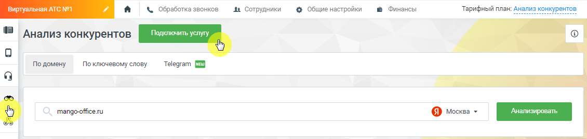
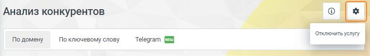

### 4.5.17. Анализ конкурентов

> Трассировка: PDF §4.5.17 · сквозные стр. 387-388 · источники: ч.2 `kb/sources/mango-lk-manual/LK_manual_v-125-281-566.pdf` с.107-108.

Анализ конкурентов – инструмент, предоставляющий данные о контекстной рекламе и органическом трафике в Яндексе, основываясь на заданном домене или ключевом слове.

Основные функции "Анализа конкурентов":

1) Отслеживание активности в Яндексе:

 Введите домен или ключевое слово конкурента.  Сервис проанализирует контекстную рекламу и органический трафик в Яндексе.  Получите подробные отчеты о рекламной стратегии конкурентов.

2) Анализ рекламы в Telegram:

 Узнайте, какую информацию о своих товарах и услугах размещают ваши конкуренты в Telegram-каналах.  Используйте инструмент "Анализ рекламы в Telegram" для мониторинга рекламной активности конкурентов в этой популярной сети.

3) Детальные отчеты:

 Получайте удобные отчеты, предоставляющие вам все необходимые данные о рекламной активности конкурентов.  Анализируйте стратегии конкурентов, выделяйте успешные подходы и формируйте свои собственные маркетинговые стратегии.

4) Сравнительный анализ:

 Сравнивайте результаты своей компании с данными о рекламной активности конкурентов.  Используйте полученные знания для оптимизации своих рекламных кампаний и укрепления своего положения на рынке.

Будьте оперативными и адаптируйте свои маркетинговые планы в реальном времени.

> **Описание иллюстрации LK-§4.5.17-1** (к §4.5.17 «Анализ конкурентов», стр. 388; 1130×269 px). Снимок экрана / схема Личного кабинета.
> Относится к тексту руководства: «…Будьте оперативными и адаптируйте свои маркетинговые планы в реальном времени.».
> Текст на изображении (OCR, требует сверки): Тарифный план: At; fe | сообобоказвониов — в сотрудники — @ Общиенастройки № Финансы; 18 Анализ конкурентов; По домену; По ключевому слову; Telegram (2; mango-office.ru

Для подключения услуги в Личном кабинете пользователя ВАТС последовательно нажмите на пиктограмму «Анализ конкурентов» в вертикальном меню, далее на кнопку Подключить услугу. Во всплывающем окне ознакомьтесь с условиями подключения на нажимте кнопку Подключить.

> **Описание иллюстрации LK-§4.5.17-2** (к §4.5.17 «Анализ конкурентов», стр. 388; 16×18 px). Пиктограмма (значок элемента интерфейса).
> Относится к тексту руководства: «…ализ конкурентов» в вертикальном меню, далее на кнопку Подключить услугу. Во всплывающем окне ознакомьтесь с условиями подключения на нажимте кнопку Подключить.».
> Текста на изображении нет; назначение значка — см. текст, к которому он относится.

Для отключения услуги последовательно нажмите на пиктограмму , далее на кнопку Отключить услугу.

> **Описание иллюстрации LK-§4.5.17-3** (к §4.5.17 «Анализ конкурентов», стр. 388; 759×116 px). Снимок экрана / схема Личного кабинета.
> Относится к тексту руководства: «…Для отключения услуги последовательно нажмите на пиктограмму , далее на кнопку Отключить услугу.».
> Текст на изображении (OCR, требует сверки): Анализ конкурентов; Oo; Отключить услугу; По домену; По ключевому слову; Telegram (3)

«Анализ конкурентов» предоставляет следующие данные:

 кто ваши конкуренты по контекстной рекламе и в органической выдаче Яндекса;  какие ключевые слова используются в рекламных объявлениях конкурентов и на сколько они эффективны;  по каким запросам ваши Клиенты находят ваш сайт в органическом поиске Яндекса;  какие сторонние сайты наиболее часто встречаются в органическом поиске Яндекса по интересующему вас ключевому слову, какая у этого слова прогнозируемая цена за клик;  как менялись ключевые показатели интересующего вас сайта в течение отчетного периода.

Кроме того, с помощью Сервиса можно посмотреть объявления своих конкурентов и, возможно, найти идеи для своих рекламных объявлений.

Методы анализа конкурентов:

 по домену  по ключевому слову  Telegram
