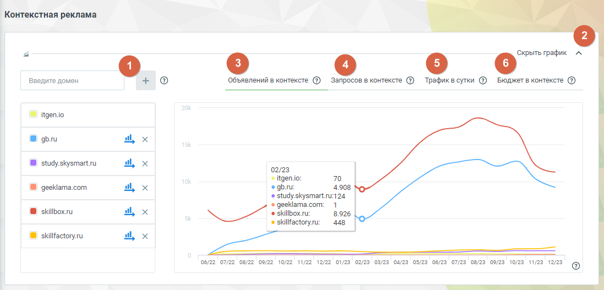
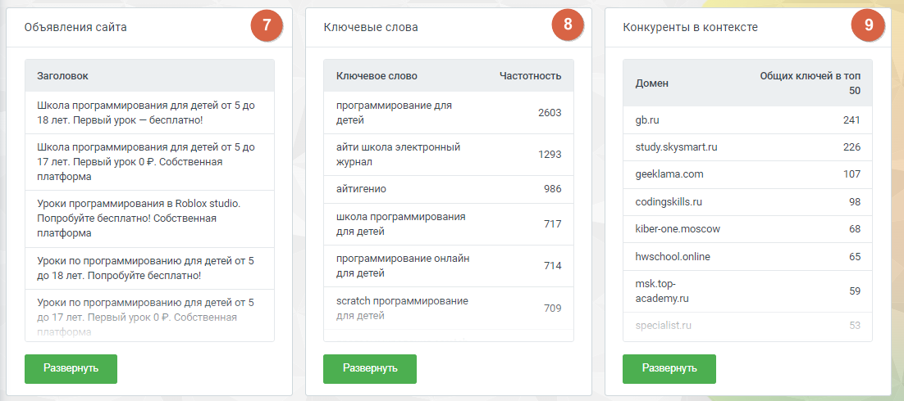
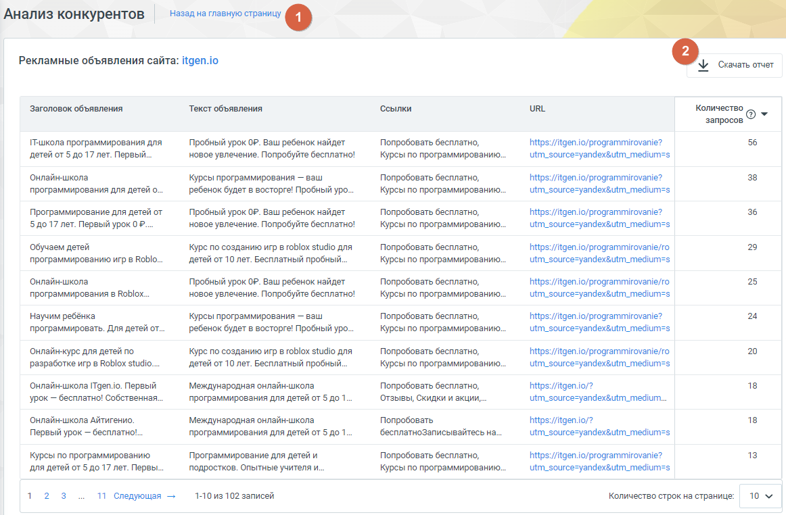
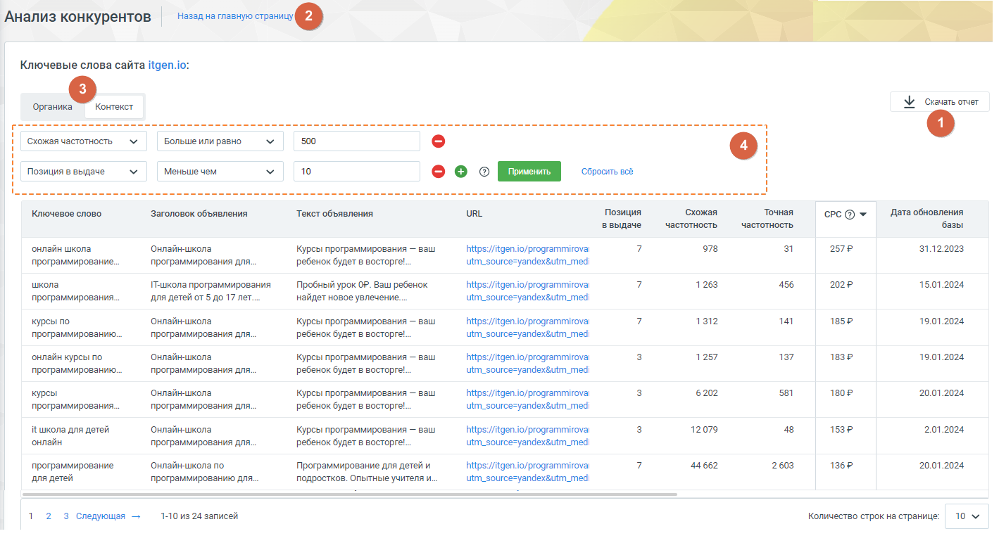
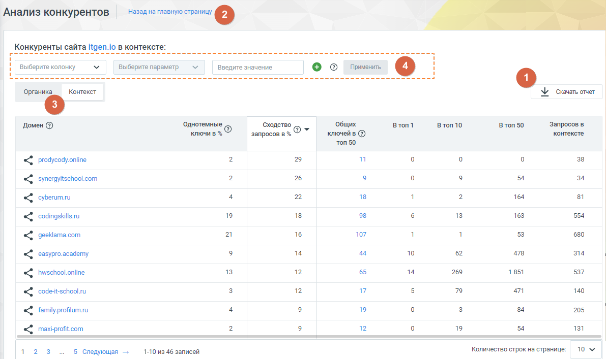
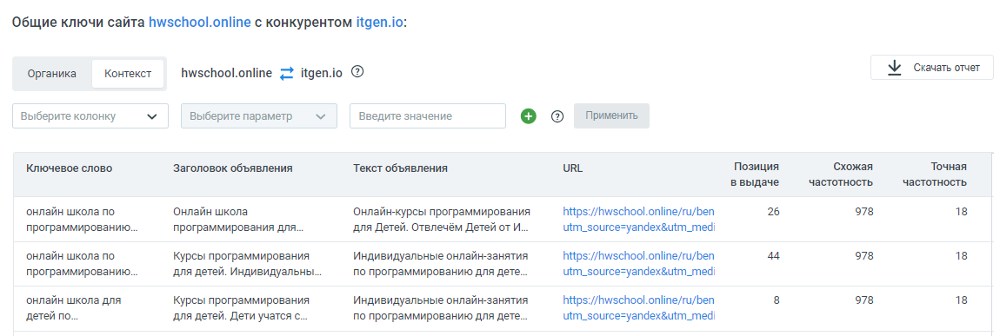

#### Блок «Контекстная реклама»

> Трассировка: PDF §4.5.17.1 · сквозные стр. 389-395 · источники: ч.2 `kb/sources/mango-lk-manual/LK_manual_v-125-281-566.pdf` с.109-115.

Функционал блока «Контекстная реклама» фокусируется на анализе контекстной рекламной активности конкурентов.

> **Описание иллюстрации LK-§4.5.17.1-1** (к §4.5.17.1 «Блок «Контекстная реклама»», стр. 389; 1097×527 px). Снимок экрана / схема Личного кабинета.
> Относится к тексту руководства: «…Функционал блока «Контекстная реклама» фокусируется на анализе контекстной рекламной активности конкурентов.».
> Текст на изображении (OCR, требует сверки): Контекстная реклама; ow”; Введите домен; ‘Объявлений в контексте @ Запросов в контексте @ Трафиквсутки @ Бюджет в контексте @; © itgen.io; al,; @ study.skysmart.ru; 02/28; < itgen.o:; 70; 4.908; @ geektama.com; study.skysmart.ru:124; «© geeklama.com; @ skillbox.ru; skillbox.ru:; 8.926; skillfactory.u: 448,; © skillfactory.ru; er; 022 07/22 92 090 0/22 11/22 12/22 0423 02/28 03/23 04/23 05/23 06/23 07/25 08/23 09/28 10/28 11/23 1223 Gy

Элементы блока:

1. Добавить домен. Введите несколько доменов для сравнения рекламной активности и стратегий конкурентов. Система предоставит подробные данные об активности на выбранных доменах.

2. Пиктограмма сворачивания/разворачивания – элемент управления, позволяющий скрыть или отобразить график для удобства работы. Щелкните, чтобы уменьшить визуальный объем информации.

Графики:

3. Объявлений в контексте – график показывает динамику изменения количества рекламных объявлений конкурента в выбранном периоде времени.

4. Запросы в контексте – информация о том, какие ключевые запросы активируют рекламу конкурента, а также как изменяется их количество со временем.

5. Трафик в сутки – график отражает колебания в объеме посещений сайта конкурента в течение каждого дня, из переходов по контекстной рекламе.

6. Бюджет в контексте – график показывает расходы конкурента на контекстную рекламу, позволяя вам оценить их стратегию и ресурсы.

> **Описание иллюстрации LK-§4.5.17.1-2** (к §4.5.17.1 «Блок «Контекстная реклама»», стр. 390; 1102×490 px). Снимок экрана / схема Личного кабинета.
> Относится к тексту руководства: «…6. Бюджет в контексте – график показывает расходы конкурента на контекстную рекламу, позволяя вам оценить их стратегию и ресурсы.».
> Текст на изображении (OCR, требует сверки): Объявления сайта; Ключевые слова; Конкуренты в контексте; Заголовок; ‚Ключевое слово.; ‘Частотность; Общих ключей в топ; "Домен; Школа программирования для детей от 5 до; программирование для; 2603; 18 лет. Первый урок — бесплатно!; детей; gbru; 241; айти школа электронный; study.skysmartru; 226; 1293; 17 лет. Первый урок ОФ. Собственная; журнал; платформа; geeklama.com; 107; ‘айтигенио; 986; Уроки программирования в Roblox studio.; codingskills.u; Попробуйте бесплатно! Собственная; ‘школа программирования; n7; kiber-one.moscow; для детей; hwschool.online; 65; Уроки по программированию для дет…

7. Объявления сайта – подробная информация о рекламных объявлениях конкурентов в Яндекс.Директе.

8. Ключевые слова – информация о ключевых словах, используемых в контекстной рекламе Яндекса на сайтах-конкурентах.

9. Конкуренты в контексте – анализ рекламных объявлений конкурентов в Яндекс.Директе, основанный на ключевых словах, указанных в контекстной рекламе анализируемого домена.

Объявления сайта

Этот раздел отчета предоставляет подробную информацию о рекламных объявлениях конкурентов в Яндекс.Директе. Вы сможете не только проанализировать рекламные кампании конкурентов, но и использовать этот отчет для оценки собственного сайта.

Нажатие на кнопку Развернуть открывает страницу отчета с детализацией:

1. Кнопка Скачать отчет – нажатие на кнопку загружает отчет о рекламных объявлениях конкурентов в формате CSV.

2. Кнопка Назад на главную страницу – переход пользователя обратно на главную страницу сервиса "Анализ конкурентов".

> **Описание иллюстрации LK-§4.5.17.1-3** (к §4.5.17.1 «Блок «Контекстная реклама»», стр. 391; 1162×762 px). Снимок экрана / схема Личного кабинета.
> Относится к тексту руководства: «…2. Кнопка Назад на главную страницу – переход пользователя обратно на главную страницу сервиса "Анализ конкурентов".».
> Текст на изображении (OCR, требует сверки): Анализ конкурентов | Назедна главную страницу ©; Рекламные объявления сайта: itgen.io; ЗУ Скачать отит; Заголовок объявления; "Текст объявления; ‘Ссылки; URL; Количество; ‘запросов; 'Пашкола программирования для; Пробный урок ОР. Ваш ребенок найдет; Попробовать бесплатно,; https: //itgen.io/programmirovanie?; 56; детей от 5 до 17 лет. Первый.; новое увлечение. Попробуйте бесплатно!; Курсы по программированию.; utm_source=yandex&utm_medium=s; `Онлайн-школа; Курсы программирования — ваш; 38; программирования для детей o..; ребенок будет в восторге! Пробный уро..; 36; Программирование ana детей о…

Предоставляемые данные:

 Заголовок объявления: заголовки, которые используют конкуренты в своих рекламных объявлениях.

 Текст объявления: текст объявлений в Яндекс.Директе, что помогает в понимании содержания рекламы конкурентов.

 Ссылки: быстрые ссылки, добавленные конкурентами в свои объявления, что может дать представление о направлении их трафика.

 URL: кликабельная ссылка на посадочные страницы сайта-конкурента, куда направляет объявление.

 Количество запросов: сколько ключевых слов соответствуют данному объявлению конкурента.

Ключевые слова

Отчет предоставляет информацию о ключевых словах, используемых в контекстной рекламе Яндекса на сайтах конкурентов. Этот отчет полезен как для анализа конкурентов, так и для оптимизации собственных рекламных кампаний.

Нажатие на кнопку Развернуть открывает страницу отчета с детализацией:

> **Описание иллюстрации LK-§4.5.17.1-4** (к §4.5.17.1 «Блок «Контекстная реклама»», стр. 392; 1419×762 px). Снимок экрана / схема Личного кабинета.
> Относится к тексту руководства: «…Нажатие на кнопку Развернуть открывает страницу отчета с детализацией:».
> Текст на изображении (OCR, требует сверки): Анализ конкурентов | Назедна (2); Ключевые слова сайта itgen.io:; ‘Органика; Контекст; Y crasars orver; re; ‘схожая частотность; Больше или равно.; 500; Позиция в выдаче; Меньше чем; 10; ooo; При; ить; ‘Сбросить всё; "Точная; ключевое слово; Заголовок объявления; Текст объявления; URL.; Дата обновления; ввыдаче; базы; ‘онлайн школа; `Онлайн-школа; Курсы программирования — ваш; https://itgen io/programmirovat; 978; 31; 2572; 31.12.2023; программирование.; программирования для...; ребенок будет в восторге...; utm_source=yandexgutm_medi; школа; Twkona программирования; Пробный урок ОР. Ваш ребено…

1. Кнопка Скачать отчет – нажатие на кнопку загружает отчет в формате CSV.

2. Кнопка Назад на главную страницу – переход пользователя обратно на главную страницу сервиса "Анализ конкурентов".

3. Переключатель «Органика/Контекст» – быстрое переключение между анализом ключевых слов сайта в органическом поиске и в контекстной рекламе.

4. Фильтры данных отчета – фильтры для настройки отображения данных отчета согласно предпочтениям пользователя.

a. Выберите колонку: выбор конкретной колонки данных, по которым вы хотите

применить фильтр.

b. Выберите параметр: выбор параметра фильтрации, связанного с выбранной колонкой данных.

c. Введите значение: здесь пользователи могут ввести конкретное значение

или условие, которое будет использоваться для фильтрации данных в выбранной колонке.

d. Кнопка Применить: нажатие на кнопку запускает процесс применения

фильтра, основанного на выбранных параметрах и значениях.

e. Пиктограммы добавления и удаления полей: нажмите на плюс (+) для

добавления нового фильтрационного поля. Нажмите на минус (-), чтобы удалить соответствующее поле фильтрации.

f. Кнопка Сбросить все: нажатие на кнопку очищает поля фильтрации.

Предоставляемые данные:

 Ключевое слово: конкретные слова или фразы, по которым показываются рекламные объявления в блоке контекстной рекламы Яндекс.Директа.

 Заголовок объявления: заголовки рекламных объявлений, связанных с соответствующим ключевым словом.

 Текст объявления: тексты рекламных объявлений, что помогает понять, какие креативные элементы используют конкуренты.

 URL: ссылка на посадочные страницы, куда направляют рекламные объявления, связанные с определенным ключевым словом.

 Позиция в выдаче: на какой позиции в блоке контекстной рекламы расположено объявление для данного ключевого слова.

 Схожая частотность: количество упоминаний запроса, включающее его самого и его словоформы. Информация предоставляется на основе данных системы "Wordstat" от Яндекса.

 Точная частотность: количество упоминаний запроса в точной форме и порядке слов в запросе, предоставляя точную статистику.

 CPC (Средняя цена клика): средняя стоимость клика на рекламное объявление для данного ключевого слова.

 Дата обновления базы: дата последнего обновления данных о ключевых словах в отчете.

Конкуренты в контексте

Отчет "Конкуренты в контексте" предоставляет анализ рекламных объявлений конкурентов в Яндекс.Директе, основанный на ключевых словах, указанных в контекстной рекламе анализируемого домена.

Нажатие на кнопку Развернуть открывает страницу отчета с детализацией:

1. Кнопка Скачать отчет – нажатие на кнопку загружает отчет в формате CSV.

2. Кнопка Назад на главную страницу – переход пользователя обратно на главную страницу сервиса "Анализ конкурентов".

3. Переключатель «Органика/Контекст» – быстрое переключение между анализом ключевых слов сайта в органическом поиске и в контекстной рекламе.

4. Фильтры данных отчета – фильтры для настройки отображения данных отчета согласно предпочтениям пользователя.

a. Выберите колонку: выбор конкретной колонки данных, по которым вы хотите

применить фильтр.

b. Выберите параметр: выбор параметра фильтрации, связанного с выбранной колонкой данных.

c. Введите значение: здесь пользователи могут ввести конкретное значение

или условие, которое будет использоваться для фильтрации данных в выбранной колонке.

d. Кнопка Применить: нажатие на кнопку запускает процесс применения

фильтра, основанного на выбранных параметрах и значениях.

e. Пиктограммы добавления и удаления полей: нажмите на плюс (+) для

добавления нового фильтрационного поля. Нажмите на минус (-), чтобы удалить соответствующее поле фильтрации.

f. Кнопка Сбросить все: нажатие на кнопку очищает поля фильтрации.

> **Описание иллюстрации LK-§4.5.17.1-5** (к §4.5.17.1 «Блок «Контекстная реклама»», стр. 394; 1191×707 px). Снимок экрана / схема Личного кабинета.
> Относится к тексту руководства: «…f. Кнопка Сбросить все: нажатие на кнопку очищает поля фильтрации.».
> Текст на изображении (OCR, требует сверки): Анализ конкурентов | Назаднаглавную страницу ©; ‚Конкуренты сайта Идеп.о в контексте:; Выберите колонку; Выберите параметр; Введите значение; оо; ‘Органика; Контекст; Y cravat orver; `Общих; Втоп1; В топ 10; Втоп 50; Домен ©; днотемные; Сходство G; Запросов в; ключи в %; запросов в %; ключейв ©; топ 50; 29; 38; «< родусодуопйпе; synergyitschool.com; 26; 18; 164; 81; cyberum.ru; 19; 98; 13; 163; 554; codingskills.ru; 16; 107; 53; 680; geeklama.com; 10; 478; 314; easypro.academy; hwschool online; 12; 65; 14; 269; 1851; 537; codeit-school.ru; 47; 140; family profilum.ru; 24; 205; maxi-profiticom;…

Предоставляемые данные:

 Домен: список предполагаемых конкурентов анализируемого сайта. Кликнув по наименованию домена, можно перейти на сайт конкурента, либо запустить новый анализ - данного домена.

 Однотемные ключи в %: процент ключевых слов анализируемого сайта, совпадающих с ключевыми словами конкурентов в контексте.

 Сходство запросов в %: процент запросов, по которым найдены сайты предполагаемых конкурентов, относительно общего количества запросов анализируемого сайта.

 В топ 1, В топ 10, В топ 50: количество ключевых слов сайта-конкурента в топ 1, 10 и 50 выдачи Яндекса.

 Запросов в контексте: количество ключевых слов, по которым контекстные объявления сайта-конкурента отображаются в выдаче Яндекса.

 Общих ключей в топ 50: количество общих ключевых слов в контекстной рекламе анализируемого сайта и конкурента в топ 50 выдачи Яндекса. Клик по числу открывает список общих ключевых слов, с возможностью фильтрации.

> **Описание иллюстрации LK-§4.5.17.1-6** (к §4.5.17.1 «Блок «Контекстная реклама»», стр. 395; 1150×387 px). Снимок экрана / схема Личного кабинета.
> Относится к тексту руководства: «… в контекстной рекламе анализируемого сайта и конкурента в топ 50 выдачи Яндекса. Клик по числу открывает список общих ключевых слов, с возможностью фильтрации.».
> Текст на изображении (OCR, требует сверки): Общие ключи сайта hwschool.online с конкурентом itgen.io:; Y cravat orver; Органика; Контекст; hwschool.online = Идепю ©; Выберите колонку; Выберите параметр; Введите значение; eo; Применить; ключевое слово; Заголовок объявления; Текст объявления; URL.; Позиция; "Точная; ввыдаче; ‘онлайн школа no; `Онлайн школа; `Онлайнурсы программирования; https://hwschool.online/ru/ben; 978; 18; программированию.; программирования для.; для Детей. Отвлечём Детей от И; utm_source=yandexgutm_medi; Курсы программирования; Индивидуальные онлайн-занятия; для детей. Индивидуальны; по программированию для дете..; …
