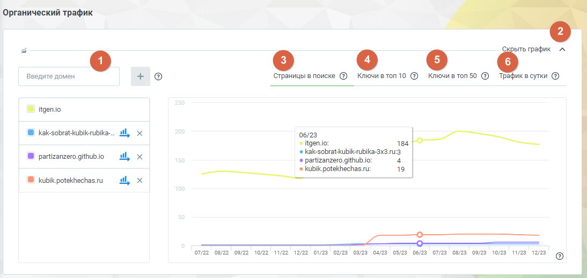
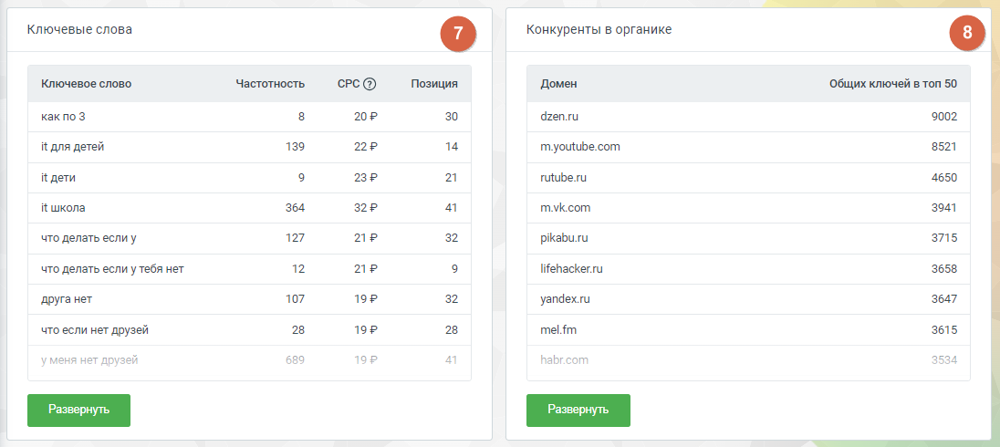

#### Блок «Органический трафик»

> Трассировка: PDF §4.5.17.1 · сквозные стр. 395-398 · источники: ч.2 `kb/sources/mango-lk-manual/LK_manual_v-125-281-566.pdf` с.115-118.

Этот отчет предоставляет возможность сравнить объем органического трафика анализируемого сайта с тремя конкурирующими веб-ресурсами. По умолчанию анализируемый сайт сопоставляется с тремя конкурентными сайтами, которые наиболее схожи по однотемным ключам и сходству запросов.

> **Описание иллюстрации LK-§4.5.17.1-1** (к §4.5.17.1 «Блок «Органический трафик»», стр. 396; 1094×520 px). Снимок экрана / схема Личного кабинета.
> Относится к тексту руководства: «…ми веб-ресурсами. По умолчанию анализируемый сайт сопоставляется с тремя конкурентными сайтами, которые наиболее схожи по однотемным ключам и сходству запросов.».
> Текст на изображении (OCR, требует сверки): Органический трафик; график; Введите домен; Страницы в поиске @ Ключивтоп10 @ Ключивтоп50 ®; Трафик в суки @; © itgenio; @ kak-sobrat-kubik-rubika-... ail,; 06/23; 184; < itgen.io:; kak-sobrat-kubik-rubika-3x3.1u:3; № partizanzero github io; al,; « partizanzero. github io:; kubik.potekhechas.ru:; 19; @ kubik potekhechas.ru; 07722 06/22 09/22, ‘002 11/22 12/22 01/28 02/28 05/28 04/23. 0578 6/23 07/23 08/25 08/25 10/28 11/23 193 ($)

Элементы блока:

1. Добавить домен. Введите несколько доменов для сравнения органического трафика. Добавленные домены будут анализироваться в соответствии с однотемными ключами и сходством запросов.

2. Пиктограмма сворачивания/разворачивания – элемент управления, позволяющий скрыть или отобразить график для удобства работы. Щелкните, чтобы уменьшить визуальный объем информации.

Графики

3. Страницы в поиске – график отображает динамику изменения количества страниц сайтов, которые обнаруживаются поисковыми системами в определенный период времени. контента в поиске.

4. Ключи в топ 10 – график показывает какое количество ключевых слов из семантического ядра попало в топ 10 результатов поиска Яндекса.

5. Ключи в топ 50 – график показывает количество ключевых слов, занимающих позиции в топ 50 поисковой выдачи.

6. Трафик в сутки – график отображает динамику суточного трафика на сайте. Он может быть связан с изменениями в рейтинге ключевых слов, позициях страниц в поиске, а также с другими факторами, влияющими на количество посетителей.

> **Описание иллюстрации LK-§4.5.17.1-2** (к §4.5.17.1 «Блок «Органический трафик»», стр. 397; 1096×490 px). Снимок экрана / схема Личного кабинета.
> Относится к тексту руководства: «…сайте. Он может быть связан с изменениями в рейтинге ключевых слов, позициях страниц в поиске, а также с другими факторами, влияющими на количество посетителей.».
> Текст на изображении (OCR, требует сверки): Ключевые слова; Конкуренты в органике; Ключевое слово; сес @; Позиция; Домен; Общих ключей в топ 50; kak no 3; 20°; 30; dzen.ru; 139; 14; 3521; it для детей; youtube.com; дети; 23Р; rutube.ru; 4650; it школа; 32Р; myvk.com; 3941; что делать если y; 127; ae; 32; pikaburu; 3715; то делать если у тебя нет; 12; lifehacker.ru; 3658; 107; 192; 3647; ‚друга нет; уапдехли; что если нет друзей; 28; пет; 3615; yous нет друзей; 689; 19P; hab; br; 3534; Pa:; рн)

7. Ключевые слова – список ключевых слов, по которым анализируемый сайт ранжируется в результатах поиска Яндекса.

8. Конкуренты в органике – сайты, которые считаются конкурентами анализируемого сайта в органической выдаче.

Ключевые слова

Отчет содержит список ключевых слов, по которым анализируемый сайт ранжируется в результатах поиска. Анализ этого списка помогает определить эффективность SEO- стратегии сайта и те тематики, которые привлекают внимание поисковой системы Яндекс.

Нажатие на кнопку Развернуть открывает страницу отчета с детализацией.

Данные, предоставляемые в детализации отчета, соответствуют данным отчета «Ключевые слова» блока «Контекстная реклама», за исключением заголовка и текста рекламного объявления.

Конкуренты в органике

Отчет содержит список сайтов, которые считаются конкурентами анализируемого сайта в органической выдаче. Просматривая их позиции, ключевые слова и стратегии, можно лучше понять конкурентное окружение и определить возможные улучшения в SEO- оптимизации анализируемого сайта.

Нажатие на кнопку Развернуть открывает страницу отчета с детализацией.

Данные, предоставляемые в детализации отчета, соответствуют данным отчета «Конкуренты в контексте» блока «Контекстная реклама», за исключением столбца «Запросов в контексте».
