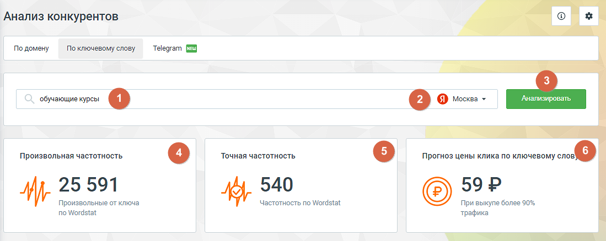
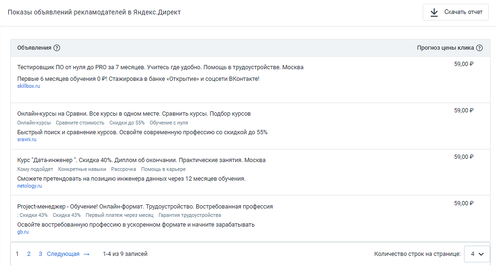
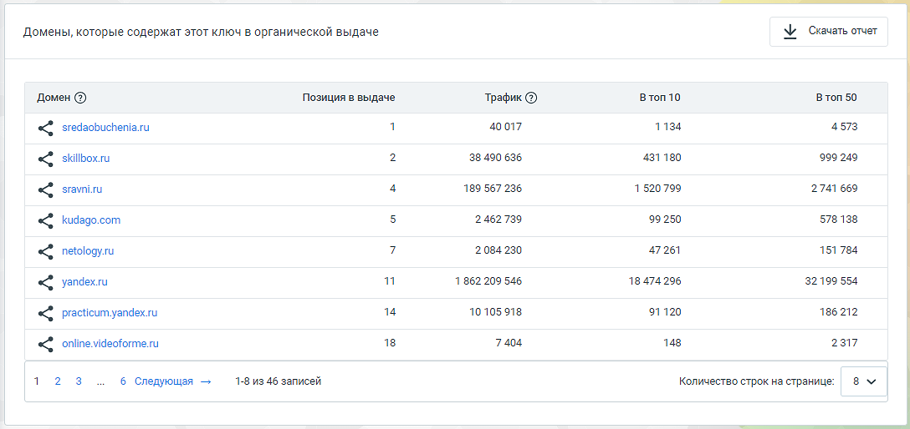

#### 4.5.17.2. Анализ по ключевому слову

> Трассировка: PDF §4.5.17.2 · сквозные стр. 398-400 · источники: ч.2 `kb/sources/mango-lk-manual/LK_manual_v-125-281-566.pdf` с.118-120.

«Анализ по ключевому слову» предоставляет возможность подробного анализа поисковых запросов на основе ключевых слов. Здесь вы сможете получить информацию о том, какие ключевые слова используются вашими конкурентами в контекстной и органической рекламе, а также какие сайты наиболее активны по данным ключевым запросам.

> **Описание иллюстрации LK-§4.5.17.2-1** (к §4.5.17.2 «Анализ по ключевому слову», стр. 398; 1099×438 px). Снимок экрана / схема Личного кабинета.
> Относится к тексту руководства: «…м, какие ключевые слова используются вашими конкурентами в контекстной и органической рекламе, а также какие сайты наиболее активны по данным ключевым запросам.».
> Текст на изображении (OCR, требует сверки): Анализ конкурентов; По домену; По ключевому слову; Telegram; Анализировать; обучающие курсы ©; Произвольная частотность; ‘Touran частотность; Прогноз цены клика по ключевому „@); 25 591; 540; 59P; ‘Частотность no Wordstat; Произвольные от ключа; При выкупе более 90%; по Wordstat; трафика

Элементы страницы:

1. Поле ввода анализируемых ключевых слов. Введите URL сайта для получения сопоставительной информации по ключевым параметрам.

2. Выбор региона. Эта опция позволяет настроить анализ конкурентов с учетом конкретной географической территории.

3. Кнопка Анализировать – запуск процесса сбора и анализа данных, основанных на введенных параметрах.

4. Произвольная частотность – количество упоминаний запроса в различных формах, включая вариации ключевых слов и порядок слов. Эта информация основана на данных от Яндекс Wordstat.

5. Точная частотность – количество упоминаний запроса именно в той форме и порядке слов, который указан в запросе.

6. Прогноз цены клика по ключевому слову – прогнозируемая цена клика при размещении рекламы по данному запросу. Это соотношение затрат на рекламу и количество кликов на объявление.

Показы объявлений в Яндекс.Директ

Этот блок содержит информацию о контекстных объявлениях, найденных по данному ключевому слову.

> **Описание иллюстрации LK-§4.5.17.2-2** (к §4.5.17.2 «Анализ по ключевому слову», стр. 399; 1071×575 px). Снимок экрана / схема Личного кабинета.
> Относится к тексту руководства: «…Этот блок содержит информацию о контекстных объявлениях, найденных по данному ключевому слову.».
> Текст на изображении (OCR, требует сверки): Показы объявлений рекламодателей в Яндекс.Директ; WY Cravare orver; ‘Объявления ®; Прогноз цены клика @; 59002; Тестировщик ПО от нуля до PRO за 7 месяцев. Учитесь где удобно. Помощь 8 трудоустройстве. Москва; Первые 6 месяцев обучения 0 P! Стажировка в банке «Открытие» и соцсети ВКонтакте!; skillbox.ru; `Онлайнчкурсы на Сравни. Все курсы в одном месте. Сравнить курсы. Подбор курсов.; Онлайнчурсы Сравните стоимость Скидкидо55% Обучение снуля; Быстрый поиск и сравнение курсов. Освойте современную профессию со скидкой до 55%; sravnisu; Курс "Дате-инженер ". Скидка 40%. Диплом об окончании. Практ…

Нажатие на кнопку Скачать отчет загружает отчет о рекламных объявлениях конкурентов в формате CSV.

Домены в органической выдаче

Таблица с информацией о сайтах, которые появляются в органической выдаче Яндекса по данному ключевому слову. Показывается домен, его позиция в выдаче, количество трафика, а также позиция сайта в топ 10 и топ 50 результатов поиска.

> **Описание иллюстрации LK-§4.5.17.2-3** (к §4.5.17.2 «Анализ по ключевому слову», стр. 399; 1088×514 px). Снимок экрана / схема Личного кабинета.
> Относится к тексту руководства: «…че Яндекса по данному ключевому слову. Показывается домен, его позиция в выдаче, количество трафика, а также позиция сайта в топ 10 и топ 50 результатов поиска.».
> Текст на изображении (OCR, требует сверки): Домены, которые содержат этот ключ в органической выдаче; Y Ceavare отит; Домен ®; Позиция в выдаче; Трафик @; Втоп10; Bron 50; «$ зедаобиспетали; 40017; 1134; 4573; skillbox.ru; 38490 636; 431180; 999 249; sravni.ru; 189 567 236; 1520 799; 2741 669; Кидадосот; 2462 739; 99250; 578 138; netology.ru; 2084230; 47261; 151 784; уапдехли; 1862 209 546; 18474296; 32199 554; practicum yandex.ru; 10105918; 91120; 186 212; online.videoforme.ru; 18; 7404; 148; 2317; 6 Следующая —; 1-8 из 46 записей; Количество строк на странице:; зу

Чтобы проанализировать или перейти на сайт, указанный в отчете об исследовании по ключевому слову, выполните следующие шаги:

Нажмите на домен интересующего вас сайта и выберите необходимое действие:

 Анализировать домен – это действие откроет новую вкладку браузера, где будут показаны результаты исследования по выбранному вами сайту.

 Перейти на сайт – при выборе этого варианта также откроется новая вкладка браузера, но уже с открытием сайта конкурента для просмотра его содержимого.

Нажатие на кнопку Скачать отчет загружает отчет о доменах конкурентов в формате CSV.
