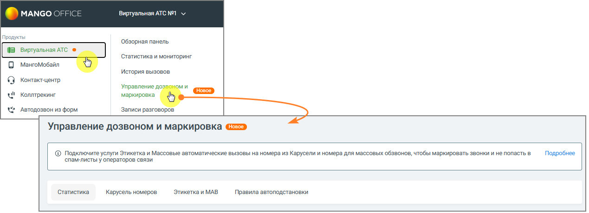

### 4.5.18. Управление дозвоном и маркировка

> Трассировка: PDF §4.5.18 · сквозные стр. 402-403 · источники: ч.2 `kb/sources/mango-lk-manual/LK_manual_v-125-281-566.pdf` с.122-123.

Раздел отображается в меню, если для текущего продукта доступна хотя бы одна из его вкладок: Статистика, Правила автоподстановки, Карусель номеров, Этикетка и МАВ.

Раздел отображается в соответствии с условиями отображения каждой вкладки.

> **Описание иллюстрации LK-§4.5.18-1** (к §4.5.18 «Управление дозвоном и маркировка», стр. 403; 1269×460 px). Снимок экрана / схема Личного кабинета.
> Относится к тексту руководства: «…Раздел отображается в соответствии с условиями отображения каждой вкладки.».
> Текст на изображении (OCR, требует сверки): MANGO OFFICE; Вир; льная АТС №1 У; [Продукты; 'Обзорная панель; ‘Статистика и мониторинг; История вызовов:; © контактцентр; `Управление.; ое; Ul Коллтрекинг; `маркировка; < Автодозвон из форм; Записи разговоров; Управление дозвоном и маркировка; © Подключите услуги Этикетка и Массовые автоматические вызовы Ha номера из Карусели и номера для массовых обзвонов, чтобы маркировать звонки и не попасть в; Подробнее; ‘спамлисты у операторов связи; "Статистика; Карусель номеров.; Этикетка и MAB; Правила автоподстановки
