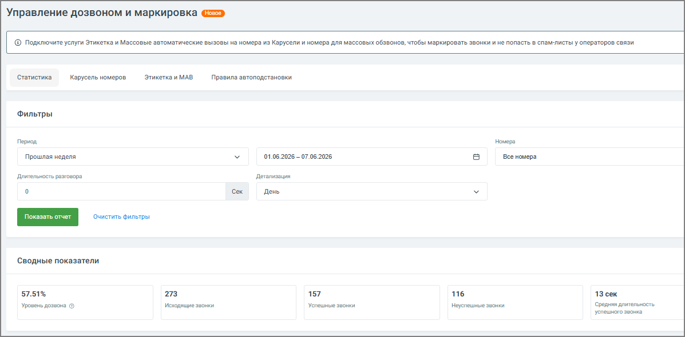
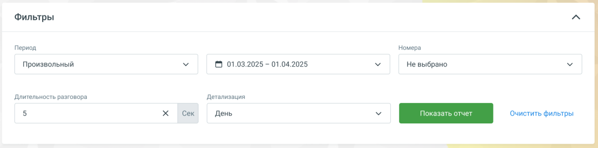
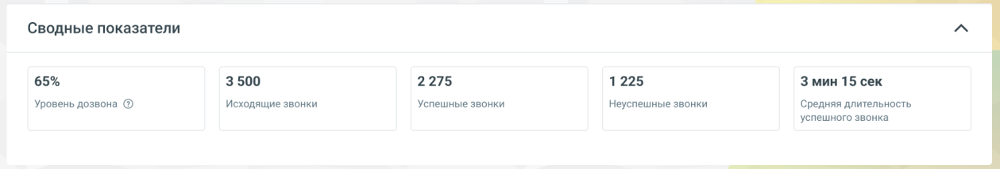
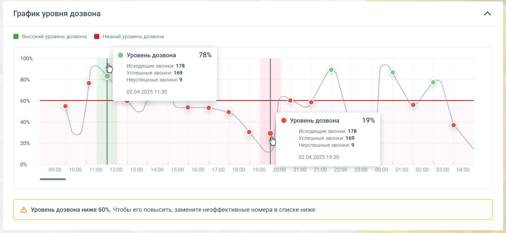
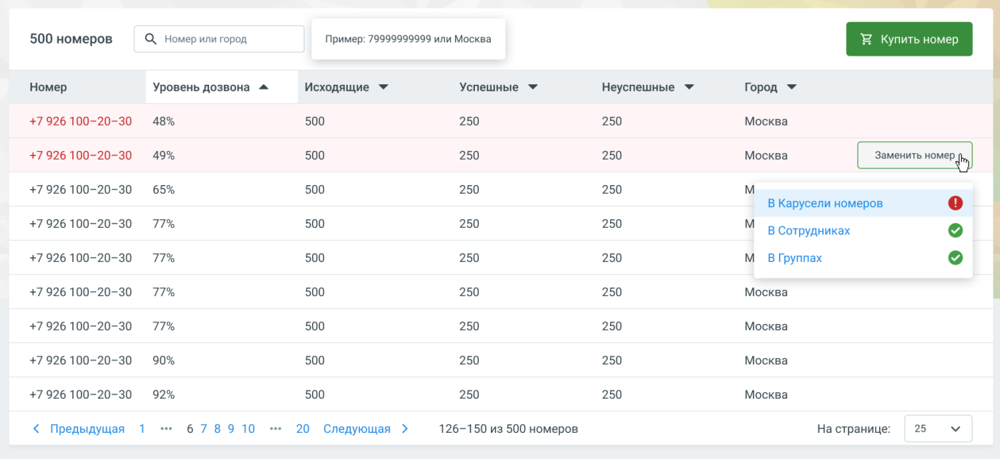

#### 4.5.18.1. Статистика

> Трассировка: PDF §4.5.18.1 · сквозные стр. 403-407 · источники: ч.2 `kb/sources/mango-lk-manual/LK_manual_v-125-281-566.pdf` с.123-127.

Вкладка Статистика дозвона позволяет оперативно отслеживать показатель успешных дозвонов (ASR – Answer-Seizure Ratio).

> **Описание иллюстрации LK-§4.5.18.1-1** (к §4.5.18.1 «Статистика», стр. 403; 1197×590 px). Снимок экрана / схема Личного кабинета.
> Относится к тексту руководства: «…Вкладка Статистика дозвона позволяет оперативно отслеживать показатель успешных дозвонов (ASR – Answer-Seizure Ratio).».
> Текст на изображении (OCR, требует сверки): Управление дозвоном и маркировка @:=э; © подключите услуги Этикетка и Массовые эвтоматические вызовы Ha номера из Карусели и номера для массовых обзвонов, чтобы маркировать звонки и не попасть в сламлисты у операторов связи; Статистика; Карусель номеров.; Этикетка иМАВ; Правила автоподстановки; Фильтры; Период.; 01.06.2028 — 07.06.2028; Прошлая неделя; Boe номера; Длительность разговора; Детализация; сек; День; зать; ‘Очистить фильтры; Сводные показатели; 57.51%; 157; 116; 13 сек; Уровень дозьсна ©; `исодящие звонки; Успешные звонки; "неспешные звонки; Средняя длительность; успешного звонка

Это ключевой инструмент для контроля эффективности исходящих обзвонов. Благодаря ему вы сможете:

 Видеть, сколько из всех сделанных звонков действительно дозвонились;  Выявлять проблемы со спам-базами и низким уровнем дозвона;  Оценивать результативность обзвона по дням, группам или ролям;  Принимать решения об изменении стратегии обзвона: смене номера, времени звонков, контакт-базы и т.д.

Вкладка «Статистика» отображается всегда, но имеет разный вид в зависимости от тарифа:

 Версии «Расширенная», «Максимальная», «Корпорация» (услуга «Управление дозвоном» доступна, есть хотя бы один номер) — стандартный вид со статистикой.

 Все прочие версии (услуга «Управление дозвоном» недоступна) — демо-режим: «Отчёт Управление дозвоном в демо-режиме» с тестовыми данными по пяти номерам и кнопкой «Оставить заявку».

Демо-режим для версий без услуги «Управление дозвоном»

Если услуга «Управление дозвоном» не подключена на вашем тарифе, на вкладке отображается демо-отчёт с тестовыми данными по 5 номерам. Чтобы получить реальную статистику по вашим номерам, оставьте заявку на подключение услуги.

На основной странице вы увидите:

Фильтры и разрезы

> **Описание иллюстрации LK-§4.5.18.1-2** (к §4.5.18.1 «Статистика», стр. 404; 1259×313 px). Снимок экрана / схема Личного кабинета.
> Относится к тексту руководства: «…Фильтры и разрезы».
> Текст на изображении (OCR, требует сверки): Фильтры; Период; Номера; Произвольный; © 01.03.2025 - 01.04.2025; He выбрано; Длительность разговора; Детализация; Сек; День

 Период времени – выберите дни или диапазон.  Группа пользователей – для анализа по отделам или регионам.  Тип номера – если у вас подключено несколько исходящих номеров/сетей.

СОВЕТ

Статистика доступна с 1 июля 2025 года или с даты перехода на совместимую версию Виртуальной АТС и подключения номера. Можно выбрать период до 3 месяцев из данных за последний год.

Ключевые метрики

> **Описание иллюстрации LK-§4.5.18.1-3** (к §4.5.18.1 «Статистика», стр. 405; 1259×214 px). Снимок экрана / схема Личного кабинета.
> Относится к тексту руководства: «…Ключевые метрики».
> Текст на изображении (OCR, требует сверки): Сводные показатели; 65%; 3500; 2275; 1225; Змин 15 сек; Уровень дозвона ®; Исходящие звонки; Успешные звонки; Неуспешные звонки; ‘Средняя длительность; успешного звонка

Основные метрики за выбранный период:

 Уровень дозвона (ASR), %  Исходящие звонки  Успешные дозвоны  Неуспешные дозвоны  Средняя длительность успешного звонка

График уровня дозвона

> **Описание иллюстрации LK-§4.5.18.1-4** (к §4.5.18.1 «Статистика», стр. 405; 1259×582 px). Снимок экрана / схема Личного кабинета.
> Относится к тексту руководства: «…График уровня дозвона».
> Текст на изображении (OCR, требует сверки): График уровня дозвона; № высокий уровень дозвона; № Низкий уровень дозвона; 100%; ® Уровень дозвона; 78%; Исходящие звонки: 178; Успешные звонки: 169; 80%; 'Неуспешные звонки: 9; 02.04.2025 11:30; 60%; pc; ‘oes; 19%; 40%; 20%; 02.04.2025 19:30; 09:00; 10:00; 11:00; 12:00; 13:00; 14:00; 15:00; 16:00; 17:00; 18:00; 19:00; 2000; FOO ZOO 221002300; 00:00; 01:00; 02:00; 03:00; 04:00; Ay Уровень дозвона ниже 60%. Чтобы его повысить, замените неэффективные номера в списке ниже

Показывает ASR и объем звонков во времени (день/неделя/месяц). Помогает определить, как меняется эффективность обзвона.

 Зелёные точки – высокий уровень дозвона.  Красные точки – низкий уровень (ниже 60%).  Подсказки при наведении показывают точные значения метрик.

совет

Используйте график для анализа времени суток, когда дозвоны наиболее успешны.

Таблица номеров

> **Описание иллюстрации LK-§4.5.18.1-5** (к §4.5.18.1 «Статистика», стр. 406; 1259×578 px). Снимок экрана / схема Личного кабинета.
> Относится к тексту руководства: «…Таблица номеров».
> Текст на изображении (OCR, требует сверки): 500 номеров; Ц, номер или город; Пример: 79999999999 или Москва; Успешные ¥; Номер; Уровень дозвона ^; Исходящие У; Неуспешные У; Город *; +7 926 100-20-30; 48%; 500; 250; Москва; 49%; 65%; В Карусели номеров; 77%; В Сотрудниках; М ВГруппах; 90%; 92%; < Предыдущая; 678910; 20 Следующая >; 126-150 из 500 номеров; На странице:; 25

В таблице содержится список номеров с показателями дозвона:

 Столбцы: номер, уровень дозвона, исходящие, успешные и неуспешные.  Красным выделены номера с ASR ниже 60%.  Есть возможность заменить номер – вручную или добавить в группу «на замену».

Часто задаваемые вопросы

Вопрос Ответ

Что считается

В систему засчитывается звонок, вошедший в активную

успешным дозвоном?

голосовую сессию клиента (не автоответчик и не занято).

Возможные причины: номера попадают в спам-листы,

Почему мой ASR ниже

неправильное время звонков или качественная база

50 %?

неактуальна.

Вопрос Ответ

Попробуйте сменить номер оператора или обзванивать в Как исправить? другое время, а затем проанализировать влияние на ASR.

Как использовать статистику для принятия решений

 Низкий ASR у номера? Замените номер через таблицу. Это поможет избежать попадания в спам-фильтры.  Устанавливайте цель ASR, например ≥ 70 %, и отслеживайте отклонения.  ASR падает вечером? Настройте обзвоны на более эффективное время.  Провал по всем номерам? Проверьте корректность Caller ID и поведение операторов.  Сравнивайте группы – так увидите, у кого лучше эффекты обзвона.
