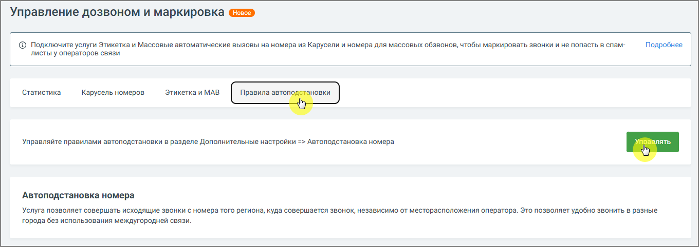
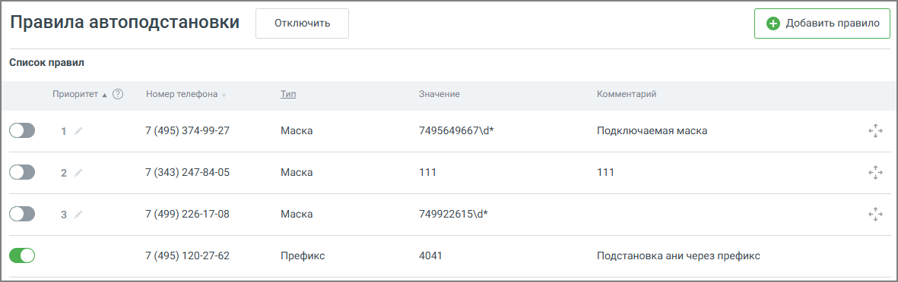

#### 4.5.18.2. Правила автоподстановки

> Трассировка: PDF §4.5.18.2 · сквозные стр. 407-408 · источники: ч.2 `kb/sources/mango-lk-manual/LK_manual_v-125-281-566.pdf` с.127-128.

> **Описание иллюстрации LK-§4.5.18.2-1** (к §4.5.18.2 «Правила автоподстановки», стр. 407; 1360×482 px). Снимок экрана / схема Личного кабинета.
> Относится к тексту руководства: «…начало раздела».
> Текст на изображении (OCR, требует сверки): Управление дозвоном и маркировка; © Подключите услуги Этикетка и Массовые автоматические вызовы на номера из Карусели и номера для массовых обзвонов, чтобы маркировать звонки и не попасть в спам-; Подробнее; листы у операторов связи; "Статистика; Карусель номеров.; Этикетка и MAB; Управляйте правилами автоподстановки в разделе Дополнительные настройки => Автоподстановка номера; Автоподстановка номера; Yonyra позволяет совершать исходящие звонки с номера того региона, куда совершается звонок, независимо от месторасположения оператора. Это позволяет удобно звонить в разные; города без использова…

Функция автоподстановки позволяет автоматически выбирать номер для исходящего звонка в зависимости от заданных условий.

> **Описание иллюстрации LK-§4.5.18.2-2** (к §4.5.18.2 «Правила автоподстановки», стр. 408; 1181×372 px). Снимок экрана / схема Личного кабинета.
> Относится к тексту руководства: «…Функция автоподстановки позволяет автоматически выбирать номер для исходящего звонка в зависимости от заданных условий.».
> Текст на изображении (OCR, требует сверки): Правила автоподстановки; Отключить; Список правил; Приоритет « ©; Номер телефона; Tun; Значение; Комментарий; Маска; ah; 7 (495) 374-99-27; 7495649667\4*; Подключаемая маска; 7 (343) 247-84-05; 111; 7 (499) 226-17-08; 749922615\4*; 7 (495) 120-27-62; Префикс; 4041; Подстановка ани через префикс

Чтобы создать новое правило, нажмите кнопку «Добавить правило». Откроется форма для настройки автоподстановки с учетом одного из следующих типов:

 По префиксу — правило срабатывает при совпадении начальных цифр номера абонента;  По маске — используется для сопоставления с шаблоном (например, по шаблону номера телефона);  По региону — позволяет задать номер для звонков в определённые географические регионы.

Все созданные правила отображаются в списке на экране. Каждое правило содержит информацию о типе, условиях применения и связанном номере. Вы можете редактировать или удалять правила при необходимости.
