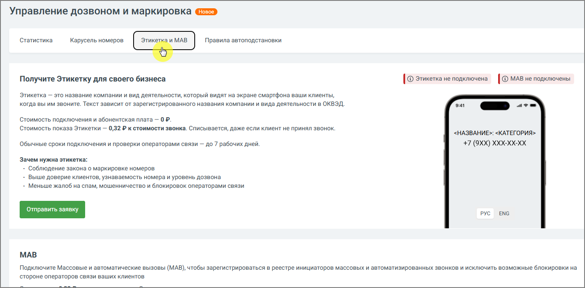
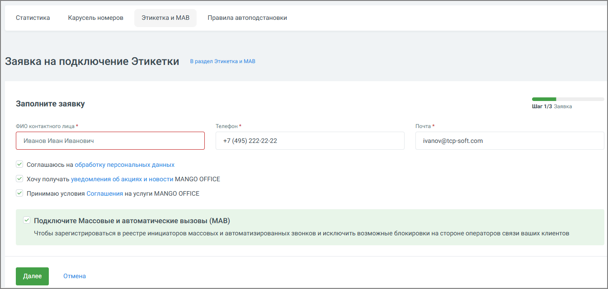
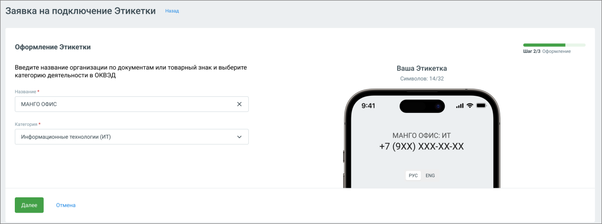
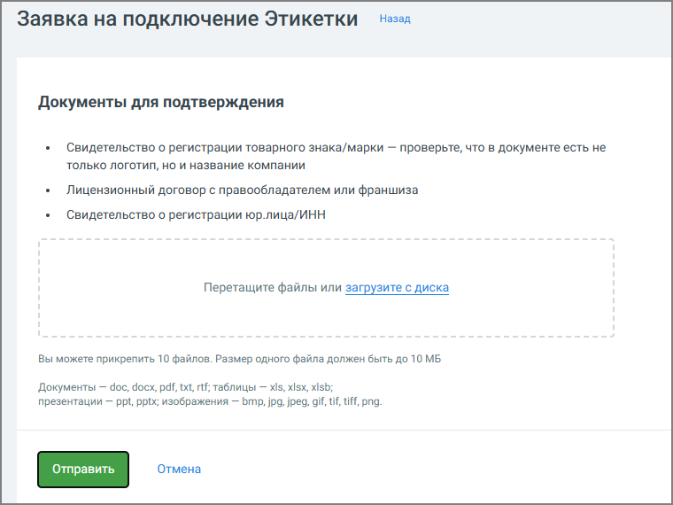

##### 4.5.18.3.1. Этикетка

> Трассировка: PDF §4.5.18.3.1 · сквозные стр. 409-413 · источники: ч.2 `kb/sources/mango-lk-manual/LK_manual_v-125-281-566.pdf` с.129-133.

Этикетка — это функция, которая позволяет при исходящем звонке показать клиенту не только номер телефона, но и название вашей компании, бренд или торговую марку. Отображение происходит в сети операторов (Билайн, Мегафон, МТС) для абонентов с поддержкой VoLTE.

Таким образом, когда абонент получает звонок, он видит подпись к номеру, например:

«Сбербанк». Это помогает клиенту сразу понять, кто ему звонит и по какому поводу.

Варианты Этикеток

В ЛК ВАТС используются несколько вариантов Этикеток. Они отличаются способом формирования названия, уровнем проверки оператором связи и назначением.

Выбор варианта зависит от того, как клиенты знают компанию и каким образом она использует телефонные коммуникации.

Основные варианты Этикеток:

 Базовая Этикетка  Персональная Этикетка

 Этикетка по товарному знаку (брендовая)

Каждый вариант решает разные задачи бизнеса.

Сравнение вариантов Этикеток

Базовая

Персональная

Этикетка по

Параметр Этикетка

Этикетка

товарному знаку

Юридическое

Пользовательское

Источник названия

Бренд

название

название

Автоматическое Да Нет Нет создание

Проверка Минимальная Возможна Обязательная оператором

Скорость Быстро Средняя Может быть дольше подключения

Использование Нет Да Да бренда

Как выбрать подходящий вариант

При выборе типа Этикетки рекомендуется учитывать, как клиенты воспринимают компанию.

Если клиенты знают компанию как Рекомендуемый вариант

Юридическое название Базовая Этикетка

Бренд или торговую марку Персональная Этикетка

Известный зарегистрированный бренд Этикетка по товарному знаку

В большинстве случаев рекомендуется начинать с базовой Этикетки, поскольку она:

 быстрее подключается;  не требует дополнительной проверки;  соответствует юридическим данным компании.

При необходимости её можно изменить на персональную Этикетку, чтобы отображать бренд компании.

Как это работает

1. Компания подключает услугу «Этикетка» и указывает название.

2. Этикетка передаётся в сеть оператора и отображается на экране смартфона клиента при входящем звонке.

3. Если клиентское устройство поддерживает VoLTE, подпись к номеру отображается автоматически.

Как подключить Этикетку

> **Описание иллюстрации LK-§4.5.18.3.1-1** (к §4.5.18.3.1 «Этикетка», стр. 411; 1340×661 px). Снимок экрана / схема Личного кабинета.
> Относится к тексту руководства: «…Как подключить Этикетку».
> Текст на изображении (OCR, требует сверки): Управление дозвоном и маркировка; "Статистика; Карусель номеров.; Правила автоподстановки; Получите Этикетку для своего бизнеса; | @ Этикетка не подключена | @ MAB не подключены; Этикетка — это название компании и вид деятельности, который видят на экране смартфона ваши клиенты,; когда вы им звоните. Текст зависит от зарегистрированного названия компании и вида деятельности в ОКВЭД,; oat; Стоимость подключения и абонентская плата — 0 P.; Стоимость показа Этикетки — 0,32 P к стоимости звонка. Списывается, даже если клиент не принял звонок.; <НАЗВАНИЕ>: <КАТЕГОРИЯ>; +7 (9хх) ххххххх; Обычные сро…

Перейдите в раздел «Управление дозвоном и маркировка» → вкладка «Этикетка и МАВ» в левом вертикальном меню Личного кабинета. Здесь можно подключить услугу, подать заявку и управлять отображением этикетки.

Подключение Этикетки с базовым именем

Чтобы отправить заявку на подключение Этикетки с базовым именем, нажмите Отправить заявку. Ознакомьтесь с названием компании (на русском и/или латинице). Далее заполните доступные поля формы: укажите ФИО, контактный телефон или e-mail и подтвердите согласие на обработку персональных данных.

Подключение Этикетки с персональным именем

Нажмите Отправить заявку в блоке «Этикетка по товарному знаку». Далее:

Шаг 1. Заполните доступные поля формы: укажите ФИО, контактный телефон или e-mail и подтвердите согласие на обработку персональных данных.

> **Описание иллюстрации LK-§4.5.18.3.1-2** (к §4.5.18.3.1 «Этикетка», стр. 412; 1345×641 px). Снимок экрана / схема Личного кабинета.
> Относится к тексту руководства: «…Шаг 1. Заполните доступные поля формы: укажите ФИО, контактный телефон или e-mail и подтвердите согласие на обработку персональных данных.».
> Текст на изображении (OCR, требует сверки): "Статистика; Карусель номеров.; Этикетка и MAB; Правила автоподстановки; В раздел Этикетка и MAB; Заявка на подключение Этикетки; Sanonnute заявку; War 1/3 Заявка; ФИО контактного лица*; Телефон*; Почта *; Иванов Иван Иванович; +7 (495) 222-22-22; ivanov@tep-soft.com; Y) соглашаюсь Ha обработку персональных данных; У Хочу получать уведомления об акциях и новости MANGO OFFICE; У) Принимаю условия Соглашения на услуги MANGO OFFICE; Y Подключите Массовые и автоматические вызовы (MAB); Чтобы зарегистрироваться в реестре инициаторов массовых и автоматизированных звонков и исключить возможные блокир…

Шаг 2. Укажите название организации, бренда или товарного знака и вид деятельности.

> **Описание иллюстрации LK-§4.5.18.3.1-3** (к §4.5.18.3.1 «Этикетка», стр. 412; 1259×470 px). Снимок экрана / схема Личного кабинета.
> Относится к тексту руководства: «…Шаг 2. Укажите название организации, бренда или товарного знака и вид деятельности.».
> Текст на изображении (OCR, требует сверки): назад; Заявка на подключение Этикетки; Оформление Этикетки; ar 23 Оформление; Введите название организации по документам или товарный знак и выберите; Ваша Этикетка; категорию деятельности в ОКВЭД; символов: 14/32; ван,; МАНГО ОФИС; hoe; информационные технологии (ИТ); МАНГО ОФИС: ИТ; +7 (OXX) XXX-XX-XX; РУС; ENG; отмена

Система покажет пример, как будет выглядеть Этикетка при звонке.

При формировании подписей и адресов латиницей в услуге «Этикетка» используется единая система транслитерации.

Шаг 3. Прикрепите подтверждающие документы (свидетельства, договоры, выписки). Поддерживается до 10 файлов в форматах pdf, doc, xls, jpg и др., размером до 10 МБ каждый.

> **Описание иллюстрации LK-§4.5.18.3.1-4** (к §4.5.18.3.1 «Этикетка», стр. 413; 760×570 px). Снимок экрана / схема Личного кабинета.
> Относится к тексту руководства: «…икрепите подтверждающие документы (свидетельства, договоры, выписки). Поддерживается до 10 файлов в форматах pdf, doc, xls, jpg и др., размером до 10 МБ каждый.».
> Текст на изображении (OCR, требует сверки): Назад; Заявка на подключение Этикетки; Документы для подтверждения; Свидетельство о регистрации товарного знака/марки — проверьте, что в документе есть не; только логотип, но и название компании; Лицензионный договор с правообладателем или франшиза; Свидетельство о регистрации юр.лица/ИНН; Перетащите файлы или загрузите с диска; Вы можете прикрепить 10 файлов. Размер одного файла должен быть до 10 МБ; Документы — doc, docx, pdf, txt, rtf; таблицы — xls, xlsx, xIsb;; презентации — ppt, pptx; изображения — bmp, jpg, jpeg, gif, tif, tiff, png.; Отмена

После заполнения всех шагов заявка отправляется на проверку. Пользователь получает уведомление об успешной отправке или сообщение об ошибке.

Управление и статусы

 В течение одного календарного дня от одного аккаунта в ЛК ВАТС можно отправить не более 5 заявок на подключение Этикетки. Если лимит превышен, новые заявки можно подать на следующий день.  Все действия фиксируются в журнале и передаются в Яндекс.Метрику.
