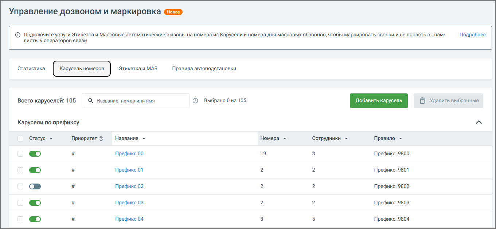

### 4.5.19. Карусель номеров

> Трассировка: PDF §4.5.19 · сквозные стр. 415-417 · источники: ч.2 `kb/sources/mango-lk-manual/LK_manual_v-125-281-566.pdf` с.135-137.

Карусель номеров — это инструмент Виртуальной АТС, который автоматически меняет номер при каждом исходящем звонке. Такой механизм помогает снизить вероятность попадания в нежелательные списки и особенно полезен для сотрудников, выполняющих большое количество звонков. Он повышает эффективность дозвона и уменьшает риск блокировки номеров.

> **Описание иллюстрации LK-§4.5.19-1** (к §4.5.19 «Карусель номеров», стр. 415; 1361×630 px). Снимок экрана / схема Личного кабинета.
> Относится к тексту руководства: «…ельные списки и особенно полезен для сотрудников, выполняющих большое количество звонков. Он повышает эффективность дозвона и уменьшает риск блокировки номеров.».
> Текст на изображении (OCR, требует сверки): Управление дозвоном и маркировка; © Подключите услуги Этикетка и Массовые автоматические вызовы на номера из Карусели и номера для массовых обзвонов, чтобы маркировать звонки и не попасть в спам-; Подробнее; листы у операторов связи; Всего каруселей: 105; О, Название, номер или имя; © выбрано 0из105; авить кар}; {0 Удалить выбранные; Карусели по префиксу; Статус >; Приоритет ©; Название =; Номера ~; Сотрудники -; Правило =; Префикс 00; 19; Префикс: 9800; Префикс 01; Префикс: 9801; Префикс 02; Префикс: 9802; Префикс 03; Префикс: 9803; Префикс 04; Префикс: 9804

Основные задачи:

возможность параллельного ведения нескольких кампаний с разными номерами; ● обеспечение стабильного дозвона и улучшение обслуживания клиентов; ● имитация локального присутствия в разных регионах. ●

Использование карусели номеров позволяет решить ряд практических задач, актуальных для бизнеса:

Снижение риска блокировок при массовых обзвонах - за счёт чередования ● номеров. Распределение нагрузки между несколькими номерами. ● Гибкое управление проектами - каждый сотрудник работает со своим набором ● номеров. Локализация звонков - можно создавать отдельные карусели под разные ● регионы, чтобы звонки клиентам выполнялись с номеров, относящихся к нужному региону или выбранных пользователем. При этом номера в карусели не обязаны принадлежать конкретному региону - можно использовать любые региональные номера, которые клиент посчитает подходящими. Это повышает вероятность ответа. Автоматизация процессов - система автоматически выбирает подходящую ● карусель на основе заданных правил, а номера внутри карусели используются поочерёдно. При этом может быть создано и запущено несколько одновременных каруселей, что обеспечивает автоматизацию.

Таким образом, включение карусели помогает не только оптимизировать внутренние процессы, но и повысить эффективность внешней коммуникации.

внимание

Карусель имеет приоритет над обычными правилами автоподстановки и действует при наличии подключенной услуги «Карусель номеров». При необходимости можно одновременно использовать карусель номеров и правила автоподстановки. При этом приоритет всегда остаётся за каруселью.

Для использования функционала необходимо перейти в Управление дозвоном и

маркировка → Карусель номеров. Услугу можно подключить сразу при создании первой карусели. Услуга «Карусель номеров» доступна в рамках версий ВАТС «Максимальная» и «Корпорация».

Подключение услуги «Карусель номеров»

Перед созданием первой карусели нужно подключить услугу:

1. Перейдите в раздел Управление дозвоном и маркировка → Карусель номеров. 2. Нажмите Подключить карусель. 3. Ознакомьтесь с условиями в открывшемся окне: при использовании карусели номеров к стоимости исходящего звонка по тарифу добавляется 0,49 руб./мин. 4. Нажмите Подключить.

При успешной активации появится уведомление об успешном подключении услуги. После этого откроется форма создания первой карусели.
