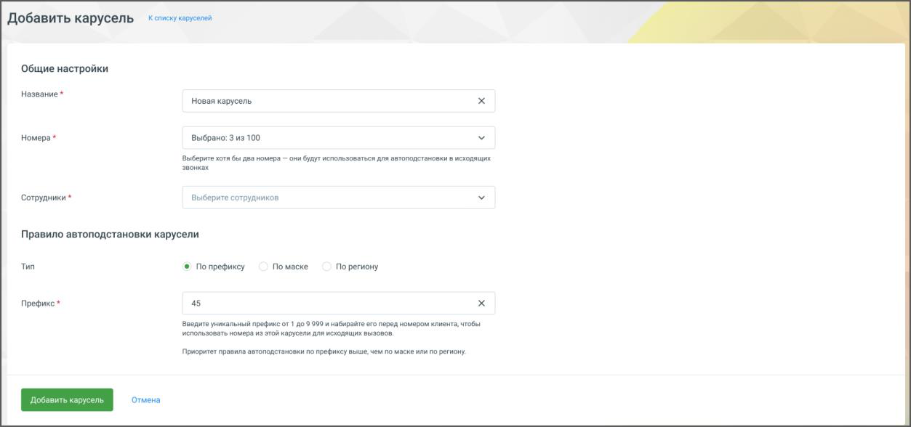

#### 4.5.19.2. Создание карусели

> Трассировка: PDF §4.5.19.2 · сквозные стр. 417-418 · источники: ч.2 `kb/sources/mango-lk-manual/LK_manual_v-125-281-566.pdf` с.137-138.

После подключения услуги можно создать карусель:

1. Нажмите кнопку Добавить карусель.

> **Описание иллюстрации LK-§4.5.19.2-1** (к §4.5.19.2 «Создание карусели», стр. 417; 1253×588 px). Снимок экрана / схема Личного кабинета.
> Относится к тексту руководства: «…1. Нажмите кнопку Добавить карусель.».
> Текст на изображении (OCR, требует сверки): Добавить карусель; списку каруселей; Общие настройки; Название *; Новая карусель; Номера*; Выбрано: 3из 100; выберите хотя бы два номера — они будут иелользоваться для автоподстановки 8 исходящих; звонках; ‘Сотрудники *; Выберите сотрудников; Правило автоподстановки карусели; тип; Flo macke; © Попрефиксу; По региону; Префикс*; 45; Введите уникальный прафиксот1 409999 и набирайте его перед номером илиента чтобы; использовать номера и этой карусели для исховящих вызовов.; Приоритет правыла автоподстаноеки по префиксу выше чем по маске или по региону

2. В открывшейся странице укажите параметры: Название (до 64 символов), o Номера (для повышения эффективности работы карусели рекомендуется o добавить 10-20 номеров, но не менее двух. - DID, DEF, МангоМобайл, SIP Trunk), Сотрудники (до 500), o Правило автоподстановки: o

по префиксу (например, «45»), ▪ по маске (например, 7495\d*), ▪

по региону (например, «Москва»). ▪ 3. Нажмите кнопку Добавить карусель.

Созданная карусель появится в списке и будет активна (переключатель состояния карусели находится в положении «включен»).

Подробнее о том, как работает логика маршрутизации звонков, узнайте далее.
