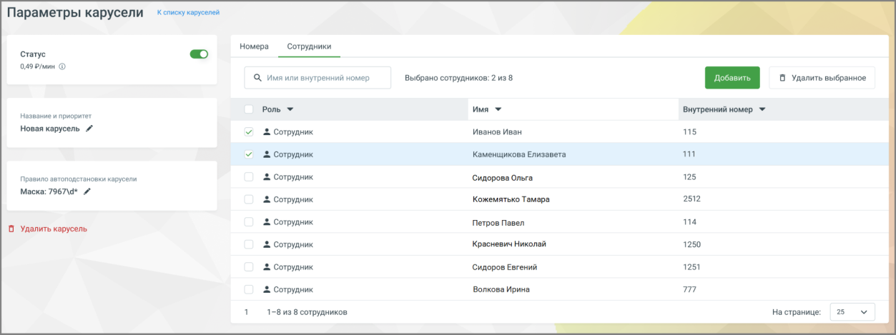

#### 4.5.19.3. Редактирование карусели

> Трассировка: PDF §4.5.19.3 · сквозные стр. 418 · источники: ч.2 `kb/sources/mango-lk-manual/LK_manual_v-125-281-566.pdf` с.138.

Редактирование позволяет изменить название, номера, сотрудников и правила автоподстановки.

Чтобы отредактировать карусель, нажмите в списке каруселей:

● на её название или число номеров - откроется вкладка Номера;

● на число сотрудников - откроется вкладка Сотрудники.

В открывшемся окне можно изменить все параметры: название, правила автоподстановки (префикс, маска, регион), добавить или удалить сотрудников и номера, а также включить или отключить индикатор активности.

> **Описание иллюстрации LK-§4.5.19.3-1** (к §4.5.19.3 «Редактирование карусели», стр. 418; 1253×469 px). Снимок экрана / схема Личного кабинета.
> Относится к тексту руководства: «…тры: название, правила автоподстановки (префикс, маска, регион), добавить или удалить сотрудников и номера, а также включить или отключить индикатор активности.».
> Текст на изображении (OCR, требует сверки): Параметры карусели; Кспискукаруселей; Номера; Сотрудники; Статус; te); олормин ©; Q имяили внутренний номер; Выбрано сотрудников: 2 из 8; Роль *; имя т; Внутренний номер У; название w приоритет; Новая карусель #; 2 Сотрудник; иванов Иван; ns; Каменщикова Елизавета; правило звтоподстановки карусели; © Сотрудник; Сидорова Ольга; 125; Маска: 7967\4* и; 252; & Сотрудник; Кожемятько Тамара; Сотрудник; "Петров Павел; Удалить карусель; Красневич Николай; 1250; Сидоров Евгений.; 1251; |2 Сотрудник; Волкова Ирина; 1-8 ns 8 сотрудников.; Ha странице:; 25
