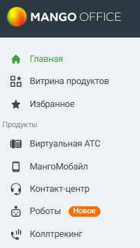
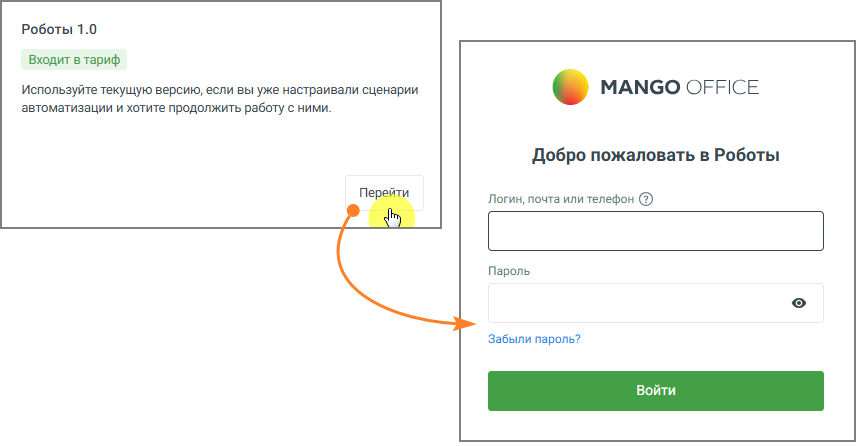

### 4.5.21. Роботы

> Трассировка: PDF §4.5.21 · сквозные стр. 435-436 · источники: ч.2 `kb/sources/mango-lk-manual/LK_manual_v-125-281-566.pdf` с.155-156.

Для перехода в раздл «Роботы» выберите соответствующую строку меню.

> **Описание иллюстрации LK-§4.5.21-1** (к §4.5.21 «Роботы», стр. 435; 202×357 px). Снимок экрана / схема Личного кабинета.
> Относится к тексту руководства: «…Для перехода в раздл «Роботы» выберите соответствующую строку меню.».
> Текст на изображении (OCR, требует сверки): MANGO OFFICE; Главная; oo; Витрина продуктов; Избранное; Продукты; Виртуальная АТС; МангоМобайл; Контакт-центр; Роботы; wil Коллтрекинг

Если модуль не подключен, вам будетпредложено его подключить.

Если подключен или входит в тариф ЛК ВАТС, клик по кнопке открывает окно аутентификации в модуле Роботы (вводите логин/пароль от ЛК ВАТС):

> **Описание иллюстрации LK-§4.5.21-2** (к §4.5.21 «Роботы», стр. 435; 860×446 px). Снимок экрана / схема Личного кабинета.
> Относится к тексту руководства: «…Если подключен или входит в тариф ЛК ВАТС, клик по кнопке открывает окно аутентификации в модуле Роботы (вводите логин/пароль от ЛК ВАТС):».
> Текст на изображении (OCR, требует сверки): Роботы 1.0; Входит в тариф; Используйте текущую версию, если вы уже настраивали сценарии; « MANGO OFFICE; автоматизации и хотите продолжить работу с ними.; Добро пожаловать в Роботы; Пере!; Логин, почта или телефон (2); Пароль; Забыли пароль?

Больше информации о работе модуля узнайте в Руководстве пользователя «Роботы MANGO OFFICE».
