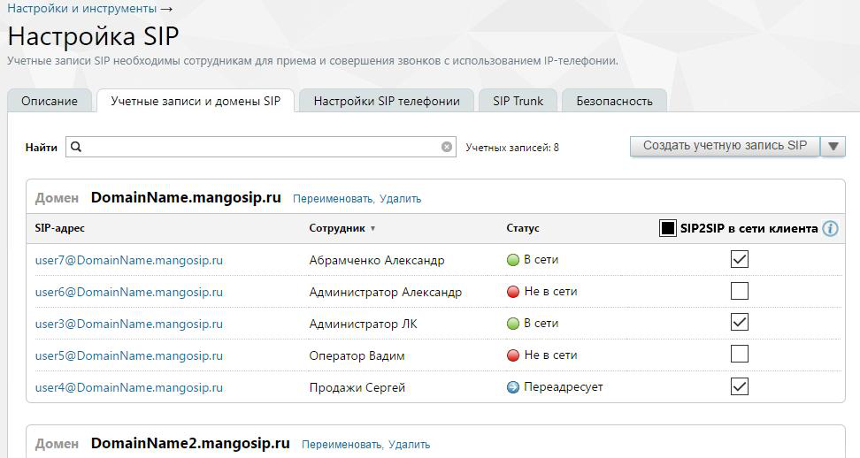

#### 4.6.1.1. Учетные записи и домены SIP

> Трассировка: PDF §4.6.1.1 · сквозные стр. 436-437 · источники: ч.2 `kb/sources/mango-lk-manual/LK_manual_v-125-281-566.pdf` с.156-157.

На этой вкладке отображаются домены и учетные записи SIP, связанные с текущей виртуальной АТС. Учетные записи SIP группируются по домену. Если с учетной записью SIP связано имя пользователя Виртуальной АТС, то оно отображается в столбце «Cотрудник».

> **Описание иллюстрации LK-§4.6.1.1-1** (к §4.6.1.1 «Учетные записи и домены SIP», стр. 436; 972×518 px). Снимок экрана / схема Личного кабинета.
> Относится к тексту руководства: «… АТС. Учетные записи SIP группируются по домену. Если с учетной записью SIP связано имя пользователя Виртуальной АТС, то оно отображается в столбце «Cотрудник».».
> Текст на изображении (OCR, требует сверки): Настройки и инструменты —; Настройка SIP; Учетные записи SIP необходимы сотрудникам для приема и совершения звонков с использованием [Р-телефонии.; Описание; Учетные записи и домены SIP; Настройки SIP телефонии; SIP Trunk; Безопасность; "Найти; Учетных записей: 8; Создать учетную запись SIP; Домен DomainName.mangosip.ru Переименовать, Удалить; SIP-aapec; Сотрудник ¥; Статус; [IM SIP2SIP в сети клиента (7); uset7@DomainNamemangosip.ru; Абрамченко Александр; Овсети; 92; user6@DomainNamemangosip.ru; Администратор Александр; © Невсети; user3@DomainNamemangosip.ru; Администратор ЛК; userS@DomainNam…

Столбец SIP2SIP в сети клиента отображается, если

 на ВАТС подключена услуга «MediaProxy».

 во вкладке "Внешний MediaProxy" включена настройка "Как настроено на вкладке "Учётные записи и домены SIP".

Действия, доступные на данной странице:

 просмотр статуса сотрудника;  контекстный поиск записей по любому полю (SIP-адрес, сотрудник, статус);  создание, редактирование, удаление домена SIP;  создание, редактирование, удаление учетной записи SIP.

Возможность создания домена SIP и учетной записи SIP доступна при редактировании карточки сотрудника в блоке настроек «Сотрудники и Группы» (подробнее в подразделе).

Статусы учетных записей SIP обновляются автоматически с периодичностью не более 60 секунд. Индикаторы в столбце «Статус» обновляются поочередно для каждой записи по мере того, как системой определяется статус текущей учетной записи.
