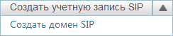
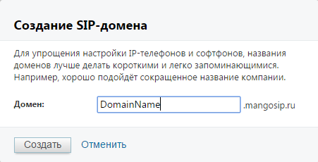
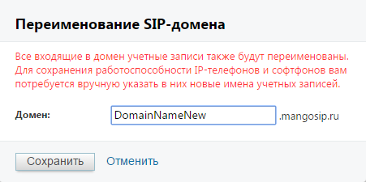
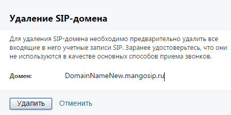
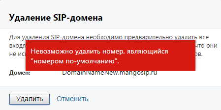
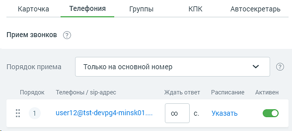

##### 4.6.1.1.1. Домены SIP

> Трассировка: PDF §4.6.1.1.1 · сквозные стр. 437-440 · источники: ч.2 `kb/sources/mango-lk-manual/LK_manual_v-125-281-566.pdf` с.157-160.

Создание

Для создания домена SIP выберите дополнительный пункт «Создать домен SIP» кнопки «Создать учетную запись SIP». Дополнительный пункт открывается при нажатии на стрелку справа. Вид кнопки в развернутом состоянии приведен на рисунке ниже.

> **Описание иллюстрации LK-§4.6.1.1.1-1** (к §4.6.1.1.1 «Домены SIP», стр. 437; 244×52 px). Снимок экрана / схема Личного кабинета.
> Относится к тексту руководства: «…нопки «Создать учетную запись SIP». Дополнительный пункт открывается при нажатии на стрелку справа. Вид кнопки в развернутом состоянии приведен на рисунке ниже.».
> Текст на изображении (OCR, требует сверки): Создать учетную запись SIP; Создать домен SIP

В открывшейся форме введите наименование домена. При создании наименования домена соблюдайте следующие правила: первый символ должен быть буквой латинского алфавита. Минимальное количество символов - четыре. Это могут быть буквы латинского алфавита, цифры и символы "-". Регистр не учитывается.

> **Описание иллюстрации LK-§4.6.1.1.1-2** (к §4.6.1.1.1 «Домены SIP», стр. 437; 451×230 px). Снимок экрана / схема Личного кабинета.
> Относится к тексту руководства: «…ыть буквой латинского алфавита. Минимальное количество символов - четыре. Это могут быть буквы латинского алфавита, цифры и символы "-". Регистр не учитывается.».
> Текст на изображении (OCR, требует сверки): Создание $!Р-домена; Для упрощения настройки {Р-телефонов и софтфонов, названия; доменов лучше делать короткими и легко запоминающимися.; Например, хорошо подойдёт сокращенное название компании.; Домен:; Создать; Отменить

После создания новый домен отображается в общем списке доменов. Также новый домен доступен для выбора при создании или редактировании учетной записи SIP: на данной вкладке и в карточке сотрудника.

Переименование

Для переименования домена нажмите «Переименовать» рядом с наименованием домена. В открывшейся форме введите новое наименование домена.

> **Описание иллюстрации LK-§4.6.1.1.1-3** (к §4.6.1.1.1 «Домены SIP», стр. 438; 451×225 px). Снимок экрана / схема Личного кабинета.
> Относится к тексту руководства: «…Для переименования домена нажмите «Переименовать» рядом с наименованием домена. В открывшейся форме введите новое наименование домена.».
> Текст на изображении (OCR, требует сверки): Переименование $!Р-домена; Все входящие в домен учетные записи также будут переименованы; Для сохранения работоспособности 1Р-телефонов и софтфонов вам; потребуется вручную указать в них новые имена учетных записей.; Домен:; Отменить; Сохранить

Входящие в домен учетные записи SIP получают новое наименование автоматически. Имена учетных записей, введенные в IP-телефоны и софтфоны, необходимо изменить самостоятельно. После переименования домена рекомендуем сразу же проверить их корректную работоспособность.

Удаление

Для удаления домена нажмите «Удалить» рядом с наименованием домена.

> **Описание иллюстрации LK-§4.6.1.1.1-4** (к §4.6.1.1.1 «Домены SIP», стр. 438; 449×224 px). Снимок экрана / схема Личного кабинета.
> Относится к тексту руководства: «…Для удаления домена нажмите «Удалить» рядом с наименованием домена.».
> Текст на изображении (OCR, требует сверки): Удаление $1Р-домена; Для удаления “Р-домена необходимо предварительно удалить все; входящие в него учетные записи SIP. Заранее удостоверьтесь, что они; не используются в качестве основных способов приема звонков.; Домен:; DomainNameNew.mangosip.ru|; Удалить; Отменить

При удалении выполняется проверка: входят ли в домен учетные записи SIP, являющиеся основным способом приема звонков. В случае, если хотя бы одна учетная запись SIP в карточке сотрудника указана в качестве основного способа связи, на экране будет отображено соответствующее сообщение.

> **Описание иллюстрации LK-§4.6.1.1.1-5** (к §4.6.1.1.1 «Домены SIP», стр. 439; 449×224 px). Снимок экрана / схема Личного кабинета.
> Относится к тексту руководства: «…ае, если хотя бы одна учетная запись SIP в карточке сотрудника указана в качестве основного способа связи, на экране будет отображено соответствующее сообщение.».
> Текст на изображении (OCR, требует сверки): Удаление $!Р-домена; арительно; лить все; Для y,; даления $!Р-домена необходимо предв; TO они; вход:; не ис; Невозможно удалить номер, являющийся; DB.; "номером по-умолчанию".; Домен; VomainNameNew.mangosip.ru; Отменить

Для удаления такого домена необходимо открыть карточку сотрудника на вкладке «Телефония» и указать другой основной способ связи, либо установить переключатель в колонке «Активен» напротив наименования учетной записи в положение «OFF» («Выключен»).

Пример смотрите на рисунке на следующей странице.

> **Описание иллюстрации LK-§4.6.1.1.1-6** (к §4.6.1.1.1 «Домены SIP», стр. 439; 588×265 px). Снимок экрана / схема Личного кабинета.
> Относится к тексту руководства: «…Пример смотрите на рисунке на следующей странице.».
> Текст на изображении (OCR, требует сверки): Карточка; Телефония; Группы; КПК; Автосекретарь; Прием звонков (2); Порядок приема; Только на основной номер; Порядок; Телефоны / sip-agpec; Ждать ответ; Расписание; Активен; os; изег1 2@tst-devpg4-minsk01....; oO; Указать

После выполнения любого из этих действий домен доступен для удаления.

внимание!

При удалении домена SIP все имена и псевдонимы пользователей, связанные с этим доменом, удаляются без возможности последующего восстановления. Удаление домена mangosip.ru запрещено.
