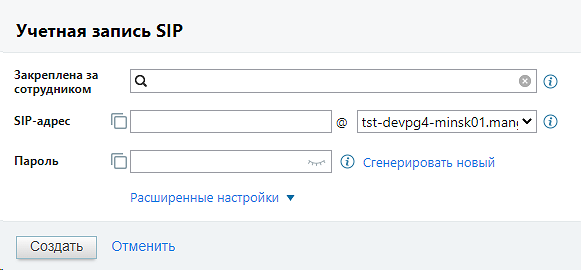
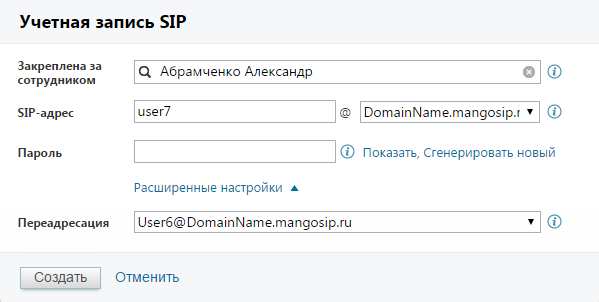
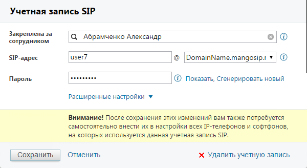
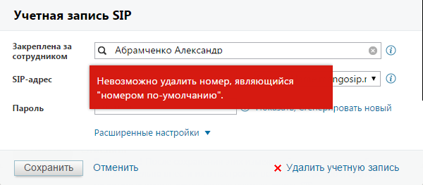

##### 4.6.1.1.2. Учетные записи SIP

> Трассировка: PDF §4.6.1.1.2 · сквозные стр. 440-443 · источники: ч.2 `kb/sources/mango-lk-manual/LK_manual_v-125-281-566.pdf` с.160-163.

Создание

Для создания новой учетной записи SIP нажмите кнопку «Создать учетную запись SIP». На экране будет отображена форма по созданию новой учетной записи SIP. Пример приведен на рисунке ниже.

> **Описание иллюстрации LK-§4.6.1.1.2-1** (к §4.6.1.1.2 «Учетные записи SIP», стр. 440; 581×270 px). Снимок экрана / схема Личного кабинета.
> Относится к тексту руководства: «… записи SIP нажмите кнопку «Создать учетную запись SIP». На экране будет отображена форма по созданию новой учетной записи SIP. Пример приведен на рисунке ниже.».
> Текст на изображении (OCR, требует сверки): Учетная запись SIP; Закреплена за; сотрудником; $Р-адрес; Пароль; me | @) сгенерировать новый; Расширенные настройки у; Создать; отменить

В поле «Закреплена за сотрудником» при помощи контекстного поиска указывается существующий сотрудник, за которым будет закреплена новая учетная запись.

совет

Если поиск не обнаружил сотрудника с таким именем, то после нажатия Создать будет создан новый сотрудник.

При создании наименования в поле «SIP-адрес» соблюдайте следующие правила: первый символ должен быть буквой латинского алфавита. Минимальное количество символов - четыре. Это могут быть буквы латинского алфавита, цифры и символы. Если вы хотите, чтобы наименование состояло только из цифр, то оно должно начинаться с «000». Регистр не учитывается.

При создании пароля следует соблюдать следующие правила: пароль в обязательном порядке должен включать цифры, строчные и прописные буквы. Минимальное количество символов - восемь. При нажатии «Сгенерировать новый» выполняется автоматическое создание «случайного» пароля, удовлетворяющего этим условиям.

При нажатии на «Расширенные настройки» форма создания учетной записи SIP принимает вид, как указано на рисунке ниже:

> **Описание иллюстрации LK-§4.6.1.1.2-2** (к §4.6.1.1.2 «Учетные записи SIP», стр. 441; 599×302 px). Снимок экрана / схема Личного кабинета.
> Относится к тексту руководства: «…При нажатии на «Расширенные настройки» форма создания учетной записи SIP принимает вид, как указано на рисунке ниже:».
> Текст на изображении (OCR, требует сверки): Учетная запись SIP; Закреплена за; С, Абрамченко Александр; сотрудником; изег7; SIP-agpec; @ |DomainName.mangosip.1 ¥ @; Пароль; @ Показать, Сгенерировать новый; Расширенные настройки ^; Переадресация; User6@DomainName.mangosip.ru; Отменить

В поле «Переадресация» при необходимости следует указать учетную запись SIP сотрудника, на которого будет переадресован входящий вызов.

После того, как все поля заполнены, нажмите «Создать». Если при заполнении полей была допущена ошибка, то на экране будет отображено соответствующее сообщение. Если все данные указаны верно, будет создана новая учетная запись SIP.

Созданная учетная запись SIP автоматически указывается в качестве активного и основного средства связи сотрудника.

Редактирование

Для редактирования учетной записи SIP нажмите на наименование учетной записи SIP в колонке «SIP-адрес». В открывшейся форме введите новые данные, следуя вышеуказанным правилам. Вид формы приведен на рисунке ниже.

При редактировании параметров учетной записи, которые указаны в настройках оборудования (Логин, Домен, Пароль), на форме отображается дополнительное сообщение, напоминающее о необходимости внесения изменений.

> **Описание иллюстрации LK-§4.6.1.1.2-3** (к §4.6.1.1.2 «Учетные записи SIP», стр. 442; 600×328 px). Снимок экрана / схема Личного кабинета.
> Относится к тексту руководства: «…торые указаны в настройках оборудования (Логин, Домен, Пароль), на форме отображается дополнительное сообщение, напоминающее о необходимости внесения изменений.».
> Текст на изображении (OCR, требует сверки): Учетная запись SIP; За; С Абрамченко Александр; сотрудником; user7; SIP-agpec; @ |DomainName.mangosip.1 у; Пароль; @ Показать, Сгенерировать новый; Расширенные настройки ¥; Сохранить; Отменить; Хх Удалить учетную запись

Если редактируемая учетная запись SIP указана в качестве основного способа связи, то изменение сотрудника, за которым она закреплена, запрещено.

Удаление

Удаление учетной записи SIP возможно как из формы редактирования, так и из карточки сотрудника. Если данная учетная запись SIP указана в качестве основного способа связи, на экране будет отображено соответствующее сообщение и удаление не будет выполнено.

Пример сообщения приведен на рисунке на следующей странице.

> **Описание иллюстрации LK-§4.6.1.1.2-4** (к §4.6.1.1.2 «Учетные записи SIP», стр. 442; 600×263 px). Снимок экрана / схема Личного кабинета.
> Относится к тексту руководства: «…Пример сообщения приведен на рисунке на следующей странице.».
> Текст на изображении (OCR, требует сверки): Учетная запись SIP; Закреплена за; сотрудником; С; Абрамченко Александр; SIP-agpec; gosip.1 ¥; Невозможно удалить номер, являющийся; "номером по-умолчанию".; Пароль; ровать новый; Расширенные настройки ¥; | Сохранить | Отменить; Хх Удалить учетную запись

Для удаления такой учетной записи SIP необходимо открыть карточку сотрудника на вкладке «Телефония» и указать другой основной способ связи, либо снять флаг в колонке «Активен» напротив наименования учетной записи.
