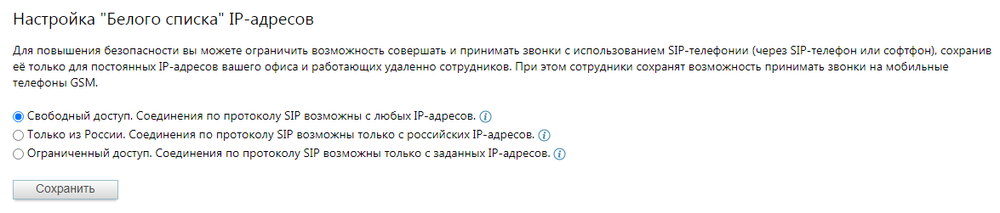
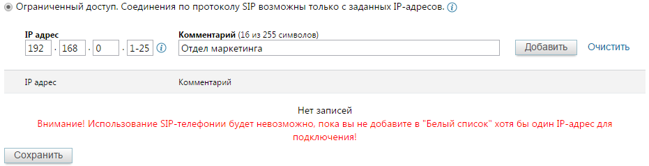

#### 4.6.1.3. Безопасность

> Трассировка: PDF §4.6.1.3 · сквозные стр. 443-444 · источники: ч.2 `kb/sources/mango-lk-manual/LK_manual_v-125-281-566.pdf` с.163-164.

В целях повышения безопасности использования SIP-телефонии предусмотрено шифрование звонков.

Пользователю доступны два типа шифрования: SRTP, TLS.

Ознакомьтесь с условиями подключения, указанными на экране, и сохраните выбранные настройки.

Блок шифрования отображается только если подключена хотя бы одна из услуг шифрования подключена или доступна для подключения на текущей версии ВАТС. При смене тарифа на тариф с невозможностью работы блока шифрования, пользователь уведомляется системным сообщением.

Также в ЛК ВАТС имеется возможность настройки «белого списка» IP-адресов. На этой странице вы можете задать список IP-адресов сотрудников, с которых будет разрешен доступ к использованию учетных записей SIP.

> **Описание иллюстрации LK-§4.6.1.3-1** (к §4.6.1.3 «Безопасность», стр. 443; 1175×251 px). Снимок экрана / схема Личного кабинета.
> Относится к тексту руководства: «…белого списка» IP-адресов. На этой странице вы можете задать список IP-адресов сотрудников, с которых будет разрешен доступ к использованию учетных записей SIP.».
> Текст на изображении (OCR, требует сверки): Настройка "Белого списка" 1Р-адресов; Для повышения безопасности вы можете ограничить возможность совершать и принимать звонки с использованием $Р-телефонии (через ЭР-телефон или софтфон), сохранив; 28 только для постоянных 1Р-адресов вашего офисз и работающих удаленно сотрудников. При этом сотрудники сохранят возможность принимать звонки на мобильные; телефоны GSM.; @ Свободный доступ. Соединения по протоколу SIP возможны с любых IP-aapecos, @); О Только из России. Соединения по протоколу SIP возможны только с российских Р-адресое. ©); О Ограниченный доступ. Соединения по протоколу SIP возмож…

Предусмотрено три типа доступа.

Свободный доступ – наименее безопасный способ. Этот тип используется, как правило, в тех случаях, когда интернет-канал вашего офиса имеет динамический IP- адрес, большинство сотрудников работает удаленно, либо сотрудникам требуется

регулярно подключаться по SIP из различных мест, в частности через сети Wi-Fi общего использования.

Только из России – высокий уровень безопасности, в то же время позволяющий сохранить мобильность сотрудников в пределах страны. Список IP-адресов в пределах России формируется автоматически, необходимости в ручной настройке нет.

Ограниченный доступ – максимальный уровень безопасности. Доступ разрешен только с указанных IP-адресов. При выборе этого варианта заполните дополнительные поля:

> **Описание иллюстрации LK-§4.6.1.3-2** (к §4.6.1.3 «Безопасность», стр. 444; 931×238 px). Снимок экрана / схема Личного кабинета.
> Относится к тексту руководства: «…Ограниченный доступ – максимальный уровень безопасности. Доступ разрешен только с указанных IP-адресов. При выборе этого варианта заполните дополнительные поля:».
> Текст на изображении (OCR, требует сверки): ® Ограниченный доступ. Соединения по протоколу SIP возможны только с заданных IP-aapecos. (2); Комментарий (16 v2 255 символов); 192; - 1-25 |® |Отдел маркетинга.; Добавить; Очистить; TP адрес; Комментарий; Нет записей; Внимание! Использование $Р-телефонии будет невозможно, пока вы не добавите в "Белый список" хотя бы один [Р-адрес для; подключения!; Сохранить

Подробнее о диапазонах и символах групповой замены

Для указания диапазонов IP-адресов используется символ «-». Например, ввод диапазона 192.168.1.16–32 равносилен указанию отдельных IP-адресов с 192.168.1.16 по 192.168.1.32 (включительно).

Символ групповой замены «*» может заменять произвольное число IP-адресов (в соответствии с сегментом, где введен этот символ). Например, ввод маски 192.168.* равносилен указанию отдельных IP-адресов с 192.168.0.0 по 192.168.255.255 включительно.

совет

Можно использовать только один символ «-» или «*» в каждом сегменте поля IP- адрес. При вводе символа «-» или «*» в любом из сегментов поля IP-адрес последующие его сегменты становятся недоступными для ввода. Не забудьте сохранить изменения.
