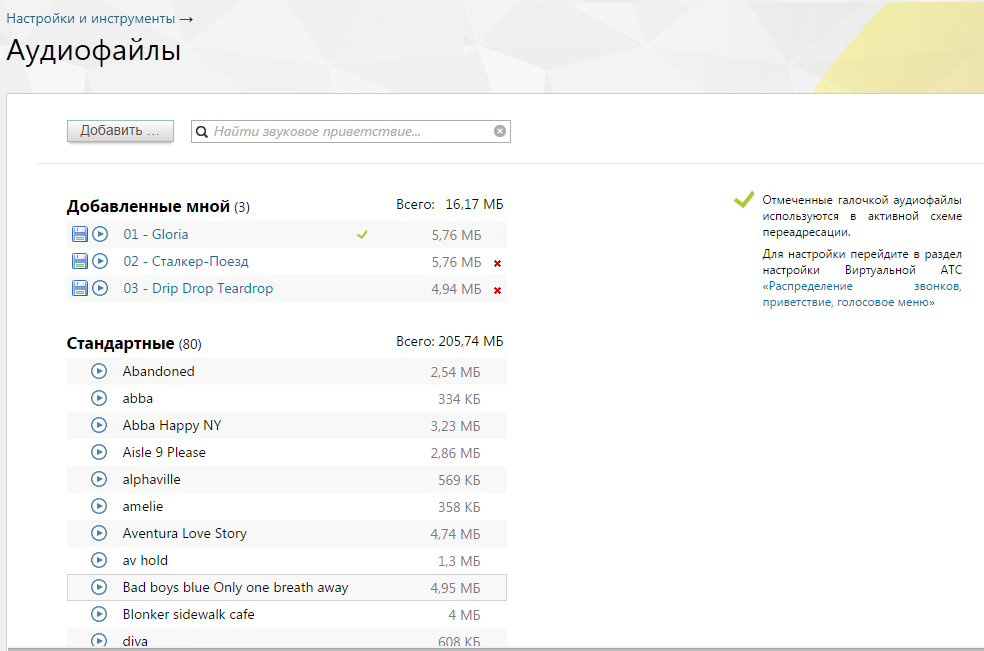
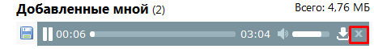

### 4.6.2. Аудиофайлы

> Трассировка: PDF §4.6.2 · сквозные стр. 447-449 · источники: ч.2 `kb/sources/mango-lk-manual/LK_manual_v-125-281-566.pdf` с.167-169.

В разделе «Аудиофайлы» можно загрузить готовый или записать новый звуковой фрагмент, а также прослушать уже имеющиеся аудиозаписи.

> **Описание иллюстрации LK-§4.6.2-1** (к §4.6.2 «Аудиофайлы», стр. 447; 984×651 px). Снимок экрана / схема Личного кабинета.
> Относится к тексту руководства: «…В разделе «Аудиофайлы» можно загрузить готовый или записать новый звуковой фрагмент, а также прослушать уже имеющиеся аудиозаписи.».
> Текст на изображении (OCR, требует сверки): Настройки и инструменты >; Аудиофайлы; Добавить __; Q Найти звуковое приветствие.; SY отмеченные галочкой аудиофайлы; Добавленные мной (3); Всего: 16,17 MB; ‘используются в активной схеме; © 01-Gloria; 5,76 МБ; перездресации.; ‘Dna настройки перейдите в раздел; © 02- Сталкер-Поезд; 5,76 МБ x; АТС; настройки; Виртуальной; © 03 - Drip Drop Teardrop; 494MB x; «Распределение; ‘звонков,; приветствие, голосовое меню»; Всего: 205,74 MB; Стандартные (80); Abandoned; 2.54 МБ; abba; 334 KB; Abba Happy NY; 3,23 MB; Aisle 9 Please; 2.86 MB; alphaville; 569 KB; amelie; 358 KB; Aventura Love Story; 474 MB; …

совет

Для создания и поддержания благоприятного имиджа компании можно заказать профессиональную студийную запись приветствий в голосовом меню, рекламных сообщений и мелодий, которые проигрываются позвонившим вам. Обращайтесь в «Манго Телеком» — 8 800 555-55-22.

В блоке «Добавленные мной» отображаются загруженные вами аудиофайлы. В заголовке указывается их количество и объем, занимаемый в облачном хранилище.

Если звуковые записи используются в Автосекретаре или иной активной схеме переадресации, то они помечаются галочкой и защищены от удаления (в противном случае рядом с ними находится крестик, позволяющий их стереть).

> **Описание иллюстрации LK-§4.6.2-2** (к §4.6.2 «Аудиофайлы», стр. 447; 458×51 px). Снимок экрана / схема Личного кабинета.
> Относится к тексту руководства: «…ной активной схеме переадресации, то они помечаются галочкой и защищены от удаления (в противном случае рядом с ними находится крестик, позволяющий их стереть).».
> Текст на изображении (OCR, требует сверки): НО 1; 92,0 КВ x; ФО 19; 77.0 КВ

1. В блоке «Стандартные» содержатся аудиофайлы, бесплатно предоставленные «Манго Телеком». Их количество и объем также

указаны, но места в вашем облачном хранилище они не занимают, и их нельзя переименовать, скачать и удалить.

Загрузка нового аудиофайла

Для загрузки готового или записи нового аудиофайла кликните по кнопке «Добавить». Откроется форма, в которой следует выбрать нужный способ.

При загрузке готового звукового приветствия укажите одно из них в системном диалоговом окне. Выбранная запись закачивается на сервер MANGO OFFICE, где производится проверка на допустимость ее формата (по расширению файла). Если верификация пройдена, то соответствующее приветствие добавляется в список и отображается в блоке «Добавленные мной». Если формат не поддерживается, то выводится сообщение об ошибке.

Перекодируйте аудиофайл в один из поддерживаемых форматов (MP3 до 256 кбит/с или PCM 8 кГц, 16 бит, моно) и повторите процедуру добавления.

Если превышен максимальный допустимый размер аудиофайла (20 Мб), то отображается сообщение об ошибке.

Для создания нового звукового приветствия нажмите «Записать самостоятельно». Если у вас есть микрофон и установлен Adobe Flash Player, то в открывшейся форме будет отображаться кнопка «Начать запись». При необходимости нажмите «Разрешить», чтобы Adobe Flash Player получил доступ к микрофону.

Если же хоть одно из условий (наличие микрофона и установленной программы) не выполнено, вы увидите рекомендацию по дальнейшим действиям.

Максимальная допустимая продолжительность создаваемого звукового приветствия — 2 минуты.

После окончания записи нажмите кнопку «Сохранить», и аудиофайл появится в блоке «Добавленные мной». Названия приветствий из этого блока можно поменять, для этого достаточно кликнуть по имени и ввести новое.

При загрузке нового аудиофайла или самостоятельной записи сохраняется информация о пользователе, загрузившим файл/запись, а также дата и время загрузки.

Прослушивание и скачивание аудиофайлов

Все аудиофайлы можно прослушать, нажав соответствующую иконку. Для перехода к другим записям следует закрыть форму плеера, кликнув по крестику (см. рисунок ниже).

> **Описание иллюстрации LK-§4.6.2-3** (к §4.6.2 «Аудиофайлы», стр. 448; 462×61 px). Снимок экрана / схема Личного кабинета.
> Относится к тексту руководства: «…е аудиофайлы можно прослушать, нажав соответствующую иконку. Для перехода к другим записям следует закрыть форму плеера, кликнув по крестику (см. рисунок ниже).».
> Текст на изображении (OCR, требует сверки): Всего: 4,76 МБ; Добавленные мной (2); 03:04 $ cm uA

Также записи из этого блока можно скачать на компьютер, нажав соответствующую иконку.

Права пользователей раздела «Аудиофайлы»

В разделе для стандартных ролей установлено право «Добавлять, просматривать и удалять аудиофайлы»:

 только свои аудиофайлы – сотрудник, старший сотрудник, бухгалтер, маркетолог;

 аудиофайлы свои и подконтрольных групп – руководитель группы;

 любые аудиофайлы – руководитель компании, администратор.

ВНИМАНИЕ: Если согласно настроек пользовательских ролей у пользователя имеется полный доступ в раздел "Аудиофайлы", то для него действует право доступа "любые аудиофайлы".
