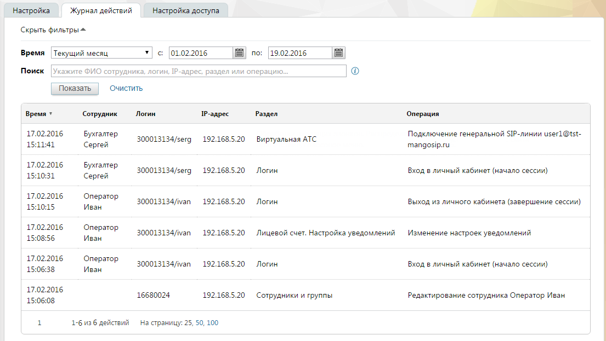

#### 4.6.3.2. Журнал действий

> Трассировка: PDF §4.6.3.2 · сквозные стр. 453-454 · источники: ч.2 `kb/sources/mango-lk-manual/LK_manual_v-125-281-566.pdf` с.173-174.

Данный отчет отображает информацию о действиях пользователей в Личном кабинете.

внимание

Отчет «Журнал действий» доступен администратору лицевого счета и пользователям с правом доступа «Администратор».

Отчет формируется по указанному периоду. Выберите период или укажите его самостоятельно в полях «с» и «по».

При необходимости заполните поле «Поиск». Допускается поиск по:

 ФИО сотрудника;

 логину вида xxxxxxxxx/name, где:

o xxxxxxxxx - цифровой идентификатор Виртуальной АТС;

o name – логин пользователя;

 IP-адресу;

 названию раздела;

 названию выполненной операции.

внимание

Поиск осуществляется по точному совпадению указанных данных. Обращайте внимание на последовательность слов в запросе.

Для формирования отчета нажмите Показать. Пример отчета приведен на рисунке ниже.

> **Описание иллюстрации LK-§4.6.3.2-1** (к §4.6.3.2 «Журнал действий», стр. 454; 1105×623 px). Снимок экрана / схема Личного кабинета.
> Относится к тексту руководства: «…Для формирования отчета нажмите Показать. Пример отчета приведен на рисунке ниже.».
> Текст на изображении (OCR, требует сверки): Настройка; Журнал действий; Настройка доступа; Скрыть фильтры =; 01.02.2016; Время | Текущий месяц; Поиск; Показать; Очистить; Время т; Сотрудник; "Логин,; 1Р-адрес; Раздел; Операция; 17.02.2016; Бухгалтер; 192.168.5.20; Подключение генеральной $Р-линии userl@tst-; Сергей; 300013134/serg; Виртуальная ATC; mangosip.ru; "Логин; Вход в личный кабинет (начало сессии); 15:10:31; Оператор; 300013134/ivan; Выход из личного кабинета (завершение сессии); 15:10:15,; Иван; "Лицевой счет. Настройка уведомлений; Изменение настроек уведомлений; 15:06:38; 16680024; 16:08; Сотрудники и группы; Редактирование …

Некоторые действия могут выполняться не сотрудником, а системой (например, отправка письма либо уведомления). В отчете такие действия помечаются как выполненные псевдо-пользователем «Система».
