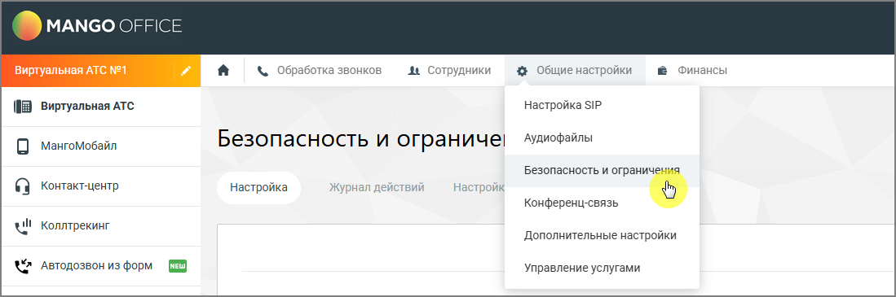

##### 4.6.3.3.1. Просмотр списка ролей

> Трассировка: PDF §4.6.3.3.1 · сквозные стр. 455-456 · источники: ч.2 `kb/sources/mango-lk-manual/LK_manual_v-125-281-566.pdf` с.175-176.

Список ролей отображается на странице управления ролями.

> **Описание иллюстрации LK-§4.6.3.3.1-1** (к §4.6.3.3.1 «Просмотр списка ролей», стр. 455; 1099×365 px). Снимок экрана / схема Личного кабинета.
> Относится к тексту руководства: «…Список ролей отображается на странице управления ролями.».
> Подпись в руководстве: «Рисунок 1. Выпадающий список раздела «Общие настройки»».
> Текст на изображении (OCR, требует сверки): MANGO OFFICE; Финансы; Виртуальная АТС №1; & обработка звонков; Ae Сотрудники; 4 Общие настройки; [8 Виртуальная ATC; Настройка SIP; Аудиофайлы; 0 мангомобайл; Безопасность и ограниче!; Безопасность и ограни'; ойк; ©} контактщентр; Настройка; Журнал действий; Конференц-связь; ll Коллтрекинг; Дополнительные настройки; {2 Автодозвон из форм; Управление услугами

Рисунок 1. Выпадающий список раздела «Общие настройки»

В списке отображаются все роли, доступные в системе. Для каждой роли отображается её название и доступные действия.

При выборе роли можно:

 просмотреть права доступа роли  изменить права доступа  создать новую роль  удалить роль.
