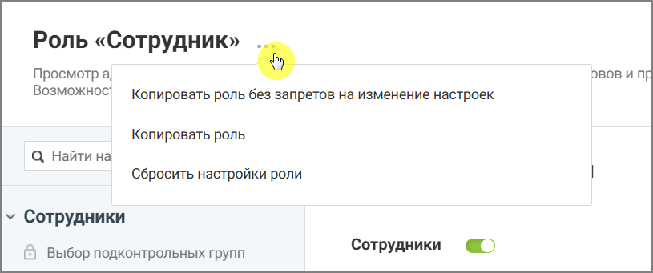
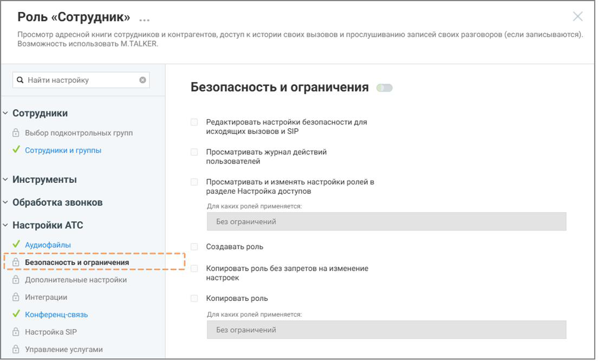
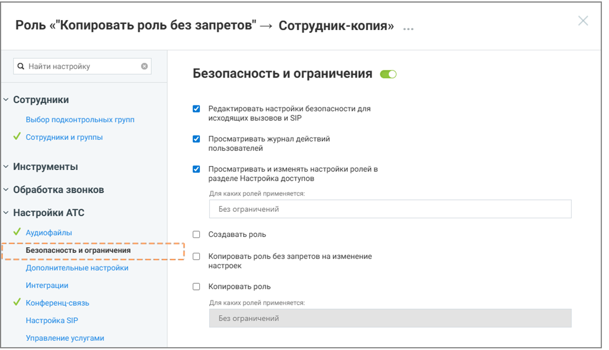
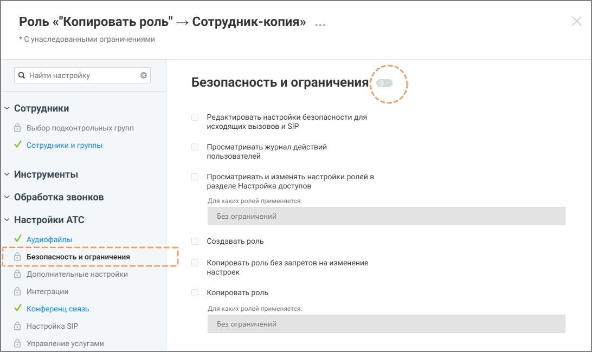

##### 4.6.3.3.3. Создание роли путем копирования

> Трассировка: PDF §4.6.3.3.3 · сквозные стр. 457-460 · источники: ч.2 `kb/sources/mango-lk-manual/LK_manual_v-125-281-566.pdf` с.177-180.

Новые роли можно создавать путем копирования существующих ролей.

> **Описание иллюстрации LK-§4.6.3.3.3-1** (к §4.6.3.3.3 «Создание роли путем копирования», стр. 457; 815×341 px). Снимок экрана / схема Личного кабинета.
> Относится к тексту руководства: «…Новые роли можно создавать путем копирования существующих ролей.».
> Подпись в руководстве: «Рисунок 2. Создание новой роли на основе существующей».
> Текст на изображении (OCR, требует сверки): Роль «Сотрудник»; Просмотр а,; oO; OBOB и ПВ; Возможнос`; Копировать роль без запретов на изменение настроек; Копировать роль; Q Найти на; Сбросить настройки роли; у Сотрудники; Сотрудники; ©) Выбор подконтрольных групп

Рисунок 2. Создание новой роли на основе существующей

Копировать роль без запретов на изменение настроек

Данная строка меню доступна для нажатия если у пользователя активировано право доступа «Копировать роль без запретов на изменение настроек».

внимание

Важно понимать: копия роли наследует от источника только перечень доступных разделов. Если раздел был закрыт/открыт для исходной роли, после создания копии он останется аналогично закрытым/открытым, с возможностью последующего изменения доступа.

Также внутри каждого унаследованного раздела копия получает возможность подключения полного набора всех возможных прав, даже если у источника они были отключены. После создания роли-копии обязательно отключите ненужные права, чтобы избежать избыточных разрешений.

Чтобы создать роль на основе существующей, без запретов на изменение настроек:

 откройте раздел Настройки АТС → Безопасность и ограничения  выберите системную роль, на основе которой будет создаваться пользовательская

> **Описание иллюстрации LK-§4.6.3.3.3-2** (к §4.6.3.3.3 «Создание роли путем копирования», стр. 457; 54×37 px). Пиктограмма (значок элемента интерфейса).
> Относится к тексту руководства: «… откройте раздел Настройки АТС → Безопасность и ограничения  выберите системную роль, на основе которой будет создаваться пользовательская».
> Текста на изображении нет; назначение значка — см. текст, к которому он относится.

 нажмите иконку контекстного меню и в выпадающем окне выберите вариант «Копировать роль без запретов на изменение настроек»  нажмите кнопку Создать роль  укажите название роли

 при необходимости укажите описание роли  настройте права доступа роли  нажмите Сохранить

> **Описание иллюстрации LK-§4.6.3.3.3-3** (к §4.6.3.3.3 «Создание роли путем копирования», стр. 458; 1115×667 px). Снимок экрана / схема Личного кабинета.
> Относится к тексту руководства: «… при необходимости укажите описание роли  настройте права доступа роли  нажмите Сохранить».
> Подпись в руководстве: «Рисунок 3. Роль-источник».
> Текст на изображении (OCR, требует сверки): Роль «Сотрудник» ...; Просмотр адресной книги сотрудников и контрагентов, доступ к истории своих вызовов и прослушиванию записей своих разговоров (если записываются); Возможность использовать M. TALKER.; Q Найти настройку; Безопасность и ограничения; Сотрудники; Редактировать настройки безопасности для; '@ выбор подконтрольных групп:; исходящих вызовов и SIP; У сотрудники и группы; Просматривать журнал действий; пользователей; Инструменты; Просматривать и изменять настройки ролей в; разделе Настройка доступов; Обработка звонков; Для каких ролей применяется:; Настройки АТС; Без ограничений; У А…

Рисунок 3. Роль-источник

> **Описание иллюстрации LK-§4.6.3.3.3-4** (к §4.6.3.3.3 «Создание роли путем копирования», стр. 458; 1115×641 px). Снимок экрана / схема Личного кабинета.
> Относится к тексту руководства: «…Рисунок 3. Роль-источник».
> Подпись в руководстве: «Рисунок 4. Роль-копия».
> Текст на изображении (OCR, требует сверки): Роль «"Копировать роль без запретов" —> Сотрудник-копия»; Q Найти настройку; Безопасность и ограничения @>; у Сотрудники; Редактировать настройки безопасности для; Выбор подконтрольных групп; исходящих вызовов и SIP; М сотрудники и группы; Просматривать журнал действий; пользователей; У Инструменты; Просматривать и изменять настройки ролей в.; разделе Настройка доступов; у Обработка звонков; Для каких ролей применяется:; у Настройки АТС; Без ограничений; У Аудиофайлы; Создавать роль; cosas; ay; 'асность и ограничения; soso; oS; et; Копировать роль без запретов на изменение; Дополнительные наст…

Рисунок 4. Роль-копия

На примере выше Рисунок 4 – роль-источник, Рисунок 5 – роль-копия. Роль-копия имеет возможности подключения разделов и подключения прав доступа внутри разделов, хотя роль-источник этой возможности не имеет.

Копировать роль

Данная строка меню доступна для нажатия если у пользователя активировано право доступа «Копировать роль».

Этот способ удобен, если необходимо создать роль с аналогичными разрешениями и запретами на изменение настроек.

Чтобы создать роль на основе существующей:

 откройте раздел Настройки АТС → Безопасность и ограничения  выберите системную роль, на основе которой будет создаваться пользовательская

> **Описание иллюстрации LK-§4.6.3.3.3-5** (к §4.6.3.3.3 «Создание роли путем копирования», стр. 459; 54×37 px). Пиктограмма (значок элемента интерфейса).
> Относится к тексту руководства: «… откройте раздел Настройки АТС → Безопасность и ограничения  выберите системную роль, на основе которой будет создаваться пользовательская».
> Текста на изображении нет; назначение значка — см. текст, к которому он относится.

 нажмите иконку контекстного меню и в выпадающем окне выберите вариант «Копировать роль»  нажмите кнопку Создать роль  укажите название роли  при необходимости укажите описание роли  настройте права доступа роли, которые остались доступными для изменения  нажмите Сохранить

> **Описание иллюстрации LK-§4.6.3.3.3-6** (к §4.6.3.3.3 «Создание роли путем копирования», стр. 459; 1092×650 px). Снимок экрана / схема Личного кабинета.
> Относится к тексту руководства: «…  укажите название роли  при необходимости укажите описание роли  настройте права доступа роли, которые остались доступными для изменения  нажмите Сохранить».
> Подпись в руководстве: «Рисунок 5. Роль-копия, с унаследованными запретами».
> Текст на изображении (OCR, требует сверки): Роль «"Копировать роль" — Сотрудник-копия» ...; * Сунаследованными ограничениями; Q Найти настройку; Безопасность и ограничения!; у Сотрудники; Редактировать настройки безопасности для; @ выбор подконтрольных групп; исходящих вызовов и SIP; У сотрудники и группы; Просматривать журнал действий; пользователей; у Инструменты; Просматривать и изменять настройки ролей в; разделе Настройка доступов; у Обработка звонков; Для каких ролей применяется:; у Настройки АТС; Без ограничений; У Аудиофайлы; Создавать роль; ©) Безопасность и ограничения; Копировать роль без запретов на изменение; Дополнительные…

Рисунок 5. Роль-копия, с унаследованными запретами

На рисунке 6 выше роль «Сотрудник»-копия имеет те же запреты, как и роль-источник.
