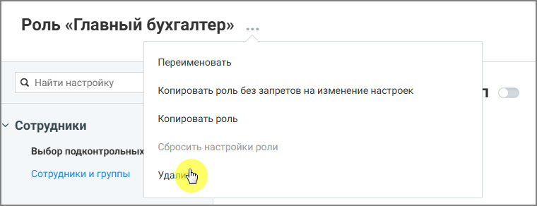

##### 4.6.3.3.4. Удаление роли

> Трассировка: PDF §4.6.3.3.4 · сквозные стр. 460 · источники: ч.2 `kb/sources/mango-lk-manual/LK_manual_v-125-281-566.pdf` с.180.

Удалить можно только пользовательские роли. Системные роли удалить нельзя. Чтобы удалить роль:

 откройте список ролей  выберите роль, которую необходимо удалить  выберите действие Удалить роль  подтвердите удаление

> **Описание иллюстрации LK-§4.6.3.3.4-1** (к §4.6.3.3.4 «Удаление роли», стр. 460; 760×292 px). Снимок экрана / схема Личного кабинета.
> Относится к тексту руководства: «… откройте список ролей  выберите роль, которую необходимо удалить  выберите действие Удалить роль  подтвердите удаление».
> Подпись в руководстве: «Рисунок 6. Удаление роли».
> Текст на изображении (OCR, требует сверки): Роль «Главный бухгалтер» .; Переименовать; Q Найти настройку; Копировать роль без запретов на изменение настроек; Копировать роль; \ Сотрудники; Выбор подконтрольных; Сбросить настройки роли; Сотрудники и группы

Рисунок 6. Удаление роли

После удаления роль становится недоступной для назначения пользователям.
