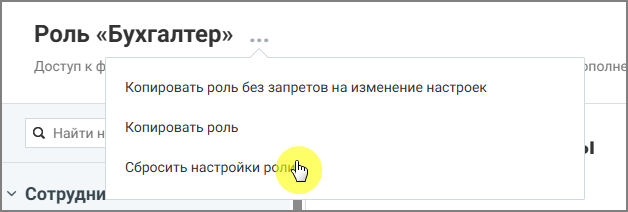

##### 4.6.3.3.5. Сбросить настройки роли

> Трассировка: PDF §4.6.3.3.5 · сквозные стр. 460-461 · источники: ч.2 `kb/sources/mango-lk-manual/LK_manual_v-125-281-566.pdf` с.180-181.

Если права доступа роли были изменены, их можно вернуть к исходным значениям.

При выполнении этой операции все изменённые права доступа будут сброшены, и роль вернётся к стандартному набору прав.

Чтобы выполнить сброс:

 откройте список ролей  выберите нужную роль

> **Описание иллюстрации LK-§4.6.3.3.5-1** (к §4.6.3.3.5 «Сбросить настройки роли», стр. 460; 54×37 px). Пиктограмма (значок элемента интерфейса).
> Относится к тексту руководства: «… откройте список ролей  выберите нужную роль».
> Текста на изображении нет; назначение значка — см. текст, к которому он относится.

 нажмите иконку контекстного меню и в выпадающем окне выберите вариант «Сбросить настройки роли»  подтвердите действие

> **Описание иллюстрации LK-§4.6.3.3.5-2** (к §4.6.3.3.5 «Сбросить настройки роли», стр. 461; 628×212 px). Снимок экрана / схема Личного кабинета.
> Относится к тексту руководства: «… нажмите иконку контекстного меню и в выпадающем окне выберите вариант «Сбросить настройки роли»  подтвердите действие».
> Подпись в руководстве: «Рисунок 7. Сбрасывание настроек роли».
> Текст на изображении (OCR, требует сверки): Роль «Бухгалтер» ...; полна; Доступ к ф; Копировать роль без запретов на изменение настроек; Q Найти н; Копировать роль; nee re

Рисунок 7. Сбрасывание настроек роли
