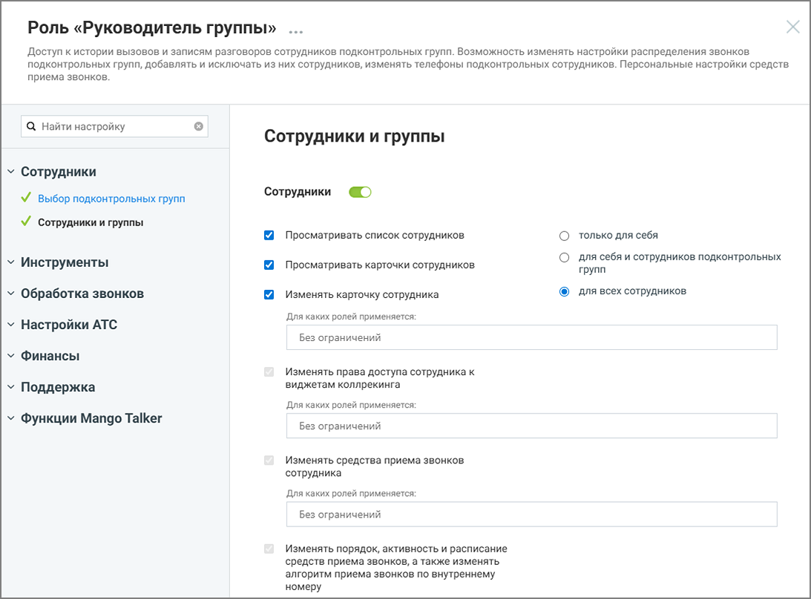
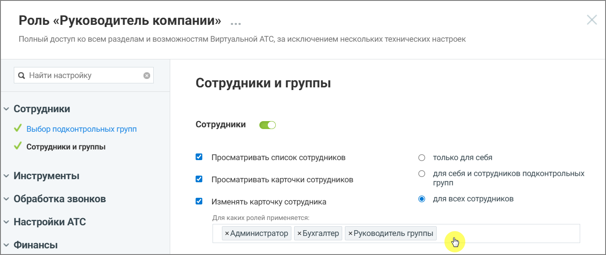
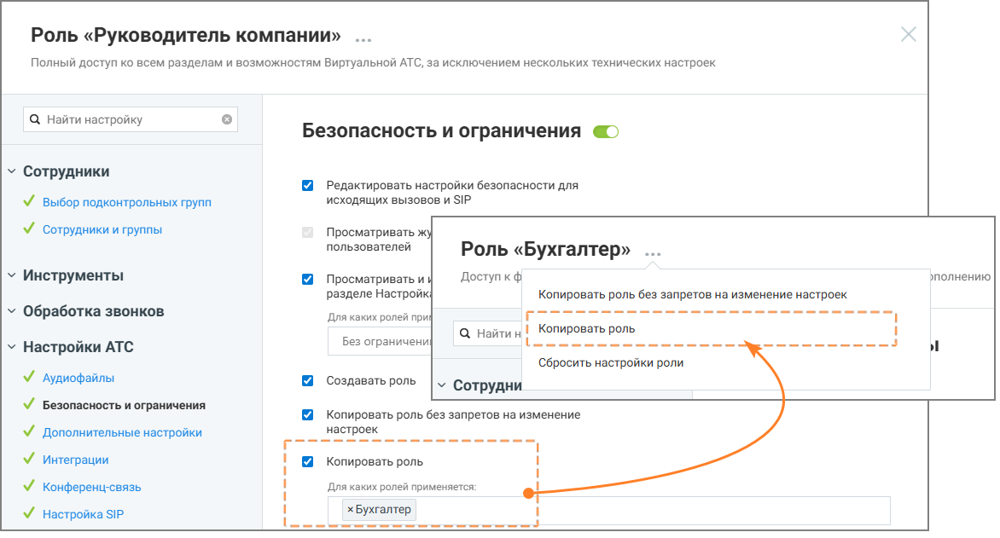
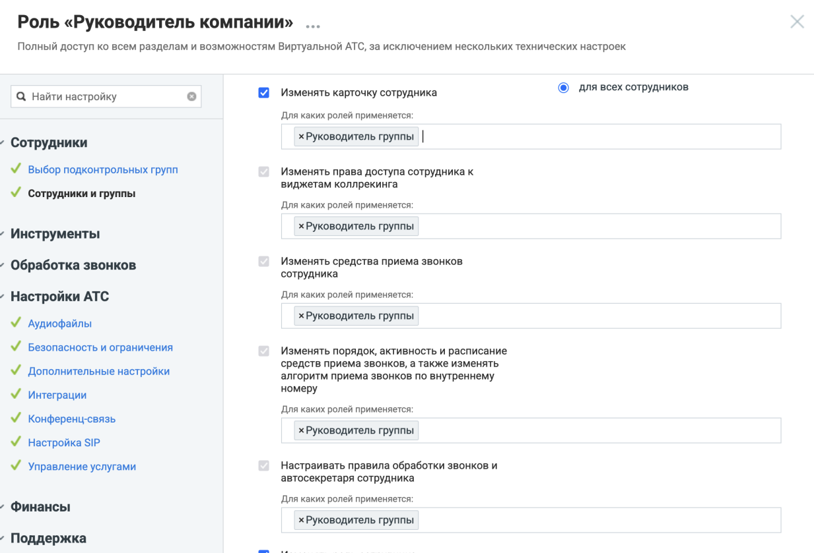

##### 4.6.3.3.6. Настройка прав доступа роли

> Трассировка: PDF §4.6.3.3.6 · сквозные стр. 461-466 · источники: ч.2 `kb/sources/mango-lk-manual/LK_manual_v-125-281-566.pdf` с.181-186.

Права доступа роли определяют, какие действия доступны пользователям с этой ролью и к каким разделам системы они могут получить доступ.

Если право включено - выполнение соответствующего действия разрешено. Если право отключено - выполнение функции недоступно.

При настройке некоторых прав доступа также можно указать, над сотрудниками с какими ролями разрешено выполнение действия. Для этого выбираются роли целевых сотрудников — действие будет доступно только в том случае, если сотрудник, на которого оно направлено, обладает ролью из списка ролей параметра доступа. Если установлено значение «Без ограничений», то принадлежность роли сотрудника, над которым производится действие не проверяется.

Настройка прав доступа выполняется при создании роли или при редактировании существующей роли.

> **Описание иллюстрации LK-§4.6.3.3.6-1** (к §4.6.3.3.6 «Настройка прав доступа роли», стр. 462; 1093×808 px). Снимок экрана / схема Личного кабинета.
> Относится к тексту руководства: «…Настройка прав доступа выполняется при создании роли или при редактировании существующей роли.».
> Подпись в руководстве: «Рисунок 8. Настройка прав доступа для роли».
> Текст на изображении (OCR, требует сверки): Роль «Руководитель группы» ...; Доступ к истории вызовов и записям разговоров сотрудников подконтрольных групп. Возможность изменять настройки распределения звонков.; подконтрольных групп, добавлять и исключать из них сотрудников, изменять телефоны подконтрольных сотрудников. Персональные настройки средств; приема звонков.; Q Найти настройку; Сотрудники и группы; Сотрудники; У выбор подконтрольных групп; VY сотрудники и группы.; Просматривать список сотрудников; только для себя; Инструменты; для себя и сотрудников подконтрольных; Просматривать карточки сотрудников; групп; для всех сотрудников;…

Рисунок 8. Настройка прав доступа для роли

Чтобы изменить права доступа роли:

 откройте раздел Настройки АТС → Безопасность и ограничения → Настройка доступа  выберите роль, права доступа которой необходимо изменить  включите или отключите необходимые права доступа и ограничения  настройте параметры прав доступа (при необходимости)  нажмите Сохранить.

внимание

После сохранения изменения применяются ко всем пользователям, которым назначена эта роль.

Некоторые права доступа могут зависеть от других прав. В этом случае изменение одного права может автоматически изменить состояние другого права. При редактировании прав в интерфейсе Личного кабинета ВАТС в таких случаях отображаются подсказки.

Также часть прав может быть недоступна для изменения и отображаться в режиме только чтения. Такие права устанавливаются системой и не могут быть изменены вручную.

Статусы прав доступа в разрезе возможностей подключения:

> **Описание иллюстрации LK-§4.6.3.3.6-2** (к §4.6.3.3.6 «Настройка прав доступа роли», стр. 463; 15×16 px). Пиктограмма (значок элемента интерфейса).
> Относится к тексту руководства: «…Статусы прав доступа в разрезе возможностей подключения:».
> Текста на изображении нет; назначение значка — см. текст, к которому он относится.

- право доступно, но не подключено

> **Описание иллюстрации LK-§4.6.3.3.6-3** (к §4.6.3.3.6 «Настройка прав доступа роли», стр. 463; 15×14 px). Пиктограмма (значок элемента интерфейса).
> Относится к тексту руководства: «…- право доступно, но не подключено».
> Текста на изображении нет; назначение значка — см. текст, к которому он относится.

- право доступно и подключено

> **Описание иллюстрации LK-§4.6.3.3.6-4** (к §4.6.3.3.6 «Настройка прав доступа роли», стр. 463; 15×15 px). Пиктограмма (значок элемента интерфейса).
> Относится к тексту руководства: «…- право доступно и подключено».
> Текста на изображении нет; назначение значка — см. текст, к которому он относится.

- возможность подключения зависит от активности какого-либо из предыдущих прав доступа

> **Описание иллюстрации LK-§4.6.3.3.6-5** (к §4.6.3.3.6 «Настройка прав доступа роли», стр. 463; 14×18 px). Пиктограмма (значок элемента интерфейса).
> Относится к тексту руководства: «…- возможность подключения зависит от активности какого-либо из предыдущих прав доступа».
> Текста на изображении нет; назначение значка — см. текст, к которому он относится.

- право недоступно для подключения

> **Описание иллюстрации LK-§4.6.3.3.6-6** (к §4.6.3.3.6 «Настройка прав доступа роли», стр. 463; 15×14 px). Пиктограмма (значок элемента интерфейса).
> Относится к тексту руководства: «…- право недоступно для подключения».
> Текста на изображении нет; назначение значка — см. текст, к которому он относится.

- право подключено и недоступно для отключения

> **Описание иллюстрации LK-§4.6.3.3.6-7** (к §4.6.3.3.6 «Настройка прав доступа роли», стр. 463; 25×25 px). Пиктограмма (значок элемента интерфейса).
> Относится к тексту руководства: «…- право подключено и недоступно для отключения».
> Текста на изображении нет; назначение значка — см. текст, к которому он относится.

Иконка рядом с названием раздела означает, что для роли включена возможность доступа хотя бы к одной функции этого раздела. Если иконка отсутствует, доступ к функциям раздела для данной роли не предоставлен.

> **Описание иллюстрации LK-§4.6.3.3.6-8** (к §4.6.3.3.6 «Настройка прав доступа роли», стр. 463; 748×133 px). Снимок экрана / схема Личного кабинета.
> Относится к тексту руководства: «…для роли включена возможность доступа хотя бы к одной функции этого раздела. Если иконка отсутствует, доступ к функциям раздела для данной роли не предоставлен.».
> Подпись в руководстве: «Рисунок 9. Иконки доступа к разделам».
> Текст на изображении (OCR, требует сверки): Контрол ь качества; раздел доступен, но не подключен; МангоМобайл; раздел недоступен для подключения; у Обращения; раздел доступен и подключен

> **Описание иллюстрации LK-§4.6.3.3.6-9** (к §4.6.3.3.6 «Настройка прав доступа роли», стр. 463; 1097×524 px). Снимок экрана / схема Личного кабинета.
> Относится к тексту руководства: «… требует сверки): Контрол ь качества; раздел доступен, но не подключен; МангоМобайл; раздел недоступен для подключения; у Обращения; раздел доступен и подключен».
> Подпись в руководстве: «Рисунок 9. Иконки доступа к разделам».
> Текст на изображении (OCR, требует сверки): Роль «Руководитель группы»; Доступ к истории вызовов и записям разговоров сотрудников подконтрольных групп. Возможность изменять настройки распределения звонков; подконтрольных групп, добавлять и исключать из них сотрудников, изменять телефоны подконтрольных сотрудников. Персональные настройки средств; приема звонков.; Найти настройку; Настройки дозвона и сообщений по умолчанию; Alocmyn отсутствует; у Сотрудники; У выбор подконтрольных групп; У сотрудники и группы; у Инструменты; у Обработка звонков; У голосовое меню и распределение; звонков; настройки дозвона и сообщений по; умолчанию; ee В

Рисунок 9. Иконки доступа к разделам

Переключатель состояния прав доступа раздела может иметь следующий вид:

> **Описание иллюстрации LK-§4.6.3.3.6-10** (к §4.6.3.3.6 «Настройка прав доступа роли», стр. 464; 38×18 px). Пиктограмма (значок элемента интерфейса).
> Относится к тексту руководства: «…Переключатель состояния прав доступа раздела может иметь следующий вид:».
> Текста на изображении нет; назначение значка — см. текст, к которому он относится.

- все права доступа к разделу для данной роли отключены

> **Описание иллюстрации LK-§4.6.3.3.6-11** (к §4.6.3.3.6 «Настройка прав доступа роли», стр. 464; 37×18 px). Пиктограмма (значок элемента интерфейса).
> Относится к тексту руководства: «…- все права доступа к разделу для данной роли отключены».
> Текста на изображении нет; назначение значка — см. текст, к которому он относится.

- права доступа доступны для подключения

> **Описание иллюстрации LK-§4.6.3.3.6-12** (к §4.6.3.3.6 «Настройка прав доступа роли», стр. 464; 37×18 px). Пиктограмма (значок элемента интерфейса).
> Относится к тексту руководства: «…- права доступа доступны для подключения».
> Текста на изображении нет; назначение значка — см. текст, к которому он относится.

- все права доступа отключены и недоступны для подключения

> **Описание иллюстрации LK-§4.6.3.3.6-13** (к §4.6.3.3.6 «Настройка прав доступа роли», стр. 464; 37×18 px). Пиктограмма (значок элемента интерфейса).
> Относится к тексту руководства: «…- все права доступа отключены и недоступны для подключения».
> Текста на изображении нет; назначение значка — см. текст, к которому он относится.

- все права доступа включены и недоступны для отключения

Гибкая настройка прав доступа с учетом ролей объекта

Существует возможность тонкой настройки для ряда существующих опций. При активации некоторых разрешений можно ограничить их действие не только уровнем влияния (на себя, подчиненных или всех), но и конкретным списком ролей объекта. Под объектом подразумевается роль пользователя, над которым производится действие, ограниченное доступом.

Как это работает: вы включаете настройку (например, «Изменять карточку сотрудника») и выбираете уровень влияния «Для всех сотрудников». Дополнительно вы можете указать, для сотрудников с какими ролями будет доступно это действие.

При настройке вам доступны следующие варианты:

 Без ограничений — настройка активна для всех сотрудников, независимо от их роли.  Выбор одной или нескольких ролей из списка — действие будет разрешено только в случае, если сотрудник, в отношении которого выполняется действие, обладает ролью из заданного списка параметров права доступа. Для сотрудников с другими ролями данное действие будет запрещено.

> **Описание иллюстрации LK-§4.6.3.3.6-14** (к §4.6.3.3.6 «Настройка прав доступа роли», стр. 464; 1360×575 px). Снимок экрана / схема Личного кабинета.
> Относится к тексту руководства: «…ии которого выполняется действие, обладает ролью из заданного списка параметров права доступа. Для сотрудников с другими ролями данное действие будет запрещено.».
> Подпись в руководстве: «Рисунок 10. Роль «Руководитель компании», настройка «Изменять карточку сотрудника»».
> Текст на изображении (OCR, требует сверки): Роль «Руководитель компании» ...; Полный доступ ко всем разделам и возможностям Виртуальной АТС, за исключением нескольких технических настроек; Q Найти настройку; Сотрудники и группы; у Сотрудники; У выбор подконтрольных групп; Сотрудники; ¥ сотрудники и группы; Просматривать список сотрудников; только для себя; для себя и сотрудников подконтрольных; у Инструменты; Просматривать карточки сотрудников; групп; у Обработка звонков; Изменять карточку сотрудника; для всех сотрудников; Для каких ролей применяется; у Настройки АТС; у Финансы; хАдминистратор xByxrantep хРуководитель группы eo

Рисунок 10. Роль «Руководитель компании», настройка «Изменять карточку сотрудника»

На рисунке 11 показан пример настройки прав доступа: пользователь с ролью Руководитель компании может изменять карточки только тех сотрудников, чьи роли указаны в настройках (Администратор, Бухгалтер, Руководитель группы). Изменение карточек сотрудников с иными ролями для него недоступно.

> **Описание иллюстрации LK-§4.6.3.3.6-15** (к §4.6.3.3.6 «Настройка прав доступа роли», стр. 465; 1172×631 px). Снимок экрана / схема Личного кабинета.
> Относится к тексту руководства: «…х сотрудников, чьи роли указаны в настройках (Администратор, Бухгалтер, Руководитель группы). Изменение карточек сотрудников с иными ролями для него недоступно.».
> Подпись в руководстве: «Рисунок 11. Роль «Руководитель компании».».
> Текст на изображении (OCR, требует сверки): Роль «Руководитель компании»; Полный доступ ко всем разделам и возможностям Виртуальной АТС, за исключением нескольких технических настроек; Q Найти настройку; Безопасность и ограничения @›; у Сотрудники; Редактировать настройки безопасности для; исходящих вызовов и SIP; У выбор подконтрольных групп; У сотрудники и группы; Просматривать ж; пользователей; Роль «Бухгалтер» ...; Доступ кф; зполнению; у Инструменты; Просматривать и; разделе Настройк!; Копировать роль без запретов на изменение настроек.; у Обработка звонков; Для каких ролей при; а найтин! Копировать роль; Bes ограничени; ee; у Наст…

Рисунок 11. Роль «Руководитель компании». Настройка «Копировать роль» доступна для изменения Руководителем компании только для роли «Бухгалтер»

На рисунке 12 показан пример настройки роли «Руководитель компании».

У этой роли есть полный доступ ко всем разделам системы, а в блоке настроек «Копировать роль» задано ограничение: руководитель может копировать только роль Бухгалтер.

Это означает, что сотрудник с ролью «Руководитель компании»:

 сможет создать копию роли «Бухгалтер» (кнопка копирования будет активна);

 не сможет скопировать никакие другие роли — при попытке это сделать система покажет уведомление об отсутствии прав.

> **Описание иллюстрации LK-§4.6.3.3.6-16** (к §4.6.3.3.6 «Настройка прав доступа роли», стр. 466; 1233×839 px). Снимок экрана / схема Личного кабинета.
> Относится к тексту руководства: «… не сможет скопировать никакие другие роли — при попытке это сделать система покажет уведомление об отсутствии прав.».
> Подпись в руководстве: «Рисунок 12. Роль «Руководитель компании», настройки.».
> Текст на изображении (OCR, требует сверки): Роль «Руководитель компании»; Полный доступ ко всем разделам и возможностям Виртуальной АТС, за исключением нескольких технических настроек; Изменять карточку сотрудника; © длявсех сотрудников; Q Найти настройку; „Для каких ролей применяется:; хРуководитель группы |; ’ Сотрудники; М Выбор подконтрольных групп; Изменять права доступа сотрудника к; виджетам коллрекинга; VY сотрудники и группы; Для каких ролей применяется:; хРуководитель группы; Инструменты; Изменять средства приема звонков; ^ Обработка звонков; сотрудника; - Настройки ATC; Ana каких ролей применяется:; У Аудиофайлы; У Безопаснос…

Рисунок 12. Роль «Руководитель компании», настройки.

На рисунке 13 пользователь с ролью Руководитель кампании имеет доступ к редактированию карточки сотрудника пользователям только с ролью Руководитель группы.

Данная настройка (задание списка ролей) позволяет ограничивать не только список прав доступа, но и уточнять роль или перечень ролей объекта, над которым планируются действия, ограниченные правом доступа.
