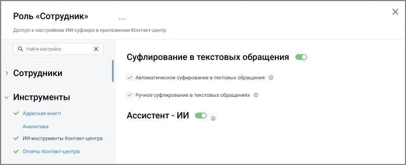

##### Доступ к ИИ-инструментам Контакт-центра

> Трассировка: PDF §4.6.3.3.6 · сквозные стр. 466-467 · источники: ч.2 `kb/sources/mango-lk-manual/LK_manual_v-125-281-566.pdf` с.186-187.

В настройках роли доступен раздел «ИИ-инструменты КЦ», который позволяет управлять доступом сотрудников с этой ролью к инструментам искусственного интеллекта в приложении Контакт-центр. Раздел отображается в настройках роли всегда, но становится активным только при наличии хотя бы одной из услуг «Суфлер- ИИ» или «Ассистент-ИИ», подключённых на тарифе. Если ни одна из услуг не подключена, раздел недоступен для настройки.

> **Описание иллюстрации LK-§4.6.3.3.6-1** (к §4.6.3.3.6 «Доступ к ИИ-инструментам Контакт-центра», стр. 467; 805×327 px). Снимок экрана / схема Личного кабинета.
> Относится к тексту руководства: «…ри наличии хотя бы одной из услуг «Суфлер- ИИ» или «Ассистент-ИИ», подключённых на тарифе. Если ни одна из услуг не подключена, раздел недоступен для настройки.».
> Текст на изображении (OCR, требует сверки): Роль «Сотрудник»; Дотсуп к настройкам ИИ-суфлера в приложении Контакт-центр; Ц, Найти настройку; Суфлирование в текстовых обращения GO; > Сотрудники; У Автоматическое суфирование в тектовых обращения @; У Ручное суфлирование в текстовых обращениях Ф; v Инструменты; М Адресная книгп; Ассистент - ИИ & »; Аналитика; У ИИ-инструменты Контакт-центра; VY Отчеты Контакт-центра

Внутри раздела доступны следующие настройки:

 Ассистент-ИИ — включает для роли доступ к ассистенту-ИИ, который отвечает на вопросы сотрудника на основании базы знаний компании.

 Суфлирование в текстовых обращениях (ручное) — включает для роли возможность самостоятельно запросить у суфлера-ИИ ответ по части или всей переписке с клиентом.

 Автоматическое суфлирование в текстовых обращениях — включает для роли автоматическое появление подсказок суфлера-ИИ во время переписки с клиентом. При включении этой настройки автоматически включается и ручное суфлирование; отключить ручное суфлирование при включённом автоматическом нельзя.

примечание

Каждая из настроек доступна только при подключённой на тарифе соответствующей услуге («Суфлер-ИИ» или «Ассистент-ИИ»).
