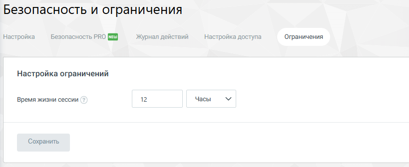

#### 4.6.3.4. Ограничения

> Трассировка: PDF §4.6.3.4 · сквозные стр. 468 · источники: ч.2 `kb/sources/mango-lk-manual/LK_manual_v-125-281-566.pdf` с.188.

На вкладке "Ограничения" пользователь может управлять временем жизни сессии в рамках системы. Эта настройка определяет, сколько времени сессия пользователя останется активной до автоматического выхода из системы по истечению указанного периода. Такая функция важна для обеспечения безопасности.

> **Описание иллюстрации LK-§4.6.3.4-1** (к §4.6.3.4 «Ограничения», стр. 468; 819×335 px). Снимок экрана / схема Личного кабинета.
> Относится к тексту руководства: «…и сессия пользователя останется активной до автоматического выхода из системы по истечению указанного периода. Такая функция важна для обеспечения безопасности.».
> Текст на изображении (OCR, требует сверки): Безопасность и ограничения; Настройка; Безопасность PRO (J; Журнал действий; Настройка доступа; Ограничения; Настройка ограничений; Часы; Время жизни сессии; 12; Сохранить

Время жизни сессии может быть настроено с минимальным интервалом в 5 минут и максимальным в 365 дней.

После задания необходимого интервала времени, необходимо сохранить изменения, нажав кнопку "Сохранить".
