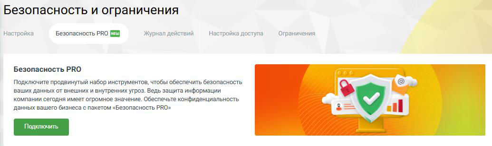

#### 4.6.3.5. Безопасность PRO

> Трассировка: PDF §4.6.3.5 · сквозные стр. 468-471 · источники: ч.2 `kb/sources/mango-lk-manual/LK_manual_v-125-281-566.pdf` с.188-191.

Безопасность PRO - это набор расширенных функций для защиты бизнеса. Вкладка предоставляет инструменты, которые снижают риски несанкционированного доступа, усиливают контроль за действиями сотрудников и повышают уровень защищённости персональных данных и бизнес-информации.

> **Описание иллюстрации LK-§4.6.3.5-1** (к §4.6.3.5 «Безопасность PRO», стр. 469; 1035×309 px). Снимок экрана / схема Личного кабинета.
> Относится к тексту руководства: «…нижают риски несанкционированного доступа, усиливают контроль за действиями сотрудников и повышают уровень защищённости персональных данных и бизнес-информации.».
> Текст на изображении (OCR, требует сверки): Безопасность и ограничения; Настройка; Безопасность PRO [I]; Журнал действий; Настройка доступа; Ограничения; Безопасность PRO; Подключите продвинутый набор инструментов, чтобы обеспечить безопасность; ‘ваших данных от внешних и внутренних угроз. Ведь защита информации; компании сегодня имеет огромное значение. Обеспечьте конфиденциальность; данных вашего бизнеса с пакетом «Безопасность PRO»; all

После подключения пакета Безопасность PRO доступны следующие настройки:

1) Двухфакторная аутентификация

Это защита "в два шага" — например, ввод пароля и код из SMS. Даже если кто-то узнает логин и пароль, без телефона он не войдёт. Можно выбрать, как именно подтверждать вход:

 Только через почту;  Только через SMS;  Или оба варианта сразу — для большей надёжности.

При выборе метода получения кода следует учесть, что отправка SMS является платной услугой и зависит от номера региона получателя.

внимание

Если у сотрудника нет доступа к почте или телефону, он не сможет войти в Личный кабинет.

2) Настройка сложности пароля для сотрудников

Интерфейс настройки сложности паролей для сотрудников позволяет задать параметры безопасности, которые будут применяться к новым паролям пользователей. Эти настройки не затрагивают текущие пароли сотрудников.

Доступны следующие настройки:

 Длина пароля: Устанавливается минимальная и максимальная длина пароля. Диапазон значений составляет от 8 до 128 символов.  Запретить спецсимволы: В этом поле можно указать символы, которые запрещено использовать в паролях.  Срок действия: Определяет период, на протяжении которого пароль будет действителен. До истечения указанного количества дней пароль необходимо сменить. Диапазон значений составляет от 1 до 365 дней. По умолчанию значение не ограничено. За 15 дней до срока истечения

пароля сотрудник получает уведомление о необходимости смены пароля.  Минимальный срок действия: Период, в течение которого после установки нового пароля его нельзя сменить повторно. Минимальное значение - 1 час. Значение параметра должно быть меньше «Срока действия пароля» минимум на 24 часа.  Журнал хранения: Устанавливает количество предыдущих паролей, которые не могут быть использованы повторно. Если значение установлено в 0, то журнал хранения паролей отключен.  Популярные пароли: Включение этой опции запрещает использование часто встречающихся паролей, чтобы повысить безопасность учетных записей.

3) Настройка доступа

Блок предназначен для ограничения или разрешения входа в личный кабинет ВАТС в зависимости от IP-адреса, с которого осуществляется авторизация. Администратору доступны следующие варианты настройки:

 Свободный доступ: При выборе данного варианта авторизация в личном кабинете разрешена с любых IP-адресов без дополнительных ограничений. Подходит для пользователей, которым необходим доступ к системе из разных сетей и местоположений, включая удалённую работу и мобильный доступ.  Безопасный доступ: При выборе данного варианта авторизация в личном кабинете разрешена только с указанных IP-адресов. Позволяет ограничить доступ к системе корпоративной сетью или доверенными адресами, что повышает уровень безопасности и снижает риск несанкционированного входа.

3) Журнал событий

Можно подключить отправку событий (например, кто входил в систему) через Syslog или API. Это удобно, если у вас есть система мониторинга или просто хотите видеть, что происходит.

Отключение пакета Безопасность PRO доступно в разделе управления дополнительными услугами.

> **Описание иллюстрации LK-§4.6.3.5-2** (к §4.6.3.5 «Безопасность PRO», стр. 470; 419×111 px). Снимок экрана / схема Личного кабинета.
> Относится к тексту руководства: «…Отключение пакета Безопасность PRO доступно в разделе управления дополнительными услугами.».
> Текст на изображении (OCR, требует сверки): Пакет информационной безопасности; Расширенный пакет безопасности; Отключить
