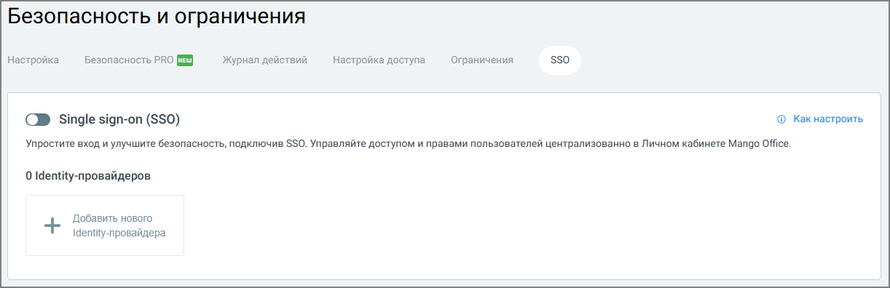

#### 4.6.3.5. SSO (Single Sign-On)

> Трассировка: PDF §4.6.3.5 · сквозные стр. 471-472 · источники: ч.2 `kb/sources/mango-lk-manual/LK_manual_v-125-281-566.pdf` с.191-192.

Вкладка SSO предназначена для настройки единого входа (Single Sign-On) в Личный кабинет ВАТС и продукты MANGO OFFICE с использованием внешнего identity- провайдера. Использование SSO позволяет централизованно управлять доступом пользователей и повысить уровень безопасности авторизации.

> **Описание иллюстрации LK-§4.6.3.5-1** (к §4.6.3.5 «SSO (Single Sign-On)», стр. 471; 1222×396 px). Снимок экрана / схема Личного кабинета.
> Относится к тексту руководства: «…ованием внешнего identity- провайдера. Использование SSO позволяет централизованно управлять доступом пользователей и повысить уровень безопасности авторизации.».
> Текст на изображении (OCR, требует сверки): Безопасность и ограничения; sso; Настройка; Безопасность PRO (i); Журнал действий; Настройка доступа; Ограничения; © Какнастроить,; С Single sign-on (SSO); 'Упростите вход и улучшите безопасность, подключив SSO. Управляйте доступом и правами пользователей централизованно в Личном кабинете Mango Office.; 0 Identity-nposaiigepoe; Добавить нового; 1епшу- провайдера

Для начала работы с SSO необходимо активировать переключатель Single sign-on (SSO). При первом включении отображается окно подтверждения подключения услуги с указанием её стоимости. Для продолжения требуется подтвердить подключение. Включение SSO позволяет пользователям входить в личный кабинет без ввода отдельных логина и пароля MANGO OFFICE, используя корпоративную учётную запись.

Identity-провайдеры

После подключения услуги администратор может добавить один или несколько identity- провайдеров, через которые будет выполняться авторизация. Для этого используется кнопка Добавить нового Identity-провайдера. Identity-провайдер определяет источник учётных данных пользователей (например, корпоративную систему аутентификации) и правила их проверки при входе.

При использовании SSO:

 авторизация пользователей выполняется через настроенный identity-провайдер;

 управление доступом и правами осуществляется централизованно;

 снижается риск использования слабых или скомпрометированных паролей.

Подробная пошаговая инструкция по настройке SSO доступна по информационной ссылке «Как настроить», размещённой в верхней правой части вкладки. Рекомендуется использовать данную инструкцию при первичной настройке или изменении параметров identity-провайдера.
