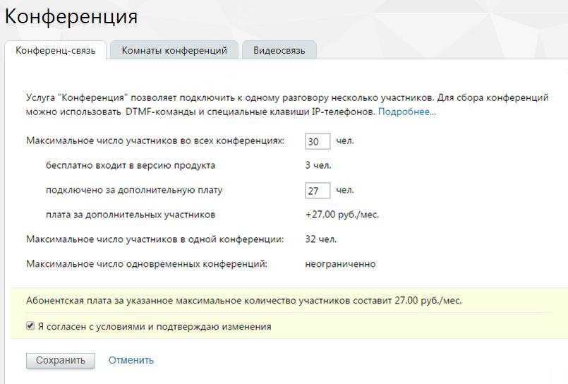

#### 4.6.4.1. Конференц-связь

> Трассировка: PDF §4.6.4.1 · сквозные стр. 472-473 · источники: ч.2 `kb/sources/mango-lk-manual/LK_manual_v-125-281-566.pdf` с.192-193.

Инструмент служит для управления количеством собеседников при конференциях. По умолчанию в одной конференции может участвовать до 8 человек, при подключении дополнительной услуги – 32.

Вы можете изменить количество участников конференции, которое бесплатно входит в версию продукта. Для этого введите новое число в поле «Максимальное число участников во всех конференциях». После ввода ниже вы увидите, сколько участников будет подключено дополнительно, а также стоимость их подключения.

> **Описание иллюстрации LK-§4.6.4.1-1** (к §4.6.4.1 «Конференц-связь», стр. 472; 805×544 px). Снимок экрана / схема Личного кабинета.
> Относится к тексту руководства: «…альное число участников во всех конференциях». После ввода ниже вы увидите, сколько участников будет подключено дополнительно, а также стоимость их подключения.».
> Текст на изображении (OCR, требует сверки): Конференция; Конференц-связь; Комнаты конференций; Видеосвязь; Услуга "Конференция" позволяет подключить к одному разговору несколько участников. Для сбора конференций; можно использовать ОТМЕ-команды и специальные клавиши 1Р-телефонов. Подробнее...; Максимальное число участников во всех конференциях:; 30; чел.; бесплатно входит в версию продукта; 3 чел.; подключено за дополнительную плату; 27; плата за дополнительных участников; +27,00 руб./мес.; 32 чел.; Максимальное число участников в одной конференции:; Максимальное число одновременных конференций:; неограниченно; Абонентская плата за указ…

Для сохранения изменений установите флаг «Я согласен с условиями и подтверждаю изменения» и нажмите Сохранить.

Команды для управления конференцией

Для создания нажмите # * или # # на клавиатуре телефона во время разговора, и Виртуальная АТС установит первого собеседника на удержание. Наберите номер следующего участника. Если он не отвечает — нажмите # # для возврата к разговору. При дозвоне до нужного номера нажмите # *. Конференция создана.

Для добавления нового участника нажмите # * или # #. Виртуальная АТС временно выводит вас из конференции. Далее выполняйте те же действия, что и при создании конференции.

Для выхода из режима конференции повесьте трубку телефона.

внимание

Если организатор конференции отключается, то конференция завершается для всех участников и вызовы завершаются.
