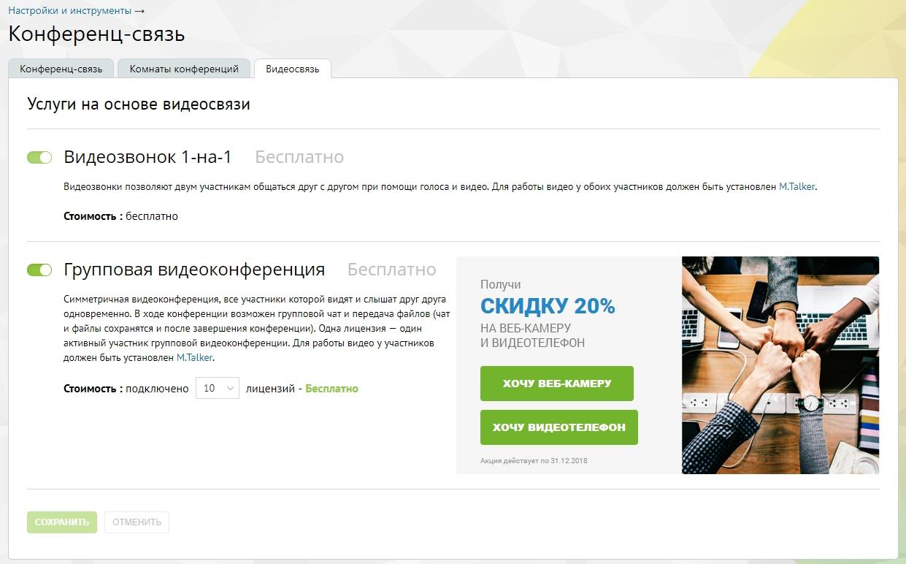

#### 4.6.4.3. Видеосвязь

> Трассировка: PDF §4.6.4.3 · сквозные стр. 475-477 · источники: ч.2 `kb/sources/mango-lk-manual/LK_manual_v-125-281-566.pdf` с.195-197.

Инструмент служит для управления услугами «Видеозвонки» и «Групповая видеоконференция».

> **Описание иллюстрации LK-§4.6.4.3-1** (к §4.6.4.3 «Видеосвязь», стр. 476; 1241×772 px). Снимок экрана / схема Личного кабинета.
> Относится к тексту руководства: «…Инструмент служит для управления услугами «Видеозвонки» и «Групповая видеоконференция».».
> Текст на изображении (OCR, требует сверки): Настройки и инструменты >; Конференц-связь; Комнаты конференций; Видеосвязь; Услуги на основе видеосвязи; Видеозвонок 1-Ha-1; Видеозвонки позволяют дум участникам общаться друг с другом при помощи голоса и видео. Для работы видео у обоих участников должен быть устеновлен M.Talker.; Стоимость : бесплатно; Групповая видеоконференция; Получи; Симметричная видеоконференция, все участники которой видят и слышат друг друга; СКИДКУ 20%; одновременно. В ходе конференции возможен групповой чат и передача файлов (чат; и файлы сохранятся и после завершения конференции). Одна лицензия — один; НА ВЕБ-КАМЕР…

Пользователям предлагаются следующие возможности:

 Видеозвонки 1-на-1 — общение двух участников. Услуга предоставляется бесплатно и не отключается.

 Групповая видеоконференция — симметричная видеоконференция, все участники которой видят и слышат друг друга одновременно. В ходе конференции возможен групповой чат и передача файлов (чат и файлы сохранятся и после завершения конференции). Максимальное число участников одной конференции зависит от количества подключенных лицензий, и не может превышать 100 человек. Услуга предоставляется бесплатно.

Внимание

Для работы видео у каждого из участников должен быть установлен M.Talker.

По умолчанию услуга «Групповая видеоконференция» отключена. Для подключения услуги следует установить переключатель в положение «Включено» и указать нужное количество лицензий. Впоследствии количество лицензий можно изменить.

Для сохранения изменений следует установить флаг «Я принимаю условия…» и нажать кнопку Сохранить.
