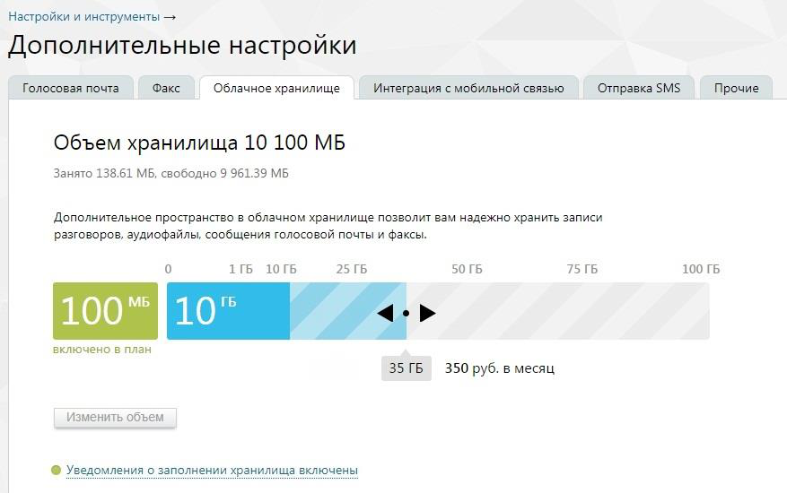
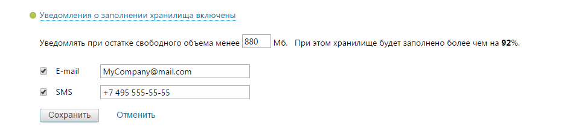
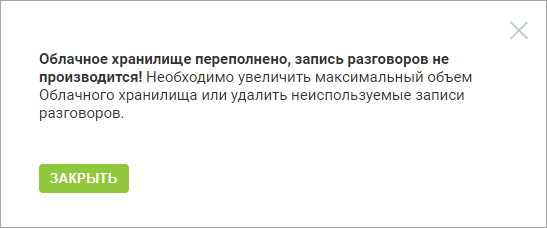
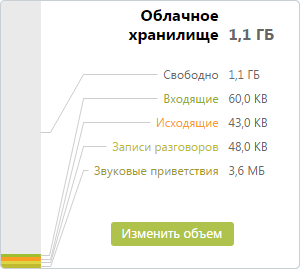

#### 4.6.5.2. Облачное хранилище

> Трассировка: PDF §4.6.5.2 · сквозные стр. 479-481 · источники: ч.2 `kb/sources/mango-lk-manual/LK_manual_v-125-281-566.pdf` с.199-201.

Виртуальная АТС хранит все данные (сообщения, записи разговоров, аудиофайлы) и настройки в защищенном персональном облачном хранилище, что позволяет не беспокоиться за их сохранность.

Бесплатно предоставляемый вам объем хранилища отображается на шкале зеленым цветом (см. рисунок ниже), дополнительно оплаченный — голубым.

Для изменения доступного пространства облачного хранилища переместите ползунок в нужное положение. При перетаскивании ползунка под ним отображаются текущий выбранный объем и стоимость ежемесячной абонентской платы за пользование хранилищем. Подтвердите операцию, нажав на кнопку «Изменить объем».

> **Описание иллюстрации LK-§4.6.5.2-1** (к §4.6.5.2 «Облачное хранилище», стр. 480; 877×550 px). Снимок экрана / схема Личного кабинета.
> Относится к тексту руководства: «…тображаются текущий выбранный объем и стоимость ежемесячной абонентской платы за пользование хранилищем. Подтвердите операцию, нажав на кнопку «Изменить объем».».
> Текст на изображении (OCR, требует сверки): Настройки и инструменты >; Дополн ительные настроики; Голосовая почта; Факс; Облачное хранилище; Интеграция с мобильной связью; Отправка SMS; Прочие; Объем хранилища 10 100 МБ; Занято 138.61 МБ, свободно 9 961.39 МБ; Дополнительное пространство в облачном хранилище позволит вам надежно хранить записи; разговоров, аудиофайлы, сообщения голосовой почты и факсы; 1 ГБ; 10 ГБ; 25 ГБ; 50 ГБ; 75 ГБ; 100 ГБ; 100”; no" gt; включено в план; 35 ГБ; 350 руб. в месяц; ъем

Для того, чтобы оперативно узнать о достижении критического объема облачного хранилища, щелкните по ссылке «Уведомления о заполнении хранилища включены» и включите отправку SMS-уведомлений установив соответствующий флаг. Отправка уведомлений на электронную почту включена по умолчанию.

> **Описание иллюстрации LK-§4.6.5.2-2** (к §4.6.5.2 «Облачное хранилище», стр. 480; 954×213 px). Снимок экрана / схема Личного кабинета.
> Относится к тексту руководства: «…олнении хранилища включены» и включите отправку SMS-уведомлений установив соответствующий флаг. Отправка уведомлений на электронную почту включена по умолчанию.».
> Текст на изображении (OCR, требует сверки): © Уведомления о заполнении хранилища включены; Уведомлять при остатке свободного объема менее 880 (Мб. При этом хранилище будет заполнено более чем на 92%.; Е-тай; MyCompany@mail.com; ‘SMS; +7495 555-55-55; Сохранить; `Отменить,

В случае, когда остаток свободного объема достигнет указанного критического значения и/или остаток составит 5 Мб, на заданный телефонный номер и/или электронный почтовый ящик будет автоматически отправлено соответствующее сообщение.

Также при достижении указанных значений при входе в Личный кабинет или при переходе на главную страницу на экране будет отображено сообщение вида:

> **Описание иллюстрации LK-§4.6.5.2-3** (к §4.6.5.2 «Облачное хранилище», стр. 481; 547×228 px). Снимок экрана / схема Личного кабинета.
> Относится к тексту руководства: «…Также при достижении указанных значений при входе в Личный кабинет или при переходе на главную страницу на экране будет отображено сообщение вида:».
> Текст на изображении (OCR, требует сверки): Облачное хранилище переполнено, запись разговоров не; производится! Необходимо увеличить максимальный объем; Облачного хранилища или удалить неиспользуемые записи; разговоров.

Информация об общем и свободном объеме хранилища дублируется при помощи виджета на главной странице текущего продукта ВАТС.

> **Описание иллюстрации LK-§4.6.5.2-4** (к §4.6.5.2 «Облачное хранилище», стр. 481; 300×269 px). Снимок экрана / схема Личного кабинета.
> Относится к тексту руководства: «…Информация об общем и свободном объеме хранилища дублируется при помощи виджета на главной странице текущего продукта ВАТС.».
> Текст на изображении (OCR, требует сверки): Облачное; хранилище; 1,1 ГБ; Свободно; Входящие; 60,0 КВ; Исходящие; 43,0 КВ; Записи разговоров; 48,0 KB; 3,6 MB; Звуковые приветствия

При подключении услуги «Перезаписывать самые старые звонки, если превышен объем хранилища» система автоматически будет заменять на новые звонки те записи, которые хранятся в архиве дольше всего, обеспечивая тем самым бесперебойную запись новых разговоров.
