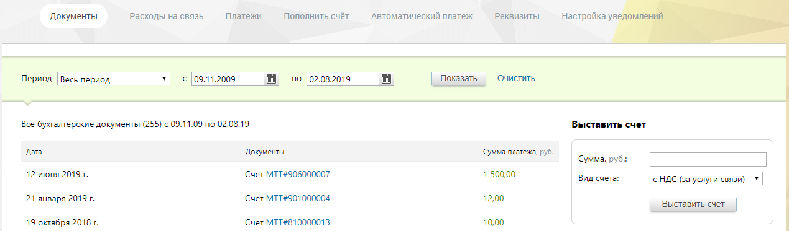

### 2.1.1. Просмотреть/загрузить бухгалтерские документы

> Трассировка: PDF §2.1.1 · сквозные стр. 28-29 · источники: ч.1 `kb/sources/mango-lk-manual/LK_manual_v-125-1-280.pdf` с.28-29.

Список «Период» позволяет установить вариант выбора дат (по умолчанию предлагается период «Произвольный»), нажав значок календаря, или ввести их в формате дд.мм.гггг в соответствующие поля. Кнопка «Очистить» возвращает к значению по умолчанию.

Кликнув по кнопке «Показать», вы загрузите бухгалтерские документы за указанный календарный период. Нажмите на название любого из них, и появится стандартное диалоговое окно браузера, позволяющее открыть или сохранить файл.

При наличии в инвойсах признака «Работать по УПД» (или «Формировать по форме УПД») в таблице отображаются Универсальные передаточные документы (УПД). Для получения более подробной информации об УПД щелкните ссылку «Что такое УПД и как с ним работать».

> **Описание иллюстрации LK-§2.1.1-1** (к §2.1.1 «Просмотреть/загрузить бухгалтерские документы», стр. 29; 1269×373 px). Снимок экрана / схема Личного кабинета.
> Относится к тексту руководства: «…е отображаются Универсальные передаточные документы (УПД). Для получения более подробной информации об УПД щелкните ссылку «Что такое УПД и как с ним работать».».
> Текст на изображении (OCR, требует сверки): Документы; Расходы на связь; Платежи; Пополнить счёт; ‘Автоматический платеж; Реквизиты; Настройка у; Период [Весь период; с [09.11.2009; по [02.08.2019; Показать | Очистить; Все бухгалтерские документы (255) с 09.11.09 по 02.08.19; Выставить счет; Дата; Сумма платежа, руб.; ‘Сумма, руб:; 12 июня 2019 г.; "Счет MTT#906000007; 1500,00; Вид счета:; < HAC (ва услуги связи); 21 января 2019 г.; "Счет MTT#901000004; 12,00; 19 октября 2018 г.; "Счет MTT#810000013; 10,00
