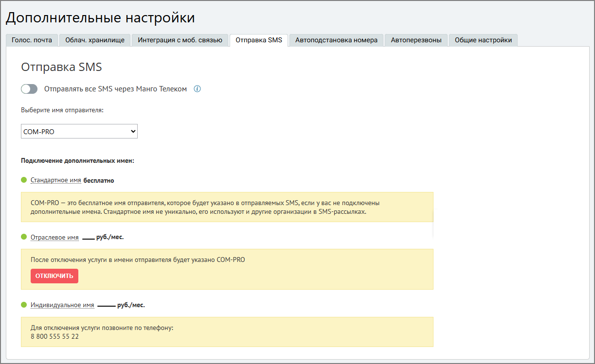
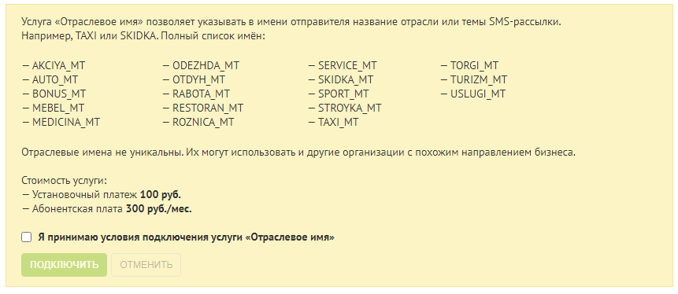

#### 4.6.5.4. Отправка SMS

> Трассировка: PDF §4.6.5.4 · сквозные стр. 482-485 · источники: ч.2 `kb/sources/mango-lk-manual/LK_manual_v-125-281-566.pdf` с.202-205.

Данная вкладка предназначена для редактирования имени отправителя SMS- сообщения, которое отображается у пользователя при получении SMS-сообщения.

Если тумблер "Отправлять все SMS через Манго Телеком" выключен, все исходящие SMS будут отправляться через оператора связи, номер которого указан в карточке сотрудника для исходящих звонков и сообщений.

> **Описание иллюстрации LK-§4.6.5.4-1** (к §4.6.5.4 «Отправка SMS», стр. 483; 1223×749 px). Снимок экрана / схема Личного кабинета.
> Относится к тексту руководства: «…го Телеком" выключен, все исходящие SMS будут отправляться через оператора связи, номер которого указан в карточке сотрудника для исходящих звонков и сообщений.».
> Текст на изображении (OCR, требует сверки): Допол нительные настрой ки; Голос. почта Облач. хранилище; Интеграция с моб. связью — Отправка SMS; Автоподстановка номера — Автоперезвоны; 'Общие настройки; Отправка SMS; (№ отправлять все SMS через Манго Телеком ®; Выберите имя отправителя:; СОМ-РВО; Подключение дополнительных имен:; © стандартное имя бесплатно; СЕроишаритииииотииииьими"; ® Отраслевое имя —— руб./мес.; отключить; © Индивидуальное имя; руб/мес.; тит

По умолчанию установлено стандартное имя отправителя (COM-PRO).

При выборе имени отправителя названия в выпадающем списке сгруппированы по трем категориям: Стандартное имя, Отраслевое имя, Индивидуальное имя.

Если у клиента подключена услуга «Отраслевое имя» или «Уникальное имя отправителя SMS», в верхней части вкладки отображается уведомление: «Выберите стандартное или индивидуальное имя — сообщения с отраслевым именем часто не доходят из-за блокировки со стороны операторов».

внимание

С 22 июля 2026 года услуга «Отраслевое имя» закрыта для нового подключения — сообщения с отраслевым именем часто не доходят из-за блокировки со стороны операторов связи. Если услуга была подключена до 22 июля 2026 года, она продолжит работать. Чтобы отправлять SMS дальше, выберите стандартное или индивидуальное имя отправителя.

Выбор отраслевого имени

Категорийное (отраслевое) имя отправителя SMS-сообщения указывается из списка. Отраслевое имя не является уникальным: его могут использовать организации, направление деятельности которых примерно совпадает с вашим.

> **Описание иллюстрации LK-§4.6.5.4-2** (к §4.6.5.4 «Отправка SMS», стр. 484; 861×374 px). Снимок экрана / схема Личного кабинета.
> Относится к тексту руководства: «…я указывается из списка. Отраслевое имя не является уникальным: его могут использовать организации, направление деятельности которых примерно совпадает с вашим.».
> Текст на изображении (OCR, требует сверки): Услуга «Отраслевое имя» позволяет указывать в имени отправителя название отрасли или темы $М5-рассылки.; Например, TAX! или SKIDKA. Полный список имён:; — AKCIYA_MT; — ODEZHDA_MT; — SERVICE_MT; — TORGI_MT; — AUTO_MT; — ОТОУН_ МТ; — SKIDKA_MT; — TURIZM_MT; — BONUS MT; — RABOTA MT; — SPORT_MT; — USLUGI_MT; — MEBEL_MT; — RESTORAN_MT; — STROYKA_MT; — MEDICINA MT; — ROZNICA_MT; — TAXI_MT; Отраслевые имена не уникальны. Их могут использовать и другие организации с похожим направлением бизнеса; Стоимость услуги:; — Установочный платеж 100 руб.; — Абонентская плата 300 руб./мес.; ( Я принимаю условия …

Если услуга подключена, выберите из выпадающего списка подходящее отраслевое имя отправителя и сохраните изменения кнопкой Сохранить.

Услуга доступна только тем клиентам, у которых она уже была подключена до 22 июля 2026 года. Новое подключение услуги недоступно.

При отключении услуги отображается предупреждение: «Услуга закрыта для подключения — сообщения с отраслевым именем часто не доходят из-за блокировки со стороны операторов. Если вы подключили услугу до 22 июля 2026 года, она продолжит работать». После отключения имя отправителя меняется на стандартное, повторно подключить услугу «Отраслевое имя» невозможно. Об успешном отключении услуги сообщает всплывающее уведомление в правом верхнем углу экрана.

Выбор уникального имени

Уникальное имя – индивидуальное имя SMS-отправителя. Возможность использования уникального имени должна быть согласована с сотрудником компании Mango Telecom.

Для выбора уникального имени выполните действия:

 Щелкните по строке «Уникальное имя отправителя SMS»

 Скачайте и заполните шаблоны документов;

 Нажмите Создать заявку;

Далее необходимо заполнить заявку на подключение уникального имени отправителя в SMS. Для этого:

 Укажите имя отправителя в SMS (латинские буквы, не более 11 символов);

 Укажите контактное лицо;

 Приложите заполненные документы. Для этого в каждом поле поочередно нажмите Обзор и укажите путь к соответствующим документам. Кроме официального письма и заявления, вам потребуется приложить скан свидетельства о регистрации компании, доменного имени или товарного знака – в зависимости от выбранного имени.

 Ознакомьтесь с условиями подключения, установите флаг «Я принимаю…»;

 Нажмите Отправить.

Далее заявка будет рассмотрена сотрудником компании Mango Telecom. В процессе рассмотрения заявки пиктограмма напротив имени услуги будет оранжевого цвета.

В случае успешного согласования нового имени с SMS-агрегатором услуга будет подключена, о чем будет сигнализировать зеленая пиктограмма напротив названия услуги. Для смены имени отправителя выберите соответствующее имя из выпадающего списка и нажмите Сохранить.

Если согласовать имя не удалось, вы получите соответствующее оповещение. В таком случае следует либо повторить процесс, указав новое имя, либо остановить его.

При повторном изменении индивидуального имени допускается прикрепление ранее заполненных документов при условии, что значения реквизитов не изменились.

У меня уже есть зарегистрированное имя

Если у вас есть индивидуальное имя, согласованное с операторами связи через другой сервис, и которое вы хотите использовать в данном сервисе, то вам следует:

1. расторгнуть договор с сервисом;

2. отправить заявку в MANGO OFFICE, приложив необходимые документы.
