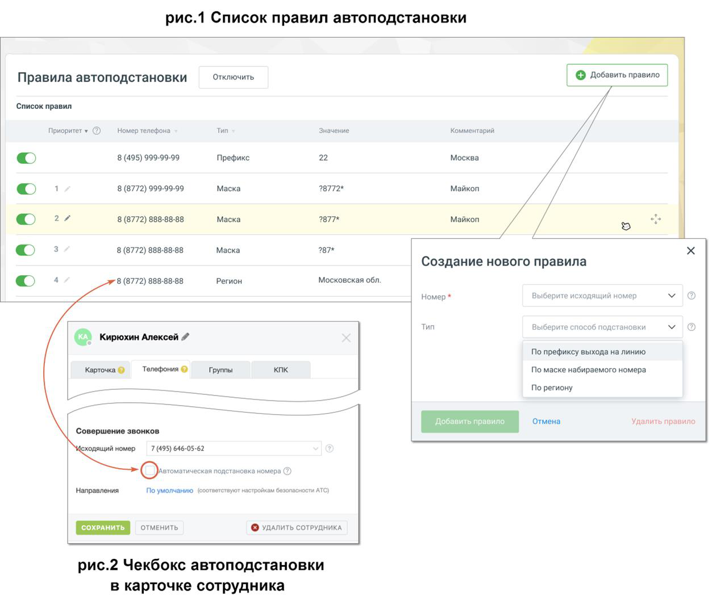

#### 4.6.5.5. Автоподстановка номера

> Трассировка: PDF §4.6.5.5 · сквозные стр. 485-487 · источники: ч.2 `kb/sources/mango-lk-manual/LK_manual_v-125-281-566.pdf` с.205-207.

Данная вкладка позволяет настроить правила подстановки номеров и совершать исходящие звонки с номера того региона, куда совершается звонок, независимо от месторасположения оператора.

После ознакомления с условиями подключения услуги, нажмите кнопку Подключить.

На вкладке размещается список существующих правил автоподстановки. Добавьте новое правило автоподстановки номера, кликнув по кнопке добавить правило.

В открывшемся окне выберите:

 Исходящий номер - выбирается из списка доступных сотруднику номеров, подключенных к ВАТС;  Тип – способ подставновки: по префиксу, по маске, по региону.

> **Описание иллюстрации LK-§4.6.5.5-1** (к §4.6.5.5 «Автоподстановка номера», стр. 485; 18×24 px). Пиктограмма (значок элемента интерфейса).
> Относится к тексту руководства: «… Исходящий номер - выбирается из списка доступных сотруднику номеров, подключенных к ВАТС;  Тип – способ подставновки: по префиксу, по маске, по региону.».
> Текста на изображении нет; назначение значка — см. текст, к которому он относится.

 Префикс, маска, регион - Нажав на пиктограмму ознакомьтесь с пояснениями к каждому из вариантов, и введите необходимые данные.  Комментарий – добавьте комментарий для данного правила. Окно не является обязательным для заполнения.

> **Описание иллюстрации LK-§4.6.5.5-2** (к §4.6.5.5 «Автоподстановка номера», стр. 486; 1253×1068 px). Снимок экрана / схема Личного кабинета.
> Относится к тексту руководства: «…ми к каждому из вариантов, и введите необходимые данные.  Комментарий – добавьте комментарий для данного правила. Окно не является обязательным для заполнения.».
> Текст на изображении (OCR, требует сверки): рис.1 Список правил автоподстановки; Правила автоподстановки; ‘Отключить; Добавить правило; Список правил; Тип; Значение; Комментарий; Приоритет » @; Homep телефона; 22; Mockea; 8 (495) 99-99-99; Префикс; 8 (8772) 999-99-99; Маска; 28772*; Майкоп; 27; 8 (8772) 888-88-88; 'Маска; 2877*; ` Майкоп; Macka; 287*; Создание нового правила; Регион; Московская обл.; Номер *; е исходящий +; номер; Выберите способ подстановки; @ Кирюхин Алексей #; По префиксу выхода на линию; Карточка ©; Телефония ©; Группы; кпк; По маске Ha6upaemoro номера; По региону; 'Отмена; Удалить правиле; ‘Совершение звонков; ‹одя…

Если один и тот же номер подпадет под несколько разных масок или же входит в регион и удовлетворяет маске, то в качестве исходящего, будет использован номер, находящийся выше в списке приоритета. Изменить приоритет можно, нажав на

> **Описание иллюстрации LK-§4.6.5.5-3** (к §4.6.5.5 «Автоподстановка номера», стр. 486; 26×26 px). Пиктограмма (значок элемента интерфейса).
> Относится к тексту руководства: «…одит в регион и удовлетворяет маске, то в качестве исходящего, будет использован номер, находящийся выше в списке приоритета. Изменить приоритет можно, нажав на».
> Текста на изображении нет; назначение значка — см. текст, к которому он относится.

пиктограмму правила левой кнопкой мыши и переместив его вверх. Правила с типом «префикс» не имеют приоритета.

Пример 1. Настройки правил с типом «маска».

7495\d* - правилу удовлетворяют все номера, начинающиеся с 7495;

5\d{7} - правилу удовлетворяет любой 11- значный номер, начинающийся с 7495;

7495\d*|7499\d* - правилу удовлетворяют все номера, начинающиеся с 7495 или 7499;

7495[5-6][5-6][5-6][5-6][5-6][5-6] - правилу удовлетворяют все номера, в диапазоне от 7495-55-55-55 до 7495-66-66-66.

Пример 2. Переводы вызова.

При переводах вызова сотрудник А, у которого включена автоподстановка АОН (Автоматическое Определение Номера) звонит сотруднику Б. Сотрудник Б переводит вызов на внешний региональный номер. При переводе линия подменяется на линию, соответствующую внешнему региону. Аналогично при переадресации по типу «маска».
