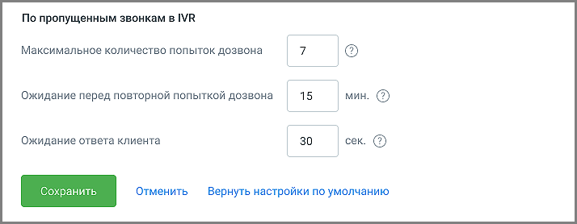

#### 4.6.5.6. Автоперезвон

> Трассировка: PDF §4.6.5.6 · сквозные стр. 487-488 · источники: ч.2 `kb/sources/mango-lk-manual/LK_manual_v-125-281-566.pdf` с.207-208.

Инструмент служит для настройки автоматического перезвона по пропущенным звонкам.

Вкладка отображается, если в разделе «Управление услугами» Личного кабинета подключена услуга Автоперезвон по пропущенным звонкам.

> **Описание иллюстрации LK-§4.6.5.6-1** (к §4.6.5.6 «Автоперезвон», стр. 487; 787×252 px). Снимок экрана / схема Личного кабинета.
> Относится к тексту руководства: «…Вкладка отображается, если в разделе «Управление услугами» Личного кабинета подключена услуга Автоперезвон по пропущенным звонкам.».
> Текст на изображении (OCR, требует сверки): Автоматический перезвон по пропущенным звонкам —кикнастроить м; По пропущенным звонкам в группе; Максимальное количество попыток дозвона; Ожидание перед повторной попыткой дозвона; 15; Ожидание ответа клиента; 30

На вкладке доступны следующие настройки:

По пропущенным звонкам в группе

 Максимальное количество попыток дозвона – не более 10 попыток.  Ожидание перед повторной попыткой дозвона – не менее 60 секунд.  Ожидание ответа клиента – не более 60 секунд. Попытка дозвона завершается, если клиент не ответил на звонок в течение указанного времени.

Установленные значения меняются в настройках ЛК ВАТС, применяются ко всем группам, в настройках которых установлен чекбокс Автоперезвон, и являются одинаковыми для каждого из сценариев ответа абонента: номер занят, абонент не берёт трубку и номер абонента не доступен.

> **Описание иллюстрации LK-§4.6.5.6-2** (к §4.6.5.6 «Автоперезвон», стр. 488; 714×278 px). Снимок экрана / схема Личного кабинета.
> Относится к тексту руководства: «…новлен чекбокс Автоперезвон, и являются одинаковыми для каждого из сценариев ответа абонента: номер занят, абонент не берёт трубку и номер абонента не доступен.».
> Текст на изображении (OCR, требует сверки): По пропущенным звонкам в IVR; Максимальное количество попыток дозвона; Ожидание перед повторной попыткой дозвона; 15; Ожидание ответа клиента; 30; Отменить — Вернуть настройки по умолчанию

По пропущенным звонкам в IVR

 Максимальное количество попыток дозвона – не более 10 попыток.  Ожидание перед повторной попыткой дозвона – не менее 60 секунд.  Ожидание ответа клиента – не более 60 секунд. Попытка дозвона завершается, если клиент не ответил на звонок в течение указанного времени.

Общие настройки

 Попытки дозвона прекращаются через – если перезвон не был осуществлён сотрудником в установленное время, задача на перезвон становится неактуальной и удаляется, чтобы не перезванивать по пропущенным вызовам слишком поздно, когда вопрос уже теряет свою актуальность.

> **Описание иллюстрации LK-§4.6.5.6-3** (к §4.6.5.6 «Автоперезвон», стр. 488; 882×156 px). Снимок экрана / схема Личного кабинета.
> Относится к тексту руководства: «…задача на перезвон становится неактуальной и удаляется, чтобы не перезванивать по пропущенным вызовам слишком поздно, когда вопрос уже теряет свою актуальность.».
> Текст на изображении (OCR, требует сверки): Общие настройки; Попытки дозвона прекращаются через

Установленные значения меняются в настройках ЛК ВАТС, применяются к IVR, если в настройках схемы распределеления установлен чекбокс Автоперезвон, и являются одинаковыми для каждого из сценариев ответа абонента: номер занят, абонент не берёт трубку и номер абонента не доступен.
