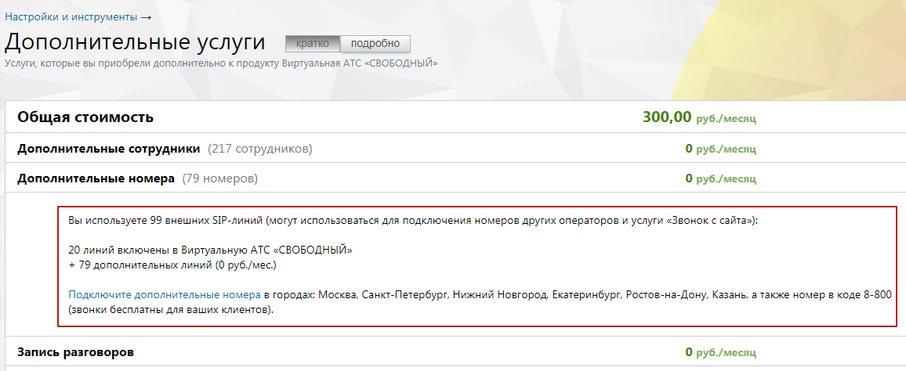

### 4.6.6. Управление услугами

> Трассировка: PDF §4.6.6 · сквозные стр. 489-491 · источники: ч.2 `kb/sources/mango-lk-manual/LK_manual_v-125-281-566.pdf` с.209-211.

Инструмент служит для агрегации информации о всех отдельно подключенных услугах (не входящих в текущую версию продукта) и быстрого перехода к управлению ими).

Пользователю доступен следующий набор услуг:

 Дополнительные сотрудники

 Дополнительные номера

 Автоматическая подстановка АОН

 Мультиканальные виджеты

 Личный автосекретарь

 Распознавание речи в голосовом меню

 Возможность загрузки собственных мелодий и голосовых сообщений

 Автоперезвон по пропущенным звонкам

 Запись разговоров

 Пакет «Мониторинг»

 Алгоритмы распределения звонков в группе

 Облачное хранилище

 Автоинформатор о времени до ответа оператора

 Автоинформатор о номере в очереди

 Переадресация по номеру клиента

 Виджет «Звонок на сайте»

 Виджет «Обратный звонок»

 Многоуровневое голосовое меню

 Групповая видеоконференция

 Речевая аналитика

 Отраслевое имя

 Голосовое сообщение при входящем звонке

 Автоматическая отправка файла на E-mail

 Подключение внешнего SIP-номера

 Способы дозвона

 Комнаты конференций

 Интеграции

> **Описание иллюстрации LK-§4.6.6-1** (к §4.6.6 «Управление услугами», стр. 490; 1156×474 px). Снимок экрана / схема Личного кабинета.
> Относится к тексту руководства: «… Интеграции».
> Текст на изображении (OCR, требует сверки): Настройки и инструменты —; Дополнительные услуги; подробно; Услуги, которые вы приобрели дополнительно к продукту Виртуальная АТС «СВОБОДНЫЙ»; Общая стоимость; 300,00 руб./месяц,; Дополнительные сотрудники (217 сотрудникое); 0 руб./месяц; Дополнительные номера (79 номерое); Вы используете 99 внешних 5Р-линий (могут использоваться для подключения номеров других операторов и услуги «Звонок с сайта»):; 20 линий включены в Виртуальную АТС «СВОБОДНЫЙ»; + 79 дополнительных линий (0 руб./мес); Подключите дополнительные номера в городах: Москва, Санкт-Петербург, Нижний Новгород, Екатеринбург, Ростов-н…

Чтобы подробнее ознакомиться с условиями подключения той или иной услуги, щелкните левой кнопкой мыши по наименованию услуги.

внимание

Инструмент доступен только для администратора Лицевого счета и пользователей с правом доступа «Администратор».

Если в списке более двух услуг, то автоматически включается режим краткого описания. Для получения более подробной информации нажмите соответствующую кнопку. Узнать больше о конкретной услуге и перейти к ее настройке можно кликнув по строке с ее названием.

внимание

С 22 июля 2026 года услуга «Отраслевое имя» закрыта для нового подключения — в описании услуги отображается надпись «С 22 июля 2026 года услуга закрыта для подключения». Подробнее о выборе имени отправителя SMS см. в разделе «Дополнительные настройки → Отправка SMS».

Ниже отображается информационный блок с описанием и возможностью быстрого подключения других услуг. С их помощью существенно расширяются возможности, предоставляемые в рамках выбранного продукта.
