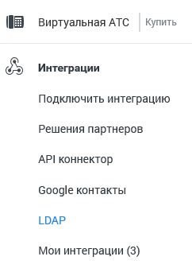

### 4.6.7. Интеграции

> Трассировка: PDF §4.6.7 · сквозные стр. 491-492 · источники: ч.2 `kb/sources/mango-lk-manual/LK_manual_v-125-281-566.pdf` с.211-212.

Данный инструмент предназначен для интеграции ВАТС со сторонними CRM- системами, облачными сервисами, бизнес-приложениями, базами данных и иными программными разработками.

Интеграция ВАТС позволяет:

 Повысить эффективность работы сотрудников;

 Позвонить клиенту в один клик;

 Предоставить информацию о клиенте до или во время звонка;

 Получить полную историю взаимодействия с клиентами;

 Повысить лояльность клиентов и снизить время их ожидания;

 Настроить автоматическое распределение звонков по ответственным сотрудникам.

 Получить инструмент работы с записями разговоров;

 Осуществлять импорт данных и формировать отчеты.

> **Описание иллюстрации LK-§4.6.7-1** (к §4.6.7 «Интеграции», стр. 491; 37×31 px). Пиктограмма (значок элемента интерфейса).
> Относится к тексту руководства: «… Осуществлять импорт данных и формировать отчеты.».
> Текста на изображении нет; назначение значка — см. текст, к которому он относится.

Зайдите в раздел, нажав на иконку в боковом меню Личного кабинета.

> **Описание иллюстрации LK-§4.6.7-2** (к §4.6.7 «Интеграции», стр. 492; 242×347 px). Снимок экрана / схема Личного кабинета.
> Относится к тексту руководства: «…Зайдите в раздел, нажав на иконку в боковом меню Личного кабинета.».
> Текст на изображении (OCR, требует сверки): {виртуальная АТС; Купить; & Интеграции; Подключить интеграцию; Решения партнеров; АР! коннектор; Google контакты; LDAP; Мои интеграции (3)
