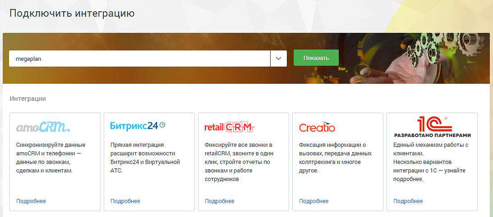
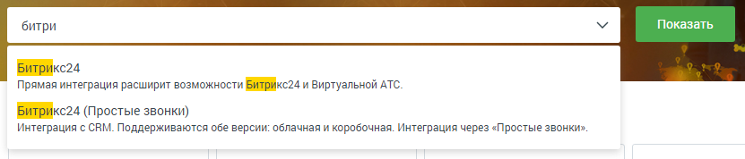
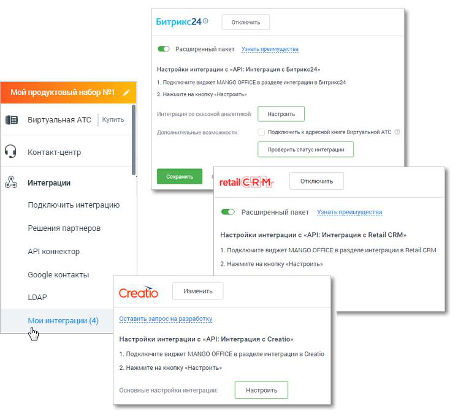
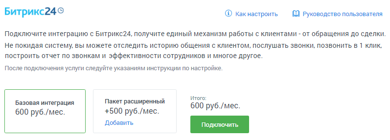
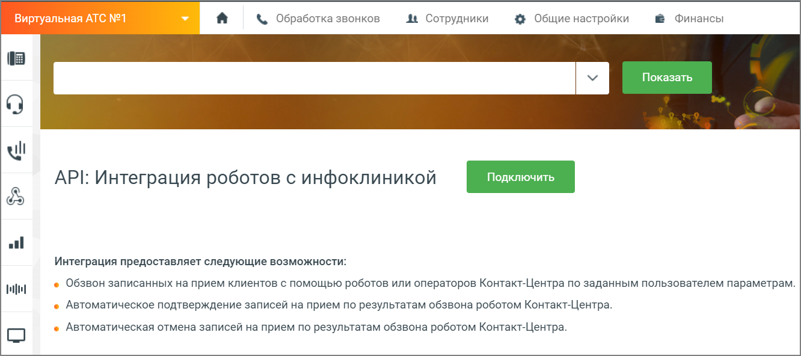
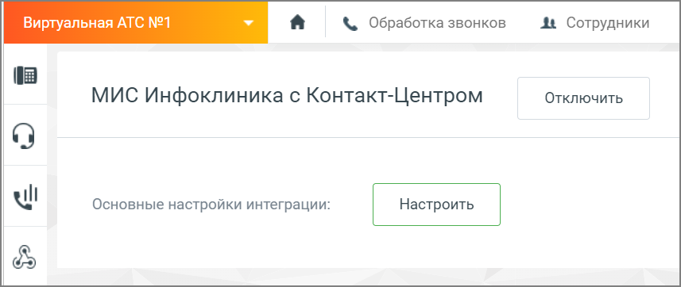
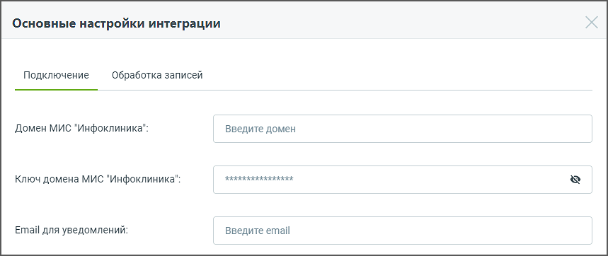
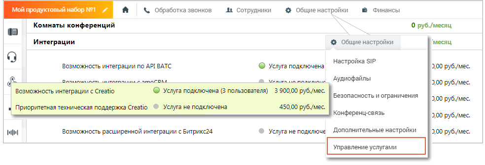
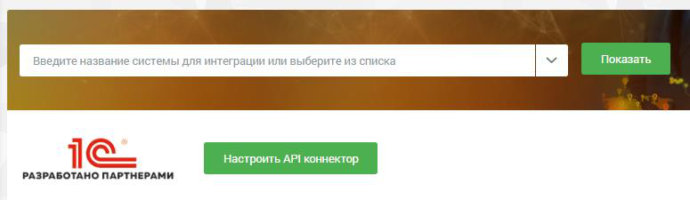
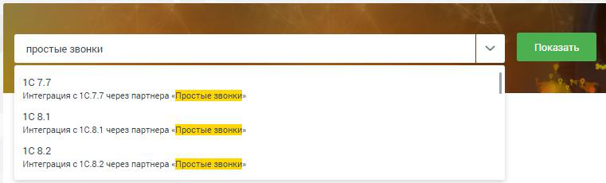

#### 4.6.7.1. Подключить интеграцию

> Трассировка: PDF §4.6.7.1 · сквозные стр. 492-500 · источники: ч.2 `kb/sources/mango-lk-manual/LK_manual_v-125-281-566.pdf` с.212-220.

После перехода в подраздел Подключить интеграцию откроется список из 5-ти наиболее распространенных систем. Для просмотра полного списка кликайте по ссылке «Показать еще 10» в правом нижнем углу окна.

> **Описание иллюстрации LK-§4.6.7.1-1** (к §4.6.7.1 «Подключить интеграцию», стр. 492; 1093×482 px). Снимок экрана / схема Личного кабинета.
> Относится к тексту руководства: «…теграцию откроется список из 5-ти наиболее распространенных систем. Для просмотра полного списка кликайте по ссылке «Показать еще 10» в правом нижнем углу окна.».
> Текст на изображении (OCR, требует сверки): Подключ ить интеграцию; сы; Ad; Показать,; |. РРРРРЕЕЕРИ; ug; интеграции; CRM.; ButpuKc24°; retail€;R|M; Creatio; 1c; РАЗРАБОТАНО ПАРТНЕРАМИ; ‘Синхронизируйте данные; Прямая интеграция; ‘Фиксируйте все звонки в; ‘Фиксация информации о; ЕДИНЫЙ механизм работы с; amoCRM и телефонии —; расширит возможности; retailCRM, звоните в один.; вызовах, передача данных; клиентами.; данные по звонкам,; Битрикс24 и Виртуальной; клик, стройте отчеты по; коллтрекинга и многое; Несколько вариантов; сделкам и клиентам,; АТС.; ‘звонкам и работе; другое.; интеграции с1б — узнайте; сотрудников; подробнее.; Подробне…

Пользователю доступны следующие варианты подключения:

 amoCRM, Битрикс24 – «базовый» и «базовый плюс расширенный» варианты прямой интеграции с MANGO OFFICE;

 1С, Yсlients, Мегаплан – интеграция с MANGO OFFICЕ с использованием API- коннектор;

 RetailCRM, ftp, Яндекс Диск, IDENT, Creatio, МИС Инфоклиника - прямая интеграция с MANGO OFFICЕ;

 1С 7.7, 1С 8.1, 1C 8.2, 1C 8.3, 1C 8.5, А2B, A&A Клуб, Бизнес.Ру, MS Access, ActiveX компонент, Baseplan, BPMSoft, Beauty Expert, CryptoCRM, Домопульт, Салоны Онлайн (Sonline), Умное ЖКХ, Excel, FrontPad, ITSM 365, JavaScript библиотека, Nemo.Travel, Okdesk, Orderino, Outlook, Pyrus, Партнер:Магазин, Ramex, Real Estate CRM, RoboMed, Simpla, Sycret , U-ON Travel, Universe SOFT, YCLIENTS, АРК Риелтор компании ТИСА, Арника, Инфо-Предприятие, ITSM365, МоиДокументы, МоиТуристы, Мой Класс, МойСклад, Омега-Плюс, Юздеск – интеграция через «Простые звонки».

Предусмотрен быстрый поиск в списке интеграций – по наименованию и описанию:

> **Описание иллюстрации LK-§4.6.7.1-2** (к §4.6.7.1 «Подключить интеграцию», стр. 493; 831×178 px). Снимок экрана / схема Личного кабинета.
> Относится к тексту руководства: «…Предусмотрен быстрый поиск в списке интеграций – по наименованию и описанию:».
> Текст на изображении (OCR, требует сверки): Показать; БитрИкс24; Прямая интеграция расширит возможности БитрИкс24 и Виртуальной АТС.; Битрикс24 (Простые звонки); Интеграция с СВМ. Поддерживаются обе версии: облачная и коробочная. Интеграция через «Простые звонки».

внимание

Для интеграции с использованием API-коннектора должна быть включена услуга «Возможность использовать API-коннектор»

Подключенные интеграции размещаются во вкладке Мои интеграции бокового меню. Там же можно изменить настройки, проверить статус, подключить к Адресной книге ВАТС, отключить интеграцию и др. возможности.

> **Описание иллюстрации LK-§4.6.7.1-3** (к §4.6.7.1 «Подключить интеграцию», стр. 494; 747×681 px). Снимок экрана / схема Личного кабинета.
> Относится к тексту руководства: «…ладке Мои интеграции бокового меню. Там же можно изменить настройки, проверить статус, подключить к Адресной книге ВАТС, отключить интеграцию и др. возможности.».
> Текст на изображении (OCR, требует сверки): Отключить; Битрикс249; &) Расширенный пакет; Узнать; Настройки интеграции с «API: Интеграция с Битрикс24»; 1, Подключите виджет MANGO OFFICE в разделе интеграции в битрихс24; 1B; и набх; #21; 2. Нажмите на кнопку «Настроить»; Купить; Интеграция со схвозной аналитикой | Настроить; 189 виртуальная АТС; Дополнительные возможиюсти; Подключить к адресной книге Виртуальной АТС; ie) Контакт-центр; Проверить статус интепрации; 4 Интеграции; Подключить интеграцию; «> Расширенный пакет; Решения партнеров; Настройки интеграции с «API: Интеграция с Retail CRM»; АР! коннектор; 1. Подключите виджет MANGO OF…

В блоке Для крупных клиентов размещаются:

 API коннектор

 Google контакты

 Подключение по LDAP

 Вебхуки

внимание

Доступ к функционалу инструментов регулируется настройками ролей пользователей на странице «Безопасность и ограничения». По умолчанию,

производить настройки функционала API ВАТС и подключать интеграции могут пользователи с ролью Администратор.

Выберите систему и нажмите кнопку Подробнее. В открывшемся окне ознакомьтесь с возможностями системы. Далее следуйте инструкции по настройке, приведенной в Руководстве пользователя.

amoCRM и Битрикс24

Для подключения интеграции с amoCRM или Битрикс24 следует выбрать тип интеграции. Просмотрите карточки возможностей, кликнув по иконке возможности левой кнопкой мыши. Выберите базовый либо расширенный тип и нажмите кнопку «Подключить».

> **Описание иллюстрации LK-§4.6.7.1-4** (к §4.6.7.1 «Подключить интеграцию», стр. 495; 797×287 px). Снимок экрана / схема Личного кабинета.
> Относится к тексту руководства: «…рации. Просмотрите карточки возможностей, кликнув по иконке возможности левой кнопкой мыши. Выберите базовый либо расширенный тип и нажмите кнопку «Подключить».».
> Текст на изображении (OCR, требует сверки): Битрикс24; @ как настроить; Ш Руководство пользователя; Подключите интеграцию с Битрикс24, получите единый механизм работы с клиентами - от обращения до сделки; Не покидая систему, вы можете отследить историю общения с клиентом, послушать звонки, позвонить в 1 клик,; построить отчет по звонкам и эффективности сотрудников и многое другое.; После подключения услуги следуйте указаниям инструкции по настройке.; Итого:; Базовая интеграция; Пакет расширенный; 600 руб./мес.; +500 руб./мес.; Добавить

В дополнение к возможностям базового типа, расширенный тип интеграции позволяет в том числе:

 видеть канал рекламной кампании, по которому обратился клиент при помощи utm-меток динамического коллтрекинга в карточке звонка;

 видеть название компании клиента благодаря интеграции с желтыми страницами;

 анализировать количество звонков, которое теряется на группах сотрудников и голосовом меню;

 работать с информацией о контактах из адресных книг продуктов MANGO OFFICE Виртуальной АТС Контакт-центра и Mango Talker;

 отслеживать все пропущенные звонки

 анализ разговоров с клиентами при помощи сервиса речевой аналитики MANGO OFFICE.

 и др.

При выборе расширенного типа дополнительно отображается настройка подключения CRM-системы к адресной книге Виртуальной АТС. При подключении автоматически выполняется синхронизация адресной книги Виртуальной АТС и CRM-системы.

внимание

Подключение интеграции ВАТС и каждой из CRM-систем является платной услугой. Для её подключения ознакомьтесь с условиями и установите флаг «Я принимаю условия подключения услуги».

В результате для подключенной CRM-системы осуществляется генерация уникального кода ВАТС и ключа для создания подписи. При необходимости допускается генерация нового кода и ключа посредством нажатия ссылки «Сгенерировать новый код и ключ».

Действия по настройке интеграции CRM-системы и ВАТС приведены в инструкции по настройке для каждой CRM-системы. Для перехода к инструкции следует нажать на ссылку «Как настроить» напротив наименования CRM-системы.

MANGO Диалоги в Битрикс24

Виджет позволяет подключить интеграцию MANGO Диалоги (МД) с Битрикс24 для обмена сообщениями и файлами в Max, Telegram, WhatsApp и онлайн-чате в интерфейсе Битрикс24.

Интеграция позволяет централизованно принимать обращения клиентов из различных текстовых каналов и обрабатывать их в Битрикс24 вручную или автоматически. После подключения пользователь может:

 принимать сообщения клиентов из мессенджеров и социальных сетей напрямую в Битрикс24;

 автоматически создавать контакт при обращении нового клиента;

 привязывать переписку к уже существующему контакту, его сделкам или лидам;

 сохранять полную историю общения с клиентом в одном окне;

 обеспечивать непрерывность коммуникации независимо от канала обращения.

Чтобы подключить интеграцию, найдите виджет MANGO Диалоги в разделе Подключить интеграцию и нажмите кнопку Подробнее.

МИС Инфоклиника

После настройки интеграции с «МИС Инфоклиника» медицинские компании, использующие в работе ПО «Инфоклиника», могут настроить взаимодействие ПО MANGO Office со своей системой.

После настройки интеграции автоматизации подлежат следующие действия:

 Обзвон записанных на прием клиентов с помощью роботов или операторов Контакт-Центра по заданным пользователем параметрам;  Автоматическое подтверждение записей на прием по результатам обзвона роботом Контакт-Центра;  Автоматическая отмена записей на прием по результатам обзвона роботом Контакт-Центра.

Для интеграции с «МИС Инфоклиника» нажмите кнопку Подключить рядом с описанием CRM-системы.

> **Описание иллюстрации LK-§4.6.7.1-5** (к §4.6.7.1 «Подключить интеграцию», стр. 497; 1332×592 px). Снимок экрана / схема Личного кабинета.
> Относится к тексту руководства: «…Для интеграции с «МИС Инфоклиника» нажмите кнопку Подключить рядом с описанием CRM-системы.».
> Текст на изображении (OCR, требует сверки): Виртуальная АТС №1; & Обработка звонков; ft Сотрудники; @ Общие настройки; @ Финансы; Показать; ОЕ; ul; API: Интеграция роботов с инфоклиникой; all; Интеграция предоставляет следующие возможности:; мы; e Обзвон записанных на прием клиентов с помощью роботов или операторов Контакт-Центра по заданным пользователем параметрам.; e Автоматическое подтверждение записей на прием по результатам обзвона роботом Контакт-Центра.; e Автоматическая отмена записей на прием по результатам обзвона роботом Контакт-Центра.

Найдите блок настроек «МИС Инфоклиника» в разделе Мои интеграции.

> **Описание иллюстрации LK-§4.6.7.1-6** (к §4.6.7.1 «Подключить интеграцию», стр. 497; 857×362 px). Снимок экрана / схема Личного кабинета.
> Относится к тексту руководства: «…Найдите блок настроек «МИС Инфоклиника» в разделе Мои интеграции.».
> Текст на изображении (OCR, требует сверки): Виртуальная АТС №1; Ww; & Обработка звонков; 4 Сотрудники; МИС Инфоклиника с Контакт-Центром; Отключить; ul; Основные настройки интеграции:; Настроить

Нажатие на кнопку Настроить открывает окно настроек интеграции.

> **Описание иллюстрации LK-§4.6.7.1-7** (к §4.6.7.1 «Подключить интеграцию», стр. 497; 859×362 px). Снимок экрана / схема Личного кабинета.
> Относится к тексту руководства: «…Нажатие на кнопку Настроить открывает окно настроек интеграции.».
> Текст на изображении (OCR, требует сверки): Основные настройки интеграции; Подключение; Обработка записей; Домен МИС "Инфоклиника":; Введите домен; kkkkkKkKKKKKKRKRKKK; Ключ домена МИС "Инфоклиника":; Email для уведомлений:; Введите етай

Вкладка Подключение:

 Домен МИС "Инфоклиника" – данные предоставляет владелей ПО «МИС Инфоклиника» при приобретении продукта.

 Ключ домена МИС "Инфоклиника" – ключ предоставляется представителем компании "Инфоклиника".

 Email для уведомлений – электронный адрес пользователя, на который будут приходить уведомления.

Все поля обязательны для заполнения.

Вкладка Обработка записей: в этой вкладке настраиваются условия отбора записей на прием в МИС Инфоклиника, по которым будет осуществляться Исходящий обзвон: время запуска, дата приема, время приема, название кампании Исходящего обзвона (для одной или нескольких записей).

Нажатие на кнопку Добавить условие открывает новый блок добавления условий.

Нажатие на кнопку Сохранить сохраняет внесенные изменения.

Для получения дополнительной информации ознакомьтесь с Руководством пользователя по интеграции коллтрекинга с МИС "Инфоклиника".

Creatio

Для интеграции с Creatio нажмите кнопку «Подробнее» под кратким описанием CRM- системы. Далее нажатие на кнопку Подключить открывает окно выбора опций подключения.

Выберите:

 Количество пользователей (минимально возможное количество - 3)

 Наличие/отсутствие приоритетной поддержки

Ознакомтесь со стоимостью услуги и нажмите кнопку «Подключить».

внимание

После подключения интеграции изменение количества пользователей или отключение услуги возможно только через личного менеджера.

Статус интеграции можно посмотреть в разделе Общие настройки, вкладка Управление услугами.

> **Описание иллюстрации LK-§4.6.7.1-8** (к §4.6.7.1 «Подключить интеграцию», стр. 499; 984×336 px). Снимок экрана / схема Личного кабинета.
> Относится к тексту руководства: «…Статус интеграции можно посмотреть в разделе Общие настройки, вкладка Управление услугами.».
> Текст на изображении (OCR, требует сверки): род; аб; & Обработка звонков; Ae сотрудники; 4 Общие настройки; @ Финансы; Комнаты конференций; 0 руб./месяц; 'Интеграции; @ Общие настройки,; ‘месяц; Настройка SIP; Возможность интеграции по API BATC; © venyrs noaknovena; 2,00 руб/мес.; ‘Аудиофайлы; © Услуга подключена (3 пользователя) 3900.00 руб.лмес.; возможность интеграции с Creatio; Безопасность и ограничения; Приоритетная техническая поддержка Creatio; `Услуга не подключена; 450,00 руб/мес.; Конференц-связь; Mt; возможность расширенной интеграции с Битрикс24; Услуга не подключе; Дополнительные настройки; Управление услугами

1С

Интеграция с платформой 1С доступна как через API коннектор MANGO OFFICE, так и через партнера «Простые звонки».

При выборе интеграции через API коннектор нажмите кнопку «Подробнее» под кратким описанием CRM-системы на главной странице модуля «Интеграции».

> **Описание иллюстрации LK-§4.6.7.1-9** (к §4.6.7.1 «Подключить интеграцию», стр. 499; 775×225 px). Снимок экрана / схема Личного кабинета.
> Относится к тексту руководства: «…При выборе интеграции через API коннектор нажмите кнопку «Подробнее» под кратким описанием CRM-системы на главной странице модуля «Интеграции».».
> Текст на изображении (OCR, требует сверки): 1G; стор.; РАЗРАБОТАНО ПАРТНЕРАМИ

Настройте API коннектор. При этом доступны следующие варианты интеграции с 1С:

 Интеграция от сервиса simplit.io

 Интеграция от компании «1C-Рарус»

 Интеграция, встроенная в «1C: УНФ»

При выборе интеграции через партнера «Простые звонки», введите в поисковой строке «Простые звонки» - и выберите в списке подходящую версию 1С (1С 7.7, 1С 8.1, 1С 8.2, 1С 8.3, 1С 8.5).

> **Описание иллюстрации LK-§4.6.7.1-10** (к §4.6.7.1 «Подключить интеграцию», стр. 500; 761×230 px). Снимок экрана / схема Личного кабинета.
> Относится к тексту руководства: «…ерез партнера «Простые звонки», введите в поисковой строке «Простые звонки» - и выберите в списке подходящую версию 1С (1С 7.7, 1С 8.1, 1С 8.2, 1С 8.3, 1С 8.5).».
> Текст на изображении (OCR, требует сверки): Nec; aC; 107.7; Интеграция с 10.7.; 7 через партнера «Простые звонки»; 108.1; Интеграция c 10.8.1 через партнера «Простые звонки»; 108.2; Интеграция с 1С.8.2 через партнера «Простые звонки»

Проставьте настройки на странице подключения в соответствии с инструкцией.
