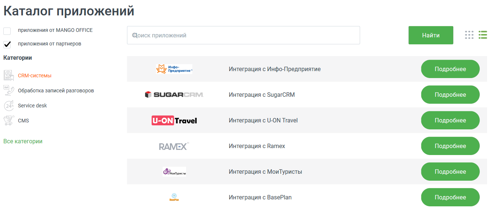
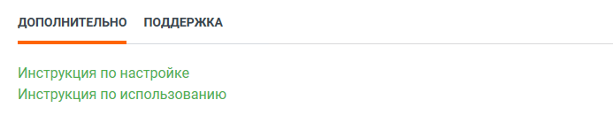

#### 4.6.7.2. Решения партнеров

> Трассировка: PDF §4.6.7.2 · сквозные стр. 500-501 · источники: ч.2 `kb/sources/mango-lk-manual/LK_manual_v-125-281-566.pdf` с.220-221.

Данный инструмент предназначен для интеграции MANGO OFFICE с программными разработками партнеров.

В боковом меню выберите поставщика и категорию приложения.

> **Описание иллюстрации LK-§4.6.7.2-1** (к §4.6.7.2 «Решения партнеров», стр. 500; 1335×573 px). Снимок экрана / схема Личного кабинета.
> Относится к тексту руководства: «…В боковом меню выберите поставщика и категорию приложения.».
> Текст на изображении (OCR, требует сверки): Каталог приложений; приложения от MANGO OFFICE; Qonck приложений; приложения от партнеров; Категории; инфо-; pease”; Интеграция с Инфо-Предприятие; `СВМ-системы; 7 обработка записей разговоров.; © ЗОВАЯСЯМ; Интеграция с SugarCRM; Service desk; смз; (5 тгаче!; Интеграция с U-ON Travel; Все категории; Интеграция с Ватех; ик; Интеграция с МоиТуристы; Интеграция с BasePlan

Для подключения выберите нужную систему из выпадающего списка и нажмите Подробнее. Ознакомьтесь с условиями подключения и нажмите Подключить.

Для настройки подключения приложения следуйте приведенной инструкции.

> **Описание иллюстрации LK-§4.6.7.2-2** (к §4.6.7.2 «Решения партнеров», стр. 500; 693×139 px). Снимок экрана / схема Личного кабинета.
> Относится к тексту руководства: «…Для настройки подключения приложения следуйте приведенной инструкции.».
> Текст на изображении (OCR, требует сверки): ДОПОЛНИТЕЛЬНО ПОДДЕРЖКА; Инструкция по настройке; Инструкция по использованию

Проверка корректности подключения осуществляется нажатием на кнопку Проверить статус интеграции в разделе Мои интеграции. Результат проверки отображается справа от кнопки.

При необходимости настройки интеграции с другими системами повторите вышеописанные действия.
