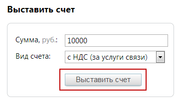

### 2.1.2. Сформировать счет на предоплату телекоммуникационных услуг

> Трассировка: PDF §2.1.2 · сквозные стр. 29 · источники: ч.1 `kb/sources/mango-lk-manual/LK_manual_v-125-1-280.pdf` с.29.

В блоке «Выставить счет» введите цифрами сумму платежа. Укажите тип формируемого счета (по умолчанию выбран первый вариант):

 с НДС — за услуги связи, например, абонентский платеж за номер, черный/белый списки, дополнительные профили сотрудников, алгоритмы распределения звонков, кнопку «Звонок с сайта» и т.п. Формируется счет с предметом «Предоплата за телекоммуникационные услуги» (например, за использование внешних линий);  без НДС — за использование ПО. Формируется счет с предметом «Ежемесячный фиксированный платеж за неисключительное право использования Программного продукта» (например, продукта Виртуальная АТС).

Нажмите кнопку «Выставить счет». Содержимое таблицы слева автоматически обновится. Чтобы просмотреть и при необходимости скачать нужный документ, кликните по любому из них. Появится стандартное диалоговое окно браузера, позволяющее открыть или сохранить файл.

> **Описание иллюстрации LK-§2.1.2-1** (к §2.1.2 «Сформировать счет на предоплату телекоммуникационных услуг», стр. 29; 363×209 px). Снимок экрана / схема Личного кабинета.
> Относится к тексту руководства: «…ь и при необходимости скачать нужный документ, кликните по любому из них. Появится стандартное диалоговое окно браузера, позволяющее открыть или сохранить файл.».
> Текст на изображении (OCR, требует сверки): Выставить счет; 10000; Сумма, руб.:; Вид счета:; с НДС (за услуги связи) |]
