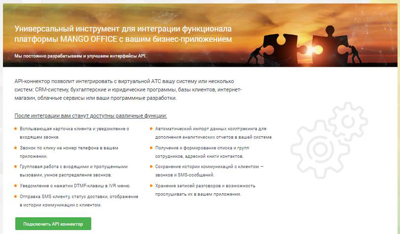
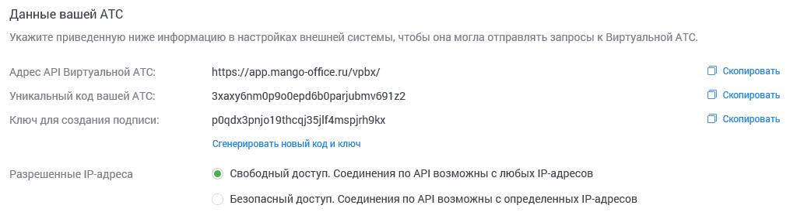
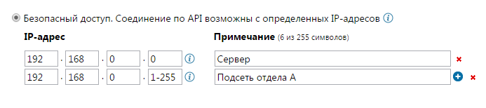
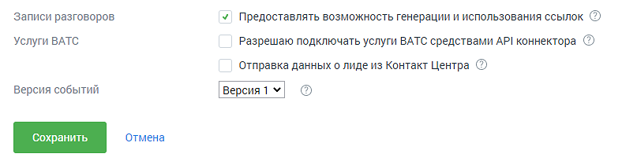
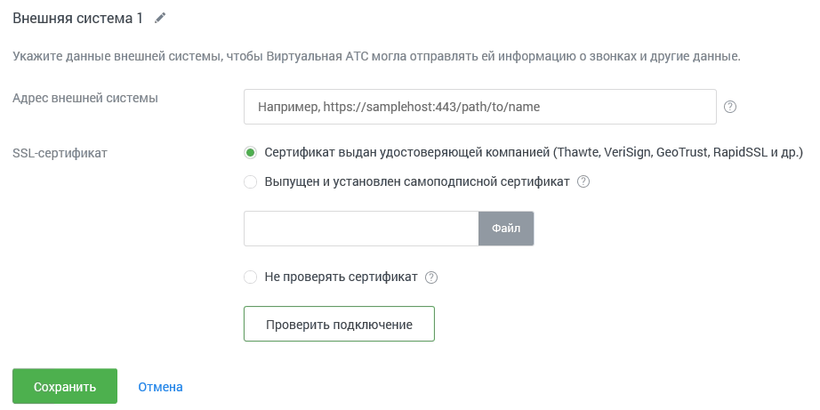
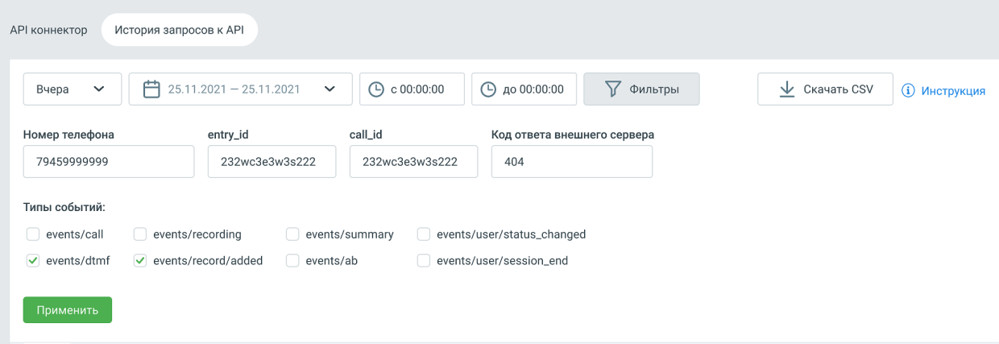
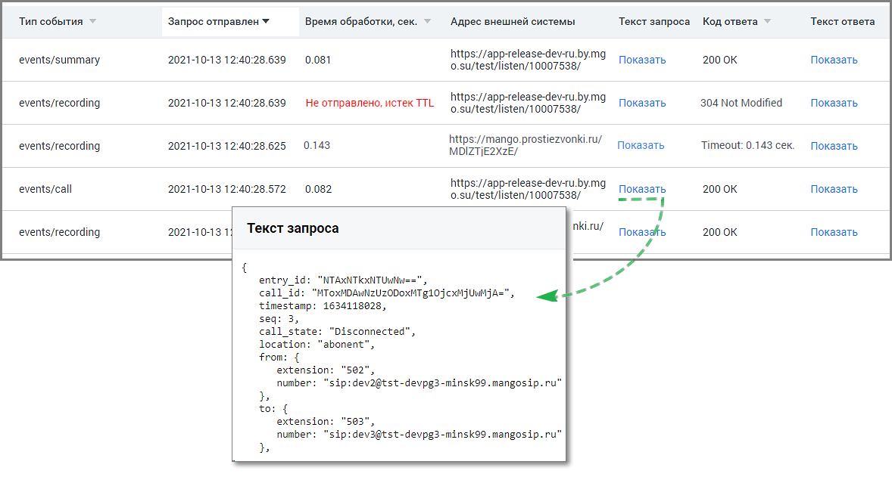

#### 4.6.7.3. API Коннектор

> Трассировка: PDF §4.6.7.3 · сквозные стр. 501-507 · источники: ч.2 `kb/sources/mango-lk-manual/LK_manual_v-125-281-566.pdf` с.221-227.

Используйте настройку «API Коннектор» для подключения к Виртуальной АТС различных внешних систем, например, таких как CRM или интернет-магазины.

Вкладка API Коннектор

Перейдите на вкладку API Коннектор, ознакомьтесь с возможностями API MANGO OFFICE и нажмите кнопку Подключить API Коннектор.

> **Описание иллюстрации LK-§4.6.7.3-1** (к §4.6.7.3 «API Коннектор», стр. 501; 811×476 px). Снимок экрана / схема Личного кабинета.
> Относится к тексту руководства: «…Перейдите на вкладку API Коннектор, ознакомьтесь с возможностями API MANGO OFFICE и нажмите кнопку Подключить API Коннектор.».
> Текст на изображении (OCR, требует сверки): 32; ПЛ}; Мы постоянно разрабатываем и улучшаем интерфейсы API.; АР|-коннектор позволит интегрировать с виртуальной ATC вашу систему или несколько; систем: СВМ-систему, бухгалтерские и юридические программы, базы клиентов, интернет-; магазин, облачные сервисы или ваши программные разработки.; После интеграции вам станут доступны различные функции:; Автоматический импорт данных коллтрекинга для; Всплызающая карточка клиента и уведомление о; входящем звонке.; дополнения аналитических отчетов в вашей системе.; Звонок по клику на номер телефона в вашем; Получение и формирование списка и групп; прил…

В открывшемся окне заполните поля формы:

Данные вашей АТС

В этом блоке приведены данные вашей Виртуальной АТС, которые следует указать в настройках внешней системы.

> **Описание иллюстрации LK-§4.6.7.3-2** (к §4.6.7.3 «API Коннектор», стр. 502; 1015×283 px). Снимок экрана / схема Личного кабинета.
> Относится к тексту руководства: «…В этом блоке приведены данные вашей Виртуальной АТС, которые следует указать в настройках внешней системы.».
> Текст на изображении (OCR, требует сверки): Данные вашей АТС; Укажите приведенную ниже информацию в настройках внешней системы, чтобы она могла отправлять запросы к Виртуальной ATC.; Адрес API Виртуальной АТС:; https://app.mango-office.ru/vpbx/; ‘Скопировать; Уникальный код вашей ATC:; 3xaxy6nmop900epd6boparjubmv691z2; Скопировать; Ключ для создания подписи:; pOgdx3pnjo1 stheqj35jlf4mspjrhokx; ‘сгенерировать новый коди ключ; Разрешенные IP-anpeca; © Свободный доступ. Соединения по API возможны с любых IP-anpecos; Безопасный доступ. Соединения по API возможны с определенных 1Р-адресов

Уникальный код и ключ для создания подписи генерируются автоматически. При необходимости вы можете сгенерировать новые код и ключ, нажав соответствующую кнопку. После изменения данных следует обновить настройки внешней системы, подключенной по API.

При настройке IP-адресов, которым разрешен доступ по API, мы рекомендуем использовать безопасный доступ с указанием так называемых «белых» IP-адресов.

Для этого установите переключатель в соответствующее положение и составьте список IP-адресов, с которых будет разрешен доступ.

> **Описание иллюстрации LK-§4.6.7.3-3** (к §4.6.7.3 «API Коннектор», стр. 502; 693×154 px). Снимок экрана / схема Личного кабинета.
> Относится к тексту руководства: «…Для этого установите переключатель в соответствующее положение и составьте список IP-адресов, с которых будет разрешен доступ.».
> Текст на изображении (OCR, требует сверки): ®) Безопасный доступ. Соединение по API возможны с определенных 1Р-адресов @; 1Р-адрес; Примечание (6 из 255 символов); 192; . 168; Сервер; Подсеть отдела А

Дополнительные параметры API

> **Описание иллюстрации LK-§4.6.7.3-4** (к §4.6.7.3 «API Коннектор», стр. 502; 788×205 px). Снимок экрана / схема Личного кабинета.
> Относится к тексту руководства: «…Дополнительные параметры API».
> Текст на изображении (OCR, требует сверки): Записи разговоров; У Предоставлять возможность генерации и использования ссылок |@); Услуги ВАТС; Разрешаю подключать услуги ВАТС средствами АР! коннектора (©); Отправка данных о лиде из Контакт Центра (<; Версия событий; Версия1 ¥

При включенной настройке «Записи разговоров» внешней системе предоставляется возможность генерации и использования прямых ссылок для скачивания и воспроизведения записи разговоров.

При включенной настройке «Услуги ВАТС» при вызовах методов API подключаются соответствующие услуги (к примеру алгоритм дозвона), если они входят в текущий тарифный план. В журнале действий в ЛК работа с услугами (в том числе сотрудниками, группами) через API отображается от имени виртуального пользователя "API конструктор".

При включенной настройке «Отправка данных о лиде из Контакт Центра» внешней системе передаются данные лидов из Контакт Центра MANGO OFFICE.

Внимание

При включенной настройке записи доступны без авторизации в Личном кабинете, что может привести к несанкционированному скачиванию записей.

Данные внешней системы

Выберите имя внешней системы. В поле для ввода адреса внешней системы указывается адрес внешней системы в виде имени сервера, порта и url-пути. В качестве имени сервера можно использовать как доменное имя, так и IP-адрес.

Укажите тип SSL-сертификата. Если вы используете самоподписной сертификат, то установите переключатель в соответствующее положение и при помощи кнопки «Обзор» укажите путь к корневому файлу сертификата. Впоследствии загруженный сертификат можно заменить или удалить.

> **Описание иллюстрации LK-§4.6.7.3-5** (к §4.6.7.3 «API Коннектор», стр. 503; 922×461 px). Снимок экрана / схема Личного кабинета.
> Относится к тексту руководства: «…оответствующее положение и при помощи кнопки «Обзор» укажите путь к корневому файлу сертификата. Впоследствии загруженный сертификат можно заменить или удалить.».
> Текст на изображении (OCR, требует сверки): Внешняя система] #; Укажите данные внешней системы, чтобы Виртуальная АТС могла отправлять ей информацию о звонках и другие данные.; Адрес внешней системы; Например, https://samplehost:443/path/to/name; З1-сертификат; © Сертификат выдан удостоверяющей компанией (Thawte, VeriSign, GeoTrust, RapidSSL и др.); Выпущен и установлен самоподписной сертификат ©; Не проверять сертификат ©

Внимание

При выборе варианта «Не проверять сертификат» проверка подлинности соединения внешней системы с Виртуальной ВАТС не выполняется. Существует угроза безопасности данных.

При наличии подключенной услуги с установленным ограничением (>1) отображается кнопка Добавить систему для добавления дополнительных внешних систем. При нажатии кнопки добавляется блок «Данные внешней системы» с аналогичным набором полей.

Внимание

При подключении нескольких внешних систем рассылка осуществляется последовательно на каждый из адресов, согласно настройкам Личного кабинета.

Настройка IP-адресов осуществляется для всех внешних систем одновременно.

совет

При использовании групповых IP-адресов вы можете избежать необходимости ввода каждого отдельного адреса, применяя символы «*» и «-». Их назначение и примеры использования приведены в справке, вызываемой при наведении курсора на значок

> **Описание иллюстрации LK-§4.6.7.3-6** (к §4.6.7.3 «API Коннектор», стр. 504; 15×15 px). Пиктограмма (значок элемента интерфейса).
> Относится к тексту руководства: «…ода каждого отдельного адреса, применяя символы «*» и «-». Их назначение и примеры использования приведены в справке, вызываемой при наведении курсора на значок».
> Текста на изображении нет; назначение значка — см. текст, к которому он относится.

.

Ограничения и фильтры на отправку данных по событиям API

Настроить отправку событий по звонкам – если чекбокс отмечен, доступны три дополнительных настройки:

o Не отправлять уведомления о промежуточном состоянии вызова и его

параметрах (событие events/call) - если включен, во внешнюю систему не отправляются данные из API по этапам совершения звонка;

o Не отправлять уведомления с итоговой информацией по звонку (событие

events/summary) - если включен, во внешнюю систему не отправляются данные из API с информацией о звонке;

o Исключить отправку событий для номеров (выбрать) - звонковые события API не

отправляются во внешнюю систему, если в них участвуют выбранные номера.

Не пробрасывать идентификатор SIP_Call_ID из внешней системы – если чекбокс отмечен, то в звонковых событиях API не передается идентификатор SIP_Call_ID, полученный от внешней системы при входящих звонках.

Не отправлять уведомления о нажатиях DTMF-клавиш клиентом в IVR (событие events/dtmf) – если чекбокс отмечен, то во внешнюю систему не передаются данные о нажатиях клиентом клавиш в меню IVR в тональном режиме.

Не отправлять уведомления о состоянии записи разговоров (событие events/recording) – если чекбокс отмечен, то во внешнюю систему не передаются данные о каждом новом состоянии записи разговора.

Не отправлять события о готовности для скачивания файла записи разговора (событие events/record/added) – если чекбокс отмечен, то во внешнюю систему не передаются данные о возможности скачать файл записи разговора.

Не отправлять информацию о статусе доставки SMS-сообщений (событие events/sms) – если чекбокс отмечен, то во внешнюю систему не передаются данные о доставке СМС клиенту.

Не отправлять информацию о событиях в Адресной книге на указанный адрес внешней системы (события events/ab) – если чекбокс отмечен, сервис API не информирует внешнюю систему об изменениях в адресной книге MANGO OFFICE.

Не отправлять события о завершении процесса распознавания тематик в телефонных разговорах (событие events/record/tagged) - если чекбокс отмечен, сервис API не информирует о завершении процесса распознавания тематик звонка.

После ввода всех данных нажмите кнопку «Проверить подключение». Если все поля заполнены корректно, то запускается процедура проверки соединения Виртуальной АТС и внешней системы по API.

Если поля заполнены неправильно, на экране отобразится подробное сообщение, указывающее на ошибку.

Аналогичная проверка выполняется при нажатии на кнопку «Сохранить». Сохранение данных выполняется только в том случае, когда все данные указаны правильно и соединение установлено.

Вкладка История запросов к API

Вкладка содержит набор фильтров для поиска запросов к API и событий для клиента.

Внимание

Услуга доступна на версиях Виртуальной АТС, начиная с версии «Расширенная».

> **Описание иллюстрации LK-§4.6.7.3-7** (к §4.6.7.3 «API Коннектор», стр. 505; 1240×427 px). Снимок экрана / схема Личного кабинета.
> Относится к тексту руководства: «…Услуга доступна на версиях Виртуальной АТС, начиная с версии «Расширенная».».
> Текст на изображении (OCR, требует сверки): API коннектор.; История запросов к АР!; Вчера; В 25.11.2021 - 25.11.2021; © 00:00:00; \У хильтры; И скачать CSV; @ инструкция; Номер телефона; entry_id; call_id; Код ответа внешнего сервера; 79459999999; 232we3e3w3s222; 404; Типы событий:; events/call; events/recording; events/summary; events/user/status_changed; У events/dtmf; VY events/record/added; events/ab; events/user/session_end

Для отбора данных доступны фильтры:

Период – варианты выпадающего списка: последний час, сегодня, вчера, последние три дня, текущая неделя, текущий месяц, произвольный период. Доступны данные за период не более двух месяцев.

Время – выбор времени осуществления запроса.

По клику на кнопку «Фильтры» ображаются поля дополнительной фильтрации:

Номер телефона – фильтрует данные по номеру телефона, в том числе по частичному совпадению строки с введёнными данными.

entry_id – фильтрует данные по параметру entry_id в API ВАТС, в том числе по частичному совпадению строки идентификатора с введёнными данными.

call_id – фильтрует данные по параметру call_id в API ВАТС, в том числе по частичному совпадению строки идентификатора с введёнными данными.

Код ответа внешней системы – фильтрует данные по числовому коду ответа сервера внешней системы. Допускается только ввод цифр, не более 3 знаков.

Чекбоксы Типы событий – events/call, events/summary, events/dtmf, events/recording, events/record/added, events/record/tagged, events/sms, events/ab, events/user/status_changed, events/user/session_end.

Нажатие на кнопку «Скачать CSV» открывает стандартное окно экспорта таблицы детализации в формате CSV (Excel).

Нажатие на кнопку «Применить» открывает окно выдачи с применением всех выбранных на странице фильтров.

Окно выдачи содержит:

> **Описание иллюстрации LK-§4.6.7.3-8** (к §4.6.7.3 «API Коннектор», стр. 506; 1178×639 px). Снимок экрана / схема Личного кабинета.
> Относится к тексту руководства: «…Окно выдачи содержит:».
> Текст на изображении (OCR, требует сверки): Тип события; Запрос отправлен ¥; Время обработки, сек.; Адрес внешней системы; Текст запроса; Код ответа; Текст ответа; https://app-release-dev-ru. by. mg; events/summary; 2021-10-13 12:40:28.639; 0.081; o.su/test/listen/10007538/; Показать; 200 0K; Показать,; events/recording; Не отправлено, истек TTL; 304 Not Modified; 0.143; https://mango.prostiezvonki.ru/; Timeout: 0.143 сек.; 2021-10-13 12:40:28.625; MDIZT|E2xzE/; events/call; 2021-10-13 12:40:28.572; 0.082; 2021-10131; nki.ru/; Показайь; entry_id; 'МТАХНТКХМТ Омь.; calli; “MToxMDAUNZUZ0DOxMT g105.cxéj мм); timestamp: 1634118028,; call_st…

Тип события – список событий в соответствии с выбранными в фильтрах чекбоксами.

Запрос отправлен – дата и время отправки запроса от API ВАТС клиенту.

Время обработки – время обработки запроса от API ВАТС сервером клиента.

Адрес внешней системы – адрес внешней системы, на который API отправляет событие.

Текст запроса – клик на кнопку «Показать» открывает окно с полным текстом POST- запроса со стороны API к внешней системе.

Код ответа – содержит код ответа сервера клиента на http-запрос от API ВАТС с расшифровкой. Например: "200 OK", "404 Not Found", "405 Method Not Allowed".

Текст ответа – клик на кнопку «Показать» открывает окно с полным текстом ответа на POST-запрос от API ВАТС.

Предусмотрен экспорт файла истории в формате CSV. После клика на кнопку «Скачать CSV» будет открыто стандартное диалоговое окно браузера, позволяющее сохранить файл.
