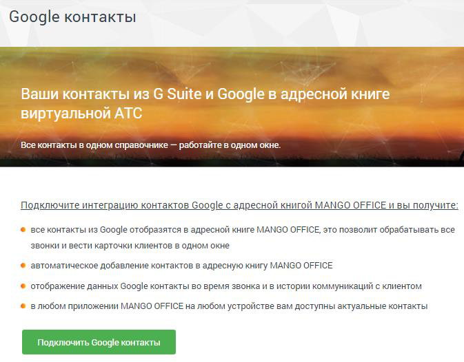
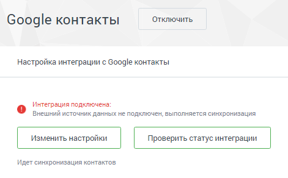

#### 4.6.7.4. Gооgle контакты

> Трассировка: PDF §4.6.7.4 · сквозные стр. 507-508 · источники: ч.2 `kb/sources/mango-lk-manual/LK_manual_v-125-281-566.pdf` с.227-228.

Данный инструмент предназначен для настройки подключения и интеграции вашей ВАТС с сервисом Gsuite и Google контакты. Интеграция систем позволит добавлять контакты из GSuite в адресную книгу MANGO OFFICE и отображать информацию во время звонка.

> **Описание иллюстрации LK-§4.6.7.4-1** (к §4.6.7.4 «Gооgle контакты», стр. 507; 673×526 px). Снимок экрана / схема Личного кабинета.
> Относится к тексту руководства: «…ервисом Gsuite и Google контакты. Интеграция систем позволит добавлять контакты из GSuite в адресную книгу MANGO OFFICE и отображать информацию во время звонка.».
> Текст на изображении (OCR, требует сверки): Google контакты; he mag; eae; Все контакты в одном справочнике — работайте в одном окне.; Подключите интеграцию контактов Google с адресной книгой MANGO OFFICE и вы получите; все контакты из Google отобразятся в адресной книге MANGO OFFICE, это позволит обрабатывать все; звонки и вести карточки клиентов в одном окне; автоматическое добавление контактов в адресную книгу MANGO OFFICE; отображение данных Google контакты BO время звонка и в истории коммуникаций с клиентом; в любом приложении MANGO OFFICE на любом устройстве вам доступны актуальные контакты

Для интеграции с сервисом Gsuite и Google контакты:

1. Установите флаг «Я принимаю условия…» и нажмите кнопку Подтвердить.

2. В стандартной форме авторизации Google выберите аккаунт и авторизуйтесь.

3. В открывшейся форме выберите «Дополнительные настройки», затем «Перейти на страницу "mango-office.ru" (небезопасно)»

4. Разрешите приложению интеграцию доступ на чтение контактов. Закройте вкладку и вернитесь в Личный кабинет.

5. Нажмите кнопку Проверить статус интеграции. Теперь при появлении новых контактов в GSuite, они будут автоматически (с некоторой задержкой) добавляться в адресную книгу Виртуальной АТС

> **Описание иллюстрации LK-§4.6.7.4-2** (к §4.6.7.4 «Gооgle контакты», стр. 508; 471×292 px). Снимок экрана / схема Личного кабинета.
> Относится к тексту руководства: «…ь статус интеграции. Теперь при появлении новых контактов в GSuite, они будут автоматически (с некоторой задержкой) добавляться в адресную книгу Виртуальной АТС».
> Текст на изображении (OCR, требует сверки): Отключить; Google контакты; Настройка интеграции с Google контакты; Интеграция подключена:; Внешний источник данных не подключен, выполняется синхронизация; Изменить настройки | | Проверить статус интеграции; Идет синхронизация контактов
