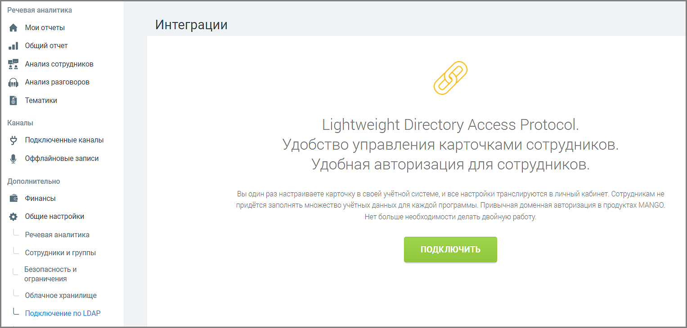
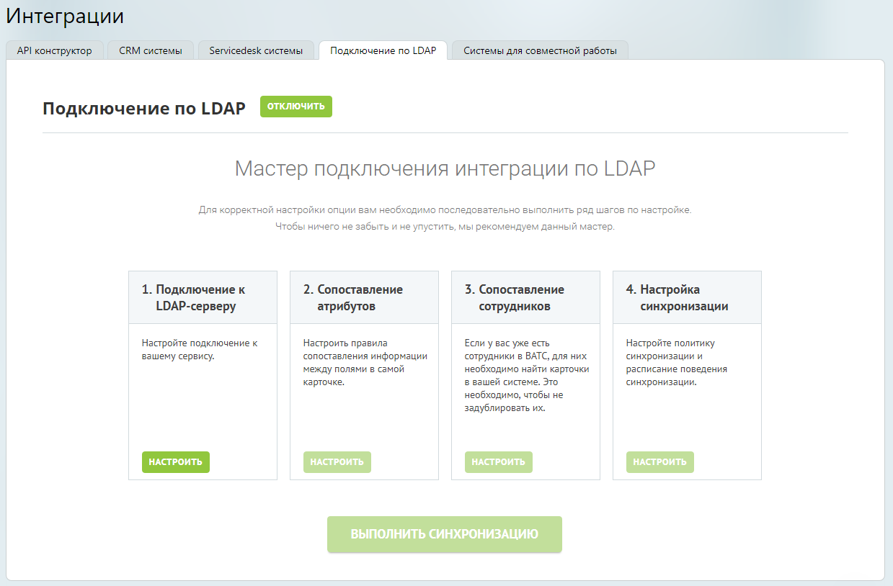

#### 4.6.7.5. Подключение по LDAP

> Трассировка: PDF §4.6.7.5 · сквозные стр. 508-509 · источники: ч.2 `kb/sources/mango-lk-manual/LK_manual_v-125-281-566.pdf` с.228-229.

Данный инструмент предназначен для интеграции со сторонними сервисами по протоколу Lightweight Directory Access Protocol (LDAP) с целью синхронизации данных о сотрудниках.

> **Описание иллюстрации LK-§4.6.7.5-1** (к §4.6.7.5 «Подключение по LDAP», стр. 508; 1527×730 px). Снимок экрана / схема Личного кабинета.
> Относится к тексту руководства: «…румент предназначен для интеграции со сторонними сервисами по протоколу Lightweight Directory Access Protocol (LDAP) с целью синхронизации данных о сотрудниках.».
> Текст на изображении (OCR, требует сверки): Речевая аналитика; @ Моиотчеты; Интеграции; «| Общий отчет; 9 Анализ сотрудников.; Анализ разговоров; В Тематики; Каналы; Lightweight Directory Access Protocol.; $} Подключенные каналы; Удобство управления карточками сотрудников.; ® оффлайновые записи; Удобная авторизация для сотрудников.; Дополнительно; Вы один раз настраиваете карточку в своей учётной системе, и все настройки транслируются в личный кабинет. Сотрудникам не; № Финансы; придётся заполнять множество учётных данных для каждой программы. Привычная доменная авторизация в продуктах MANGO,; 4% Общие настройки; Нет больше необходимост…

Настройка подключения по LDAP будет доступна только после подключения услуги. Для этого нажмите Подключить, ознакомьтесь с условиями подключения и нажмите Подтвердить.

> **Описание иллюстрации LK-§4.6.7.5-2** (к §4.6.7.5 «Подключение по LDAP», стр. 509; 1239×814 px). Снимок экрана / схема Личного кабинета.
> Относится к тексту руководства: «…ка подключения по LDAP будет доступна только после подключения услуги. Для этого нажмите Подключить, ознакомьтесь с условиями подключения и нажмите Подтвердить.».
> Текст на изображении (OCR, требует сверки): Интеграции; API конструктор; CRM системы; Servicedesk системы; Подключение по LDAP; Системы для совместной работы; Подключение no LDAP; Мастер подключения интеграции no LDAP; Для корректной настройки опции вам необходимо последовательно выполнить ряд шагов по настройке.; Чтобы ничего не забыть и не упустить, мы рекомендуем данный мастер.; 1. Подключение к; 2. Сопоставление; 3. Сопоставление; 4. Настройка; LDAP-cepsepy; атрибутов; сотрудников; синхронизации; "Настройте подключение к; Настроить правила; Если у вас уже есть; Настройте политику; вашему сервису.; сопоставления информации; сотрудник…

После подключения услуги необходимо произвести настройку функционала. Настройка осуществляется при помощи мастера настройки, определяющего порядок внесения информации.

Настройка интеграции распределена на четыре шага:

1. Подключение к LDAP-серверу — ввод данных для подключения к сервису;

2. Сопоставление атрибутов — сопоставление информации между полями карточек;

3. Сопоставление сотрудников — поиск и сопоставление карточек сотрудников двух систем;

4. Настройка синхронизации — настройка синхронизации и расписания.

Каждый последующий шаг доступен только при корректном выполнении предыдущего. По завершении настроек активируется кнопка Выполнить синхронизацию.
