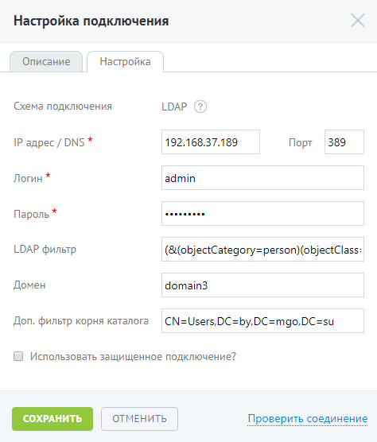
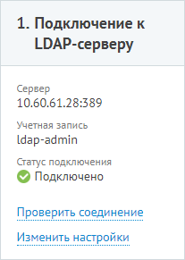

#### Шаг 1. Подключение к LDAP-серверу

> Трассировка: PDF §4.6.7.5 · сквозные стр. 509-511 · источники: ч.2 `kb/sources/mango-lk-manual/LK_manual_v-125-281-566.pdf` с.229-231.

На данной вкладке осуществляется настройка подключения. При подключении по LDAP следует заполнить набор полей:

> **Описание иллюстрации LK-§4.6.7.5-1** (к §4.6.7.5 «Шаг 1. Подключение к LDAP-серверу», стр. 510; 474×556 px). Снимок экрана / схема Личного кабинета.
> Относится к тексту руководства: «…На данной вкладке осуществляется настройка подключения. При подключении по LDAP следует заполнить набор полей:».
> Текст на изображении (OCR, требует сверки): Настройка подключения; Описание; Настройка; Схема подключения; LDAP; IP адрес / DNS *; 192.168.37.189; Порт; 389; Логин *; admin; Пароль *; фазе»; LDAP фильтр; (&(objectCategory=person)(objectClass:; Домен; domain3; Доп. фильтр корня каталога; CN=Users,DC=by,DC=mgo,DC=su; © Использовать защищенное подключение?; ОТМЕНИТЬ; Проверить соединение

Поля, отмеченные символом «*», являются обязательными для заполнения.

При необходимости использования защищенного подключения следует установить соответствующий флаг и выбрать сертификат.

После ввода всех обязательных полей становится доступной кнопка Проверить соединение. При нажатии кнопки выполняется проверка наличия доступа к системе клиента по указанным настройкам. В результате успешного подключения указывается значение «Подключено».

Также при успешном подключении на вкладке «Подключение по LDAP» в строке «Статус подключения» отобразится зелёная пиктограмма.

> **Описание иллюстрации LK-§4.6.7.5-2** (к §4.6.7.5 «Шаг 1. Подключение к LDAP-серверу», стр. 510; 207×291 px). Снимок экрана / схема Личного кабинета.
> Относится к тексту руководства: «…Также при успешном подключении на вкладке «Подключение по LDAP» в строке «Статус подключения» отобразится зелёная пиктограмма.».
> Текст на изображении (OCR, требует сверки): 1. Подключение к; LDAP-cepsepy; Cepsep; 10.60.61.28:389; Учетная запись; ldap-admin; Статус подключения; © Подключено; Проверить соединение; Изм

При корректной настройке становится доступным следующий шаг.
