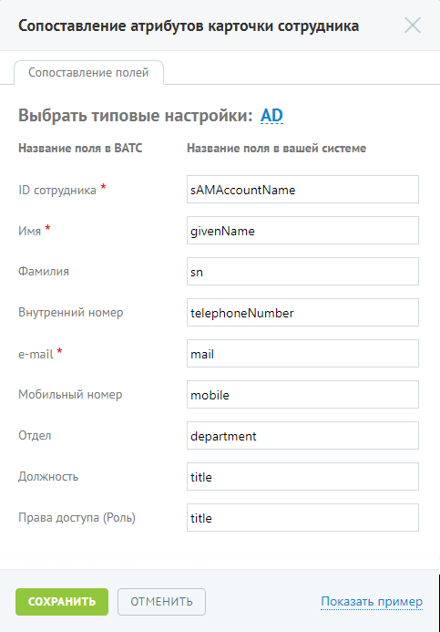
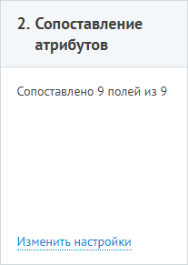

#### Шаг 2. Сопоставление атрибутов

> Трассировка: PDF §4.6.7.5 · сквозные стр. 511-512 · источники: ч.2 `kb/sources/mango-lk-manual/LK_manual_v-125-281-566.pdf` с.231-232.

На данном шаге выполняется сопоставление полей карточки сотрудника в Личном кабинете соответствующим полям в учетной системе клиента.

> **Описание иллюстрации LK-§4.6.7.5-1** (к §4.6.7.5 «Шаг 2. Сопоставление атрибутов», стр. 511; 483×693 px). Снимок экрана / схема Личного кабинета.
> Относится к тексту руководства: «…На данном шаге выполняется сопоставление полей карточки сотрудника в Личном кабинете соответствующим полям в учетной системе клиента.».
> Текст на изображении (OCR, требует сверки): Сопоставление атрибутов карточки сотрудника; Сопоставление полей; Выбрать типовые настройки: AD; aM; Название поля в BATC; Название поля в вашей системе; ID сотрудника *; sAMAccountName; Имя *; givenName; Фамилия; sn; Внутренний номер; telephoneNumber; e-mail *; mail; Мобильный номер; mobile; Otgen; department; Должность; title; Права доступа (Роль); ОТМЕНИТЬ

Для упрощения настройки предлагаются наиболее распространенные параметры для каждого из полей. Данные настройки подставляются при нажатии кнопки AD в заголовке.

Поля, отмеченные «*», являются обязательными для заполнения.

При нажатии на кнопку Показать пример введенные настройки сохраняются, после чего из сторонней системы согласно настройкам сопоставления полей, отобразятся значения соответствующие полям из сопоставления.

Возврат в режим редактирования сопоставления осуществляется нажатием по ссылке Вернуться к настройке.

> **Описание иллюстрации LK-§4.6.7.5-2** (к §4.6.7.5 «Шаг 2. Сопоставление атрибутов», стр. 512; 207×291 px). Снимок экрана / схема Личного кабинета.
> Относится к тексту руководства: «…Возврат в режим редактирования сопоставления осуществляется нажатием по ссылке Вернуться к настройке.».
> Текст на изображении (OCR, требует сверки): 2. Сопоставление; атрибутов; Сопоставлено 9 полей из 9; Изм

При корректной настройке становится доступными шаги 3 и 4.
