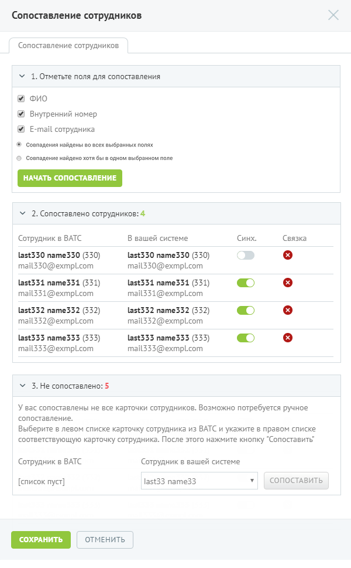
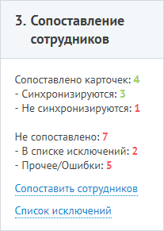
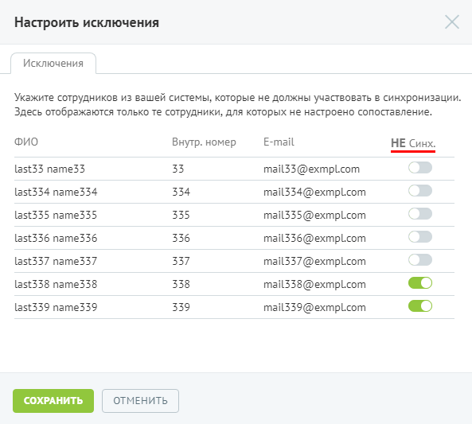

#### Шаг 3. Сопоставление сотрудников

> Трассировка: PDF §4.6.7.5 · сквозные стр. 512-515 · источники: ч.2 `kb/sources/mango-lk-manual/LK_manual_v-125-281-566.pdf` с.232-235.

Данный шаг не является обязательным. Если на ВАТС не создано ни одного пользователя, то его можно пропустить и перейти к шагу 4.

> **Описание иллюстрации LK-§4.6.7.5-1** (к §4.6.7.5 «Шаг 3. Сопоставление сотрудников», стр. 513; 600×969 px). Снимок экрана / схема Личного кабинета.
> Относится к тексту руководства: «…Данный шаг не является обязательным. Если на ВАТС не создано ни одного пользователя, то его можно пропустить и перейти к шагу 4.».
> Текст на изображении (OCR, требует сверки): Сопоставление сотрудников; \ 1. Отметьте поля для сопоставления; ФИО; Внутренний номер; E-mail сотрудника; ® Совпадения найдены во всех выбранных полях; © Совпадение найдено хотя бы в одном выбранном поле; Y 2. Сопоставлено сотрудников: 4; Сотрудник в BATC; В вашей системе; Синх; Связка; 1351330 name330 (330); last330 name330 (330); mail330@exmpLcom; last334 name334 (331); mail331@exmpLcom; last332 name332 (332); mail332@exmpLcom; last333 name333 (333); mail333@exmpLcom; \ 3. Не сопоставлено: 5; У вас сопоставлены не все карточки сотрудников. Возможно потребуется ручное; сопоставление.; Выбери…

На первом шаге настройки следует указать, по каким полям будет производиться поиск для сопоставления. Чем больше полей выбрано, тем больше шанс оптимального сопоставления.

Помимо выбора полей, доступны также следующие опции сопоставления:

 Совпадения найдены во всех выбранных полях (выбрано по умолчанию) - засчитывается только наличие совпадения данных по каждому из выбранных полей.

 Совпадение найдено хотя бы в одном выбранном поле – засчитывается наличие совпадения данных хотя бы по одному из выбранных полей.

При нажатии кнопки Начать сопоставление начинается автоматический поиск и сопоставление карточек.

На втором шаге представлен результат сопоставления карточек сотрудников ВАТС и сторонней системы. Предусмотрена возможность остановить синхронизацию карточки и удалить связку. Остановка синхронизации не разрывает связь — в дальнейшем для карточки в ВАТС синхронизация выполняться не будет.

Третий шаг выполняется при необходимости сопоставления карточек в ручном режиме. Для этого необходимо выбрать сотрудника в ВАТС и соответствующего ему сотрудника сторонней системы, после чего нажать Сопоставить. В выпадающих списках сотрудники отсортированы в алфавитном порядке.

При подобном сопоставлении, в случае конфликта данных, приоритет будет отдаваться данным из сторонней системы, за исключением случаев пустых строк. Под «конфликтом» понимается ситуация, когда одно поле имеет различные значения в ВАТС и сторонней системе. При выполнении синхронизации осуществляется замена данных в ВАТС на данные из сторонней системы.

Для сохранения изменений нажмите Сохранить.

При этом на общей вкладке «Интеграция с LDAP» в разделе «Сопоставление» для параметра «Поиск карточек» отображаются следующие данные:

> **Описание иллюстрации LK-§4.6.7.5-2** (к §4.6.7.5 «Шаг 3. Сопоставление сотрудников», стр. 514; 207×291 px). Снимок экрана / схема Личного кабинета.
> Относится к тексту руководства: «…При этом на общей вкладке «Интеграция с LDAP» в разделе «Сопоставление» для параметра «Поиск карточек» отображаются следующие данные:».
> Текст на изображении (OCR, требует сверки): 3. Сопоставление; сотрудников; Сопоставлено карточек: 4; - Синхронизируются: 3; - Не синхронизируются: 1; Не сопоставлено: 7; - В списке исключений: 2; - Прочее/Ошибки: 5; Сопоставить сотрудников; Спи; ии

 Сопоставлено карточек — общее количество сопоставленных карточек;

o Синхронизируются — количество сопоставленных карточек с включенной синхронизацией;

o Не синхронизируются — количество сопоставленных карточек, синхронизация которых отключена.

 Не сопоставлено — общее количество несопоставленных карточек;

o В списке исключений — количество карточек сторонней системы,

которые исключены из синхронизации;

o Прочее/ошибки — количество карточек, для которых не задана

соответствующая карточка в ВАТС.

Также предусмотрена настройка исключений — список карточек сторонней системы, которые не должны синхронизироваться (например, технические учетные записи). Для настройки списка следует нажать ссылку «Список исключений».

> **Описание иллюстрации LK-§4.6.7.5-3** (к §4.6.7.5 «Шаг 3. Сопоставление сотрудников», стр. 515; 593×533 px). Снимок экрана / схема Личного кабинета.
> Относится к тексту руководства: «… сторонней системы, которые не должны синхронизироваться (например, технические учетные записи). Для настройки списка следует нажать ссылку «Список исключений».».
> Текст на изображении (OCR, требует сверки): Настроить исключения; Исключения; Укажите сотрудников из вашей системы, которые не должны участвовать в синхронизации.; Здесь отображаются только те сотрудники, для которых не настроено сопоставление.; ФИО; E-mail; Внутр. номер; НЕ Синх.; last33 name33; 33; mail33@exmpl.com; last334 name334; 334; mail334@exmpLcom; last335 name335; 335; mail335@exmpLcom; last336 name336; 336; mail336@exmplL.com; last337 name337; 337; mail337@exmpLcom; last338 name338; 338; mail338@exmpL.com; last339 name339; 339; mail339@exmpLcom; ОТМЕНИТЬ

Для того, чтобы отключить синхронизацию несопоставленных сотрудников из сторонней системы, установите переключатель в положение «Включено». Для сохранения настроек нажмите Сохранить.
