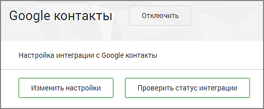
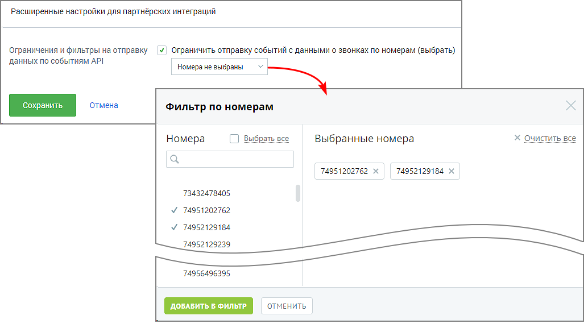

#### 4.6.7.8. Мои интеграции

> Трассировка: PDF §4.6.7.8 · сквозные стр. 519-521 · источники: ч.2 `kb/sources/mango-lk-manual/LK_manual_v-125-281-566.pdf` с.239-241.

В подразделе меню Мои интеграции отображаются блоки настроек для всех подключенных интеграций пользователя.

Проверка корректности подключения осуществляется последовательным нажатием на кнопки Настроить и, в открывшемся окне настроек, Проверить статус интеграции. Результат проверки отображается справа от кнопки.

> **Описание иллюстрации LK-§4.6.7.8-1** (к §4.6.7.8 «Мои интеграции», стр. 520; 526×217 px). Снимок экрана / схема Личного кабинета.
> Относится к тексту руководства: «…тся последовательным нажатием на кнопки Настроить и, в открывшемся окне настроек, Проверить статус интеграции. Результат проверки отображается справа от кнопки.».
> Текст на изображении (OCR, требует сверки): Отключить; Google контакты; Настройка интеграции с Google контакты; Изменить настройки | | Проверить статус интеграции

Для отключения интеграции нажмите Отключить напротив наименования системы.

Также в подразделе Мои интеграции размещаются

 Данные для настройки интеграции: уникальный код ВАТС, ключ для создания подписи и др.

 Расширенные настройки для партнёрских интеграций: ограничения и фильтры на отправку (доступны, если на ВАТС подключена интеграция с хотя бы одной системой через партнёра "Простые звонки").

> **Описание иллюстрации LK-§4.6.7.8-2** (к §4.6.7.8 «Мои интеграции», стр. 520; 1034×577 px). Снимок экрана / схема Личного кабинета.
> Относится к тексту руководства: «…ртнёрских интеграций: ограничения и фильтры на отправку (доступны, если на ВАТС подключена интеграция с хотя бы одной системой через партнёра "Простые звонки").».
> Текст на изображении (OCR, требует сверки): Расширенные настройки для партнёрских интеграций; Ограничения и фильтры на отправку; ¥) ограничить отправку событий с данными о звонках по номерам (выбрать); данных по событиям АР!; Фильтр по номерам; ) Выбрать все; х очистить все; Номера; Выбранные номера; 74951202762 х; 74952129184 Хх; 73432478405; У 74951202762; 74956496395,

Отметка в чекбоксе открывает окно фильтрации отправки событий API. Звонковые события API не отправляются во внешнюю систему, если в них участвуют выбранные номера.
