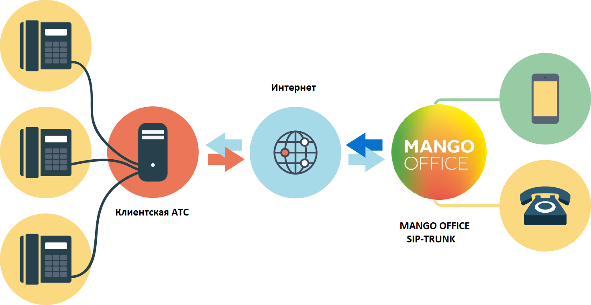

## 5.2. Что такое sip trunk

> Трассировка: PDF §5.2 · сквозные стр. 521-522 · источники: ч.2 `kb/sources/mango-lk-manual/LK_manual_v-125-281-566.pdf` с.241-242.

SIP Trunk – это виртуальный канал связи между вашей АТС (кАТС) и Виртуальной АТС MANGO OFFICE. Он позволяет объединить различные АТС в единую сеть и совершать внутренние, входящие и исходящие звонки независимо от того, к какой именно АТС принадлежит тот или иной сотрудник или телефонный номер.

> **Описание иллюстрации LK-§5.2-1** (к §5.2 «Что такое sip trunk», стр. 521; 1472×760 px). Снимок экрана / схема Личного кабинета.
> Относится к тексту руководства: «… единую сеть и совершать внутренние, входящие и исходящие звонки независимо от того, к какой именно АТС принадлежит тот или иной сотрудник или телефонный номер.».
> Текст на изображении (OCR, требует сверки): Интернет; Клиентская АТС; ye); MANGO OFFICE; SIP-TRUNK
