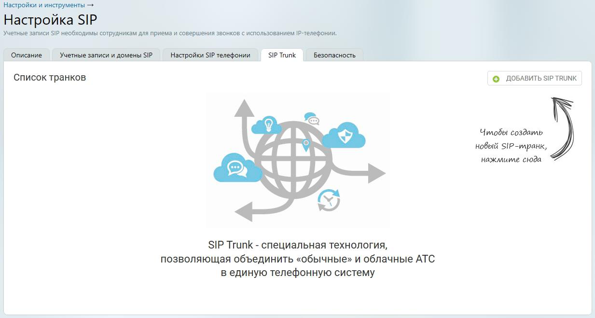

## 5.3. Создание и редактирование sip trunk

> Трассировка: PDF §5.3 · сквозные стр. 522-523 · источники: ч.2 `kb/sources/mango-lk-manual/LK_manual_v-125-281-566.pdf` с.242-243.

В подразделе “Настройки SIP” раздела “Настройки и инструменты” Личного кабинета пользователя ВАТС выберите вкладку SIP Trunk и нажмите кнопку Добавить SIP TRUNK. Далее выберите вид создаваемого транка: внешний или внутренний.

 Внешний – обеспечивает связь между вашей АТС (кАТС) и Виртуальной АТС MANGO OFFICE.  Внутренний – обеспечивает связь между разными Виртуальной АТС MANGO OFFICE.

> **Описание иллюстрации LK-§5.3-1** (к §5.3 «Создание и редактирование sip trunk», стр. 522; 1233×659 px). Снимок экрана / схема Личного кабинета.
> Относится к тексту руководства: «…нешний – обеспечивает связь между вашей АТС (кАТС) и Виртуальной АТС MANGO OFFICE.  Внутренний – обеспечивает связь между разными Виртуальной АТС MANGO OFFICE.».
> Текст на изображении (OCR, требует сверки): Настройки и инструменты >; Настройка SIP; Учетные записи SIP необходимы сотрудникам для приема и совершения звонков с использованием -телефонии.; ' Описание.; SIP Trunk; Безопасность; Учетные записи и домены SIP; Настройки SIP телефонии; Список транков; © ДОБАВИТЬ SIP TRUNK; Чилобы создаиль,; Ab; новый $1Р-илранк,; нажмиие сюда.; SIP Trunk - специальная технология,; позволяющая объединить «обычные» и облачные АТС; в единую телефонную систему
