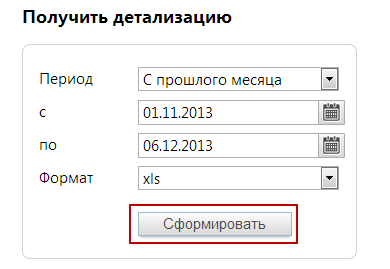

### 2.1.4. Получить детализацию совершенных звонков

> Трассировка: PDF §2.1.4 · сквозные стр. 30 · источники: ч.1 `kb/sources/mango-lk-manual/LK_manual_v-125-1-280.pdf` с.30.

Список «Период» позволяет установить вариант выбора дат (по умолчанию предлагается период «Произвольный»), нажав значок календаря, или ввести их в формате дд.мм.гггг в соответствующие поля. В списке «Формат» задайте нужный (по умолчанию выбран PDF, доступны также XLS, XLSX и TXT). Нажмите кнопку «Сформировать», и появится стандартное диалоговое окно браузера, позволяющее открыть или сохранить файл.

> **Описание иллюстрации LK-§2.1.4-1** (к §2.1.4 «Получить детализацию совершенных звонков», стр. 30; 390×269 px). Снимок экрана / схема Личного кабинета.
> Относится к тексту руководства: «…ан PDF, доступны также XLS, XLSX и TXT). Нажмите кнопку «Сформировать», и появится стандартное диалоговое окно браузера, позволяющее открыть или сохранить файл.».
> Текст на изображении (OCR, требует сверки): Получ ить детализацию; Период; С прошлого месяца; 01.11.2013; по; 06.12.2013; xls; Формат

Внимание

Первого числа любого месяца (с 00:00 до 00:00 следующего дня) получение детализации недоступно по причине формирования инвойсов за предыдущий отчетный период.
