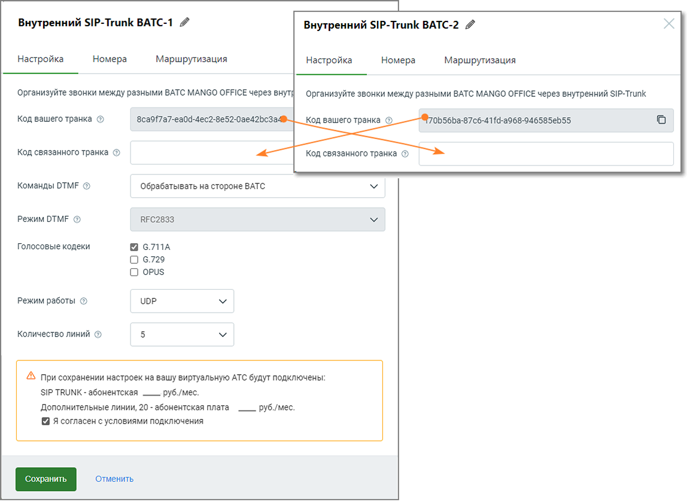

#### 5.3.2.1. Настройка

> Трассировка: PDF §5.3.2.1 · сквозные стр. 532-534 · источники: ч.2 `kb/sources/mango-lk-manual/LK_manual_v-125-281-566.pdf` с.252-254.

Для настройки внутреннего SIP Trunk необходимо установить связь между двумя ВАТС, прописав соответствующие параметры, которые позволят им взаимодействовать между

собой. Это обеспечит внутренние коммуникации между филиалами или частями одной и той же компании через SIP Trunk.

> **Описание иллюстрации LK-§5.3.2.1-1** (к §5.3.2.1 «Настройка», стр. 533; 1158×840 px). Снимок экрана / схема Личного кабинета.
> Относится к тексту руководства: «…собой. Это обеспечит внутренние коммуникации между филиалами или частями одной и той же компании через SIP Trunk.».
> Текст на изображении (OCR, требует сверки): Внутренний SIP-Trunk BATC-1 /; Внутренний SIP-Trunk BATC-2 4; Настройка; Номера; Маршрутизация; Организуйте звонки между разными BATC MANGO OFFICE через внут; Организуйте звонки между разными ВАТС MANGO OFFICE через внутренний SIP-Trunk; Код вашего транка ©; 8ca9f7a7-ea0d-4ec2-Be52-0ae42bc3; 0656Ба-876-4114-а968-946585е555,; Код связанного транка ®; Код связанного транка ©; Команды ОТМЕ @; ‘обрабатывать на стороне BATC; Режим ОТМЕ ©; RFC2833; Голосовые кодеки; 6.7ПА; О 6.729; О opus; Режим работы ©; ЦОР.; Количество линий ©; AS при сохранении настроек на вашу виртуальную АТС будут подключены; …

При заполнении остальных полей формы, руководствуйтесь инструкциями, предоставленными в разделе Настройка для внешнего SIP Trunk.
